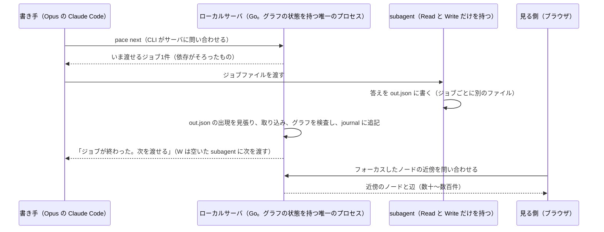

# PACE の構成と、決定根拠グラフを人間がレビューする見せ方の検討

**言いたいこと。**PACE の時間は、ほとんどが AI のジョブ（subagent）で、グラフの計算（pace.py）は 0.4〜1.8% しかない。そこで、バッチごとのバリア同期をやめて worker pool にする（オーナーが採用）。worker pool では書き込みが並行するので、グラフの状態はローカルサーバ1つが持ち、書き込むのはそのサーバだけにする。見せ方は、ノードに固定の位置を持たせず、フォーカスしたノードと直接つながるノードだけを、その場で位置を決めて見せる。

- オーナーの問い（2026-10-28 の #30 のチャット）: 「go routineなどを使って、構成要素の更新を行うたびにグラフ全体の検査を平行に行うようにすれば、グラフの完成までの時間を短縮できる?」「ファイルのロック機構を作るぐらいならgo langでローカルサーバを作ってそこにデータを集中管理させたほうが楽じゃない?」「各ノードは位置を持たず、フォーカスしているノードに直接つながっているものだけが動的に位置を変えながら見えるような見え方がいい」
- 目標の規模: 1本のプランで、決定が数千〜1万件、根拠のノードまで含めると数万件（[docs/idea.md](../idea.md) の 1.3、[docs/plans/impl/issue30_pace_time_cost_questions.md](impl/issue30_pace_time_cost_questions.md) の2章の8「数万件の規模でも処理できる」）。
- 実測の元: #30 の計画ファイルの写しを effort medium で1周目だけ回した本番の記録（2026-10-28。~/pace-eval/transcripts/issue30-cmp-<モデル>-medium/）。

## 1. 決めたこと

| 問い | 決めたこと | 誰が決めたか |
| --- | --- | --- |
| バッチごとのバリア同期をやめるか | やめて worker pool にする。subagent が1つ終わったら、すぐ次のジョブを渡す | オーナー（2026-10-28。原文「これは採用する」） |
| グラフの状態をどこに持つか | ローカルサーバ1つが持ち、書き込むのはそのサーバだけにする。ファイルのロックは作らない（3章） | AI の推奨。オーナーの問いへの答えで、了承はまだ |
| ファイルに書き出すか | 書き出す。ただし、サーバが書く追記の記録（journal）と、ある時点の写し（snapshot）として。止まっても続きから回すためと、人間と別の道具が読むため（3章） | AI の推奨 |
| 見せ方 | ノードに固定の位置を持たせない。フォーカスしたノードと直接つながるノードだけを、向きで種類を分けて置き、フォーカスを移すたびにアニメーションで置き直す（4章） | オーナーの指示（2026-10-28） |
| 作る環境 | 見る側はブラウザ（TypeScript と three.js）。ローカルサーバは Go。見る側は、サーバに近傍だけを問い合わせる（5章） | AI の推奨 |

## 2. 時間がどこで使われているか（実測）

**言いたいこと。**3モデルとも、時間の 74〜90% は subagent が働いている時間、10〜25% は書き手（Opus）の手番、pace.py は 0.4〜1.8% だった。subagent の時間の7〜8割は根拠付けのジョブである。

| モデル | 全体 | subagent が働いていた時間 | 書き手だけの時間 / pace.py の時間 |
| --- | --- | --- | --- |
| claude-opus-5-5 | 236.5分 | 206.1分（87.2%） | 26.1分（11.0%） / 4.3分（1.8%） |
| claude-sonnet-5-5 | 65.9分 | 48.7分（73.8%） | 16.5分（25.0%） / 0.8分（1.2%） |
| claude-haiku-5-5 | 137.6分 | 123.3分（89.6%） | 13.8分（10.0%） / 0.6分（0.4%） |

opus の subagent の時間を、ジョブの種類ごとに分けたもの（全部の subagent の呼び出しの時間の和。並列に走った分も足している）:

| ジョブの種類 | subagent の呼び出し / ジョブ | 時間の和（割合） | 1ジョブあたり |
| --- | --- | --- | --- |
| 根拠付け（link） | 243 / 1241 | 327.9分（70.7%） | 15.9秒 |
| 循環を断つ（decycle。根拠の辺が輪になった所の辺を切る） | 14 / 22 | 97.1分（20.9%） | 264.9秒（いちばん長い呼び出しは31分） |
| 反論（review） | 18 / 50 | 21.5分（4.6%） | 25.8秒 |
| 分類（classify）と裁定（adjudicate） | 12 / 85 | 17.5分（3.8%） | 6〜28秒 |

- pace.py の next（グラフの検査を含む）は、opus で83回打ち、合わせて4.2分、いちばん長い1回で6.4秒だった。
- バッチ（`pace.py next` を1回打って、最大4つの subagent に同時に渡すジョブの組）ごとのバリア同期で、いちばん遅い subagent（straggler）を待っている。opus はバッチの長さの合計が206.1分で、仕事を4本に平らにならせたときの下限の目安が155.8分なので、約50分を待ちに使った（sonnet は約10分、haiku は約23分）。
- haiku の循環を断つ subagent は、「全部の辺を1つの順序に並べ、その順序に逆らう辺を切れば必ず輪が消える」と提案していた。feedback arc set を求める近似の手順で、スクリプトで解ける余地がある。
- 数えたスクリプト: ~/pace-eval/analysis/timeline.py（時間の内訳）と stages.py（ジョブの種類ごとの内訳とバリア同期の待ち）。`python3 -I <スクリプト> ~/pace-eval/transcripts/issue30-cmp-<モデル>-medium` で動く。

## 3. worker pool と、ローカルサーバで状態を持つ構成

**言いたいこと。**worker pool では、subagent の答えの取り込み・次のジョブの払い出し・グラフの検査・見る側の問い合わせが並行して起きる。ファイルのロックで守るより、状態を持つプロセスを1つにして、書き込むのをそのプロセスだけにするほうが楽で壊れにくい（オーナーの問いのとおり）。



| 決めること | 中身 | なぜか |
| --- | --- | --- |
| 書き込むのはサーバだけ | subagent はジョブごとに別の答えのファイルを書く（いまと同じ）。グラフの状態・journal・snapshot を書くのはサーバだけ | 書き手が1つなら、ロックが要らない。subagent は Read と Write しか持たないので、ソケットには繋げない |
| ファイルは journal と snapshot にする | サーバは更新を1件ずつ journal（追記だけのファイル）に書き、区切りで snapshot を書く。起動し直したら、snapshot と journal から戻す | 止まっても続きから回せる。2026-10-28 の本番でも、セッションが閉じたあと、ファイルから続きを回せた |
| グラフの検査はサーバの中で、更新ごとに差分だけ | 答えを1件取り込むたびに、影響する範囲だけ検査し、渡せるジョブを増やす | 数万件で全体を毎回検査すると、検査の時間が効いてくる。差分なら1件ごとに小さい |
| 言語は Go | 1つの実行ファイルで配れる。goroutine で、見張り・取り込み・問い合わせを並行に書ける | Python でも同じ形は作れる。Go を選ぶ理由は速さではなく、並行に動く常駐プロセスを書きやすいことと、配りやすいこと |

- worker pool にすると、書き手（Opus）が subagent の終わりの知らせのたびに起きて next を打つので、書き手の手番（いま11〜25%）が増えうる。試すときは書き手の時間も測る。
- ほかに効く直し（言語を変えずにできる）: 循環を断つジョブを、スクリプトの手順で解き、AI には切る辺の候補から選ぶことだけを頼む（opus で97.1分の多く）。根拠付けのジョブの数を減らす（327.9分に比例）。どちらも #30 の計画の5章（時間・費用・質問を減らす5つの直し）で入れるかを決める。

**採らなかった案。**

| 案 | 採らない理由 |
| --- | --- |
| ファイルのロックで並行の書き込みを守る | ロックの取り忘れ・残り（プロセスが落ちてロックが外れない）という新しい壊れ方を、書き込む全部の場所で防ぐことになる |
| サーバのメモリだけに持ち、ファイルに書かない | サーバが落ちたら、グラフを失う。人間と別の道具（採点役・計測の道具）も読めない |
| 更新のたびに、グラフ全体を並列に検査する | 検査は1回数秒で、並列にしても縮むのは数秒。効くのは、検査の結果から渡せるジョブを早く見つけて待たずに渡すこと（worker pool） |

## 4. 見せ方: フォーカスしたノードの近傍だけを、動かしながら見せる

**言いたいこと。**グラフ全体を固定の位置に置いて視点を動かす見せ方は採らない（オーナーの指示）。ノードは位置を持たず、フォーカスしたノードを真ん中に置き、直接つながるノードだけを、つながりの種類ごとに決まった向きに置く。別のノードにフォーカスを移すと、アニメーションで置き直す。決定根拠グラフは層にならず、上の根拠が下につながる辺や逆向きの辺もあるが、この見せ方はフォーカスからの近傍だけを置くので、全体の形に左右されない。

| 向き | 置くもの |
| --- | --- |
| 下 | フォーカスしたノードを支えるもの（根拠の方向。人間の発言・文書・コードの事実・前提・ほかの決定） |
| 上 | フォーカスしたノードに支えられているもの（派生の方向） |
| 左右 | 反論・別案・同じ単位の決定など、支えではないつながり |
| 奥（3D のとき） | 2歩先のノードを薄く出す（どちらへ辿れば何があるかの予告） |

| 操作 | 何が起きるか |
| --- | --- |
| ↓・↑・←・→ | その向きのノードの中で、選んでいるものを移す |
| Enter | 選んでいるノードにフォーカスを移す。古い近傍が消え、フォーカスが真ん中へ動き、新しい近傍が出る |
| Backspace | 前のフォーカスへ戻る（辿った道を覚えておく） |
| 横の欄 | フォーカスしたノードの文・プランの行・支えの原文・足りない前提・質問・状態を出す（文は 3D の中に書かない） |

- アニメーションは、消えるものを薄くする → 残るものを動かす → 出るものを濃くする、の3段に分ける（GraphDiaries と visone の段を分けた遷移）。フォーカスの移り方は、Yee らの放射状の配置で、前の配置からの動きを小さくする補間に倣う。
- 1方向に何十件もつながるときは、種類（人間の発言・前提・決定）と状態でまとめて1つの束ね記号にし、開くと中が出るようにする（Provenance Map Orbiter の要約と段階的な展開に倣う）。
- 2D と 3D は、同じ置き方・同じ操作で両方作り、オーナーが比べて選ぶ。3D が 2D より良いという結果は、課題によって割れているため（6章）。

## 5. 作る環境と言語

**言いたいこと。**見る側はブラウザで作る。画面に出すのは近傍の数十〜数百件だけなので、グラフ全体が数万件でも、描く速さは問題にならない。数万件を持ち、近傍を素早く返すのはローカルサーバ（Go）の役目にする。

| 環境 | 判断 | 理由 |
| --- | --- | --- |
| ブラウザ（TypeScript と three.js） | 採る | 入れる物が無い。ローカルサーバが配るページを開くだけ。3D のライブラリと事例が多い |
| WebAssembly（Rust と Bevy など） | 採らない | 描くのは数百件までなので、速さが要らない |
| OS のネイティブのアプリ（Godot・Unity など） | 採らない | 入れて配る手間がある。得るものが無い |
| TUI | 補助としてなら作れる | 3D は描けない。同じ↑↓←→の辿り方を文で出す道具なら、ターミナルの中で使える |

| 部品 | 使い方 |
| --- | --- |
| three.js | 3D の描画。ノードの数が少ないので、素直な作りで足りる |
| d3-force-3d か WebCola | 近傍の中の重なりを避ける置き方（向きは4章で決め、細かい位置だけを計算する） |
| korbash/focus-layout（MIT、WebCola の上） | 「フォーカスと近傍の深さを指定すると、前の配置から次の配置への遷移のフレームを返す」作り。2D の試作にそのまま使える。ただし公開されたばかり（星0、npm 未公開）なので、そのまま頼らず、作り方の参考にする |
| 3d-force-graph | 全体を力で散らす作りなので、本体には使わない。全体の様子を一度見るための補助の画面には使える |
| cosmos.gl（OpenJS、GPU で百万件の配置） | 2D で全体を一度に見る補助の画面の候補。本体の近傍の見せ方には要らない |

- ローカルサーバが見る側に返す近傍の形（例）:

```json
{"focus": "D_dab50efc_1",
 "nodes": [{"id": "D_dab50efc_1", "kind": "decision", "status": "needs_gap", "line": 65, "text": "…"},
           {"id": "H_6441498532", "kind": "human", "text": "回して良い。…", "source": "#30 のコメント 6441498532"}],
 "edges": [{"from": "H_6441498532", "to": "D_dab50efc_1", "rel": "supports"}],
 "groups": [{"dir": "up", "kind": "decision", "status": "rooted", "count": 37}]}
```

- ライブラリの版は、作るときにその時点のものを確かめて固定する。

## 6. 調べた先進事例

**言いたいこと。**「フォーカスしたノードの近傍だけを、決まった向きに置いて辿る」見せ方には、製品にも研究にも前例がある。3D が 2D より良いかは、課題によって結果が割れている。

| 事例 | 何をしているか | この検討で借りるもの |
| --- | --- | --- |
| TheBrain の Plex | フォーカスした項目を真ん中に、親を上・子を下・関連を横に置く。項目を選ぶと真ん中へ滑らかに動き、周りが置き直される | 向きでつながりの種類を分ける決まりと、置き直しのアニメーション |
| Obsidian の K-Plex（TheBrain に倣ったプラグイン） | 今のノードの周りに、親を上・子を下・友と前を左・反論と次を右に、決まった規則で置く | 反論を横に置く決まり |
| Yee ら「Animated Exploration of Dynamic Graphs with Radial Layout」（InfoVis 2001） | フォーカスを中心に放射状に置き、フォーカスを変えると、ノードの順序と向きを保って補間して動かす | フォーカスを移すときの動かし方 |
| Sorger ら「Egocentric Network Exploration for Immersive Analytics」（Pacific Graphics 2021） | 3D のネットワークを、見る人の視点を中心に置き直す。単純な自己中心の見せ方で、探す速さと辿る速さが大きく上がり、方向感覚も VR 酔いも悪くならなかった | 3D でも、全体を固定せず中心から見せるほうが辿りやすい、という根拠 |
| dbt・Databricks・Datadog のデータの lineage の画面 | 1つを中心にして、上流（元）と下流（使う側）だけを出す。表示する段数に上限を設けるものもある | 支えの向き（上流）と派生の向き（下流）を分ける見せ方 |
| Provenance Map Orbiter | 大きな provenance グラフを要約（クラスタ）し、段階的に開いて辿る | 1方向に多いときの束ねと展開 |
| GraphDiaries・visone | 遷移を、消す → 動かす → 出す、の段に分ける | アニメーションの段の分け方 |
| McGuffin ら「Path Tracing in 2D, 3D, and Physicalized Networks」 | VR の 3D は、経路を辿る課題で 2D より誤りが少なかった | 3D を試す根拠 |
| 没入型のネットワークの可視化の survey（arXiv 2501.08500） | 3D と 2D の比較は、課題によって 3D が良い・2D が良い・差が無いに割れる。調べた実験の最大は7,885ノード | 2D と 3D を両方作って比べる理由 |

- 調べた範囲で、決定根拠グラフや保証ケース（GSN）を、この形で辿る道具は見つからなかった。

**出典。**
- TheBrain: [Navigating Beyond the Plex](https://thebrain.com/blog/navigating-beyond-the-plex)、[PCWorld のレビュー](https://www.pcworld.com/article/478088/thebrain.html)
- K-Plex: [k plex](https://community.obsidian.md/plugins/k-plex)、[zsviczian/kplex wiki](https://github.com/zsviczian/kplex/wiki)
- Yee ら: [Animated Exploration of Dynamic Graphs with Radial Layout](https://www.microsoft.com/en-us/research/wp-content/uploads/2016/02/yee01animated.pdf)
- Sorger ら: [arXiv:2109.09547](https://arxiv.org/abs/2109.09547)
- McGuffin ら: [arXiv:2207.11586](https://arxiv.org/html/2207.11586)
- survey: [Visual Network Analysis in Immersive Environments: A Survey](https://arxiv.org/html/2501.08500)
- GraphDiaries: [Bach ら 2013](https://aviz.fr/~bbach/graphdiaries/Bach2013GraphDiaries.pdf)
- lineage: [dbt Catalog](https://docs.getdbt.com/docs/explore/explore-projects)、[Datadog Lineage](https://docs.datadoghq.com/data_observability/lineage/)、[Databricks の lineage](https://sonra.io/databricks-data-lineage/)
- Provenance Map Orbiter: [GitHub](https://github.com/End-to-end-provenance/provenance-map-orbiter)
- focus-layout: [korbash/focus-layout](https://github.com/korbash/focus-layout)
- cosmos.gl: [introducing cosmos.gl](https://openjsf.org/blog/introducing-cosmos-gl)、[cosmos.gl v3](https://openjsf.org/blog/cosmos-gl-v3)
- 3d-force-graph: [README](https://cdn.jsdelivr.net/npm/three-forcegraph@1.43.4/README.md)
- WebGL で描ける規模（Carina）: [arXiv:1702.07099](https://arxiv.org/pdf/1702.07099)

## 7. 次にすること

- ローカルサーバで状態を持つ構成（3章）を採るかを、オーナーが決める。
- 採るなら、worker pool とローカルサーバを、#30 の5章の直しと一緒にするか、別の issue にするかを、オーナーが決める。
- 見せ方の試作は、opus の1周目の出力（~/pace-eval/repos/issue30-cmp-opus-medium/ の `.pace/`）を材料に、2D と 3D を同じ操作で作り、オーナーに比べてもらう。
