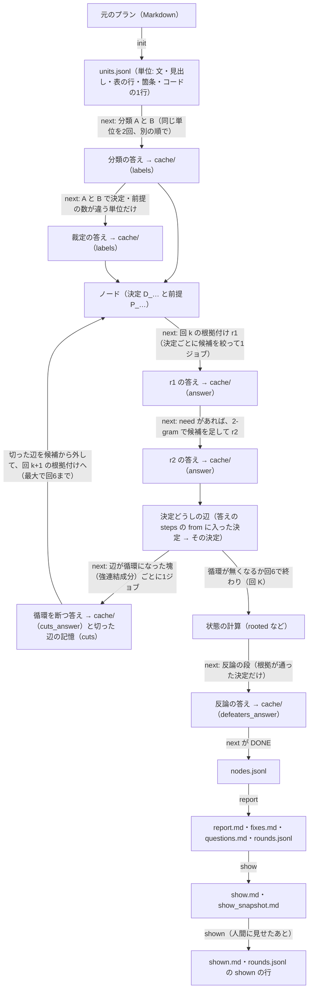
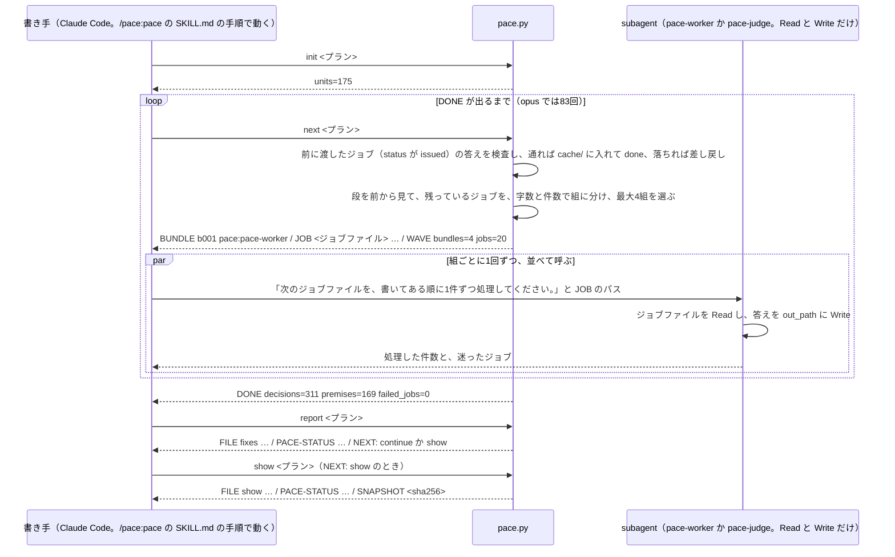
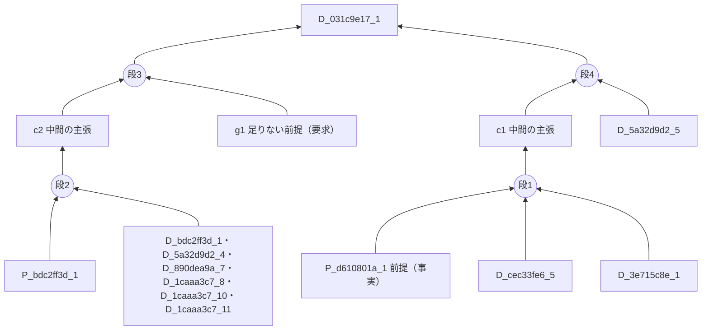

# PACE のデータの流れ: 元のプランが、どのコマンドで、どのファイルに、どう加工されるか

**言いたいこと。**PACE は、元のプランを「単位」に切り（init）、AI のジョブで単位から決定と前提を取り出し、決定ごとに根拠の推論を書かせ、決定どうしの循環を断ち、反論をかけてから（next）、直すものと訊くものに分けて書き出す（report・show）。決定根拠グラフは1つのファイルには無い。ノード（決定と前提）は nodes.jsonl に、辺（推論の段）は根拠付けの答えの中にあり、pace.py が report のたびに答えから組み立て直す。

- 通しの例: #30 の計画ファイルの写しを、claude-opus-5-5・effort medium で1周目だけ回した出力（2026-10-28）。元のプランは `~/pace-eval/repos/issue30-cmp-opus-medium/docs/plans/impl/issue30_pace_time_cost_questions.md`、作業ディレクトリは同じ場所の `.pace/issue30_pace_time_cost_questions/`。以下、作業ディレクトリの中は `<作業>/` と書く。
- このとき使った pace.py は、この branch の [plugins/pace/scripts/pace.py](../../plugins/pace/scripts/pace.py) と同じもの（`diff -q` で一致を確かめた）。SKILL.md だけは、計測のために「subagent に model と effort を渡す」1行を足した写しを使った。
- 根拠の行は pace.py と [docs/plans/pace_design.md](pace_design.md) へのリンクで添える。数は opus の実データを開いて数えたもの。

## 0. 地図

| 節 | 中身 |
| --- | --- |
| 1 | 全体の流れ（どのコマンドが、どの段を回し、どのファイルを書くか）の図 |
| 2 | 書き手（Claude Code）・pace.py・subagent のやりとりの図 |
| 3 | 作業ディレクトリの全ファイルの一覧（誰がいつ書き、誰が読むか） |
| 4 | init: plan.md・source.json・units.jsonl・shown.md |
| 5 | ジョブファイルの共通の形と、round.json・created.json・pending.json・答えのファイル・差し戻しの写し |
| 6 | 分類と裁定 → ノード（nodes.jsonl） |
| 7 | 根拠付け（r1 と r2）: 決定ごとの推論の段（辺はここにある） |
| 8 | 決定どうしの循環を断つ段と、切った辺の記憶 |
| 9 | 状態（rooted・needs_gap・ungrounded・unverified）の決め方 |
| 10 | 反論の段 |
| 11 | cache/ の5つの形 |
| 12 | report: report.md・fixes.md・questions.md・rounds.jsonl |
| 13 | show と shown: show.md・show_snapshot.md・shown.md |
| 14 | 失敗の記録（failed_jobs.jsonl）と、例外のファイル |
| 15 | 例の決定 D_031c9e17_1 を、最初から最後まで通しで追う |
| 16 | 確かめられなかったこと |

## 1. 全体の流れ

**言いたいこと。**init が1回、next が「AI に渡すジョブが無くなる（DONE）」まで何十回、report が1回で、1周になる。next は打たれるたびに、前に渡したジョブの答えを検査して取り込み、次に渡すジョブを作る。opus の1周では next を83回打った。



- 段の並びは `classify` → `adjudicate` → `link_r1_1` → `link_r2_1` → `decycle_1` → `link_r1_2` → … → `decycle_5` → `link_r1_6` → `link_r2_6`、そのあと `review`（[pace.py:610-620](../../plugins/pace/scripts/pace.py#L610-L620)）。`_1` などの数字は「回」で、循環を断つたびに1つ進む。循環を断つ段に渡すものが無くなったら、その回で終わる（[pace.py:2557-2562](../../plugins/pace/scripts/pace.py#L2557-L2562)）。
- opus の1周は、`decycle_5` にもジョブがあったので回6まで進み、回 K=6 で終わった（pace.py の計算で確かめた）。

## 2. 書き手・pace.py・subagent のやりとり

**言いたいこと。**pace.py は AI を呼ばない。next が「この順でジョブファイルを処理せよ」という組（bundle）を最大4つ出し、書き手がそれぞれを subagent に渡す。subagent は答えを `.out.json` に書くだけで、検査と取り込みは次の next が行う。



- 書き手への指示は [plugins/pace/skills/pace/SKILL.md](../../plugins/pace/skills/pace/SKILL.md) の手順1〜7、subagent への指示は [plugins/pace/agents/pace-worker.md](../../plugins/pace/agents/pace-worker.md) と [pace-judge.md](../../plugins/pace/agents/pace-judge.md)。
- 段ごとの subagent: 分類と根拠付けは pace-worker、裁定・循環を断つ・反論は pace-judge（[pace.py:601](../../plugins/pace/scripts/pace.py#L601)）。
- 出力の `WAVE` の行は「この1回の next で渡した組の数とジョブの数」。組は最大4つ（[pace.py:584](../../plugins/pace/scripts/pace.py#L584)）。4組が全部返るまで、書き手は次の next を打たない（バリア同期）。
- opus の回では、書き手は「report まで回したら止まる」と指示されて止まり、show は計測の道具（`~/pace-eval/make_review.py`）が後で打った（show.md の時刻は 19:29、report.md は 18:16）。

## 3. 作業ディレクトリの全ファイル

**言いたいこと。**作業ディレクトリは、元のプランの隣の `.pace/<プランの名前から拡張子を除いたもの>/` にある（[pace.py:421-432](../../plugins/pace/scripts/pace.py#L421-L432)）。init は cache/・rounds.jsonl・shown.md・show_snapshot.md・source.json を残して、ほかを作り直す（[pace.py:42](../../plugins/pace/scripts/pace.py#L42)）。

| ファイル | 誰がいつ書くか | 誰が読むか | opus の実物 |
| --- | --- | --- | --- |
| `.pace/.gitignore` | init（中身は `*` の1行） | git（commit に入れない） | あり |
| `plan.md` | init（元のプランのバイトの写し） | next・report が「init のあとでプランが変わっていないか」を比べる | 58,718 バイト |
| `source.json` | init | init・next などが「別のプランの作業ディレクトリでないか」を確かめる | `{"plan_file": "issue30_pace_time_cost_questions.md"}` |
| `units.jsonl` | init | next が「分け直した単位と同じか」を確かめる（中身は使わずプランから分け直す） | 175 行 |
| `shown.md` | init（無いときだけ）・shown | show が差分の基準にする | 58,718 バイト（まだ見せていないので init の写し） |
| `jobs/round.json` | 最初の next | 全部のジョブの名前に入る周の印 | `{"round": "8237d847"}` |
| `jobs/<段>/` | next（ジョブ・created.json）、subagent（.out.json） | next（検査）、subagent（ジョブ） | 19 の段のディレクトリ |
| `pending.json` | next（いま渡した組の記録） | 人間と計測の道具（判定の元はジョブの status） | DONE のあとなので `{"bundles": []}` |
| `cache/` | next（検査を通った答え・切った辺の記憶） | next・report・show（全部の段の答えの正はここ） | 1,899 ファイル |
| `nodes.jsonl` | next が DONE を出すときだけ | report・計測の道具・可視化の道具 | 480 行（決定 311・前提 169） |
| `failed_jobs.jsonl` | next（差し戻しを使い切ったジョブがあったとき） | 人間（数えるのはジョブの status） | 無し（haiku の回にはある） |
| `report.md`・`fixes.md`・`questions.md` | report | 書き手（fixes.md）・人間 | 1,147 行・2,637 行・1,210 行 |
| `rounds.jsonl` | report・shown | report（周を続けるか）・show | 1 行 |
| `show.md`・`show_snapshot.md` | show | 人間・shown | 3,864 行・58,718 バイト |

## 4. init: 元のプランを単位に切る

**言いたいこと。**init は、元のプランを Markdown の構造に沿って「単位」に切り、units.jsonl に1行1単位で書く。行で切るのではなく、段落は「。」の直後で文に切り、表は1行、箇条は1項目、見出しは1つ、コードブロックは1行を1単位にする（[pace.py:262-394](../../plugins/pace/scripts/pace.py#L262-L394)、規則の正は [pace_design.md の4節](pace_design.md)）。

- 切り方の細部: 「。」でも、backtick の中と「」『』（）の中では切らない（[pace.py:198-233](../../plugins/pace/scripts/pace.py#L198-L233)）。表の区切り行（`| --- |`）は捨てる。空の見出しは単位にしない。
- opus の例では 175 単位（箇条 75・表の行 52・文 37・見出し 11）。

units.jsonl の1行（実物）:

```json
{"id": "u87899412", "pos": 2, "kind": "sentence", "line": 5, "path": ["PACE を短い時間と少ない費用で回し、本当に人間が決めるものだけを訊く（#30 の計画）"], "sec": "", "text": "言いたいこと。"}
```

| プロパティ | 型 | 意味 |
| --- | --- | --- |
| `id` | 文字列 | `u` と、「見出しの道筋と本文」の sha256 の先頭8桁。同じものが2つ目からは `_2` などを付ける。本文が変わらなければ、行がずれても同じ id になる |
| `pos` | 整数 | 文書の中の順番（0 から） |
| `kind` | `sentence`・`heading`・`table_row`・`bullet`・`code_line` | 単位の種類 |
| `line` | 整数 | 元のプランの行番号（その単位が始まる行） |
| `path` | 文字列の配列 | その単位の上にある見出しの並び（引用の中の見出しは数えない） |
| `sec` | 文字列 | 属する H2 の見出しの本文（H1 の直下なら空） |
| `text` | 文字列 | 単位の本文（空白を詰めたもの。表の行はセルを ` | ` でつなぐ） |

- 同じときに、`plan.md`（元のプランのバイトの写し）・`source.json`（元のプランのファイル名）を書き、`shown.md` が無ければ元のプランの写しで作る（[pace.py:533-568](../../plugins/pace/scripts/pace.py#L533-L568)）。

## 5. ジョブファイルの共通の形

**言いたいこと。**AI に頼む仕事は、全部「ジョブファイル」1つにつき1件で、`<作業>/jobs/<段>/<job_id>.json` に置く。subagent はこれを読み、答えを同じディレクトリの `<job_id>.out.json` に書く。ジョブの名前には周の印（`8237d847`）が入る。

ジョブファイルの形（分類のジョブの実物。指示文と入力は省いた）:

```json
{"job_id": "classify_A_001_8237d847", "stage": "classify", "variant": "A", "cache_key": "",
 "prompt_version": "2026-10-16.1", "instructions": "あなたは設計プランの文を分類する。…",
 "input": {"units": [ … ]},
 "out_path": "<作業>/jobs/classify/classify_A_001_8237d847.out.json",
 "attempts": 0, "previous_errors": [], "status": "done"}
```

| プロパティ | 型 | 意味 |
| --- | --- | --- |
| `job_id` | 文字列 | `<段>_<対象>_<周の印>`。対象は、分類なら `A_001`（A か B と連番）、裁定なら単位の id、根拠付けと反論なら決定の id、循環を断つなら連番（[pace.py:778-782](../../plugins/pace/scripts/pace.py#L778-L782)） |
| `stage` | 文字列 | 段の名前（`classify`・`adjudicate`・`link_r1_1`…`link_r2_6`・`decycle_1`…`decycle_5`・`review`） |
| `variant` | `A` か `B`（分類だけ） | 同じ単位を2回分類するときの区別 |
| `cache_key` | 空文字 | 使わない（鍵は pace.py が検査のときに作り直す。ジョブファイルは書き換えられうるので信じない） |
| `prompt_version` | 文字列 | 段の指示文の版（[pace.py:33-39](../../plugins/pace/scripts/pace.py#L33-L39)）。キャッシュの鍵に入る |
| `instructions` | 文字列 | 段の指示文の全文（[pace.py:649-697](../../plugins/pace/scripts/pace.py#L649-L697)） |
| `input` | オブジェクト | 段ごとの入力（6・7・8・10節） |
| `out_path` | 文字列（絶対パス） | subagent が答えを書く場所 |
| `attempts` | 整数 0〜4 | 答えが検査に落ちた回数（答えが書かれなかったのも数える） |
| `previous_errors` | 文字列の配列 | 落ちた理由（1件300字まで）。subagent は次の試行でこれを直す |
| `status` | `pending`・`issued`・`done`・`failed` | 作った・渡した・答えが通った・差し戻しを3回使い切った |

| ファイル | 中身 |
| --- | --- |
| `jobs/round.json` | `{"round": "8237d847"}`。init のあと最初の next が乱数で決める周の印（[pace.py:1623-1637](../../plugins/pace/scripts/pace.py#L1623-L1637)） |
| `jobs/<段>/created.json` | `{"round": "8237d847", "count": 311, "jobs": ["link_r1_1_D_dab50efc_1_8237d847", …]}`。その段のジョブを作り終えた印（[pace.py:1722-1731](../../plugins/pace/scripts/pace.py#L1722-L1731)） |
| `pending.json` | `{"bundles": [{"bundle_id": "b001", "agent": "pace:pace-worker", "jobs": ["<ジョブファイル>", …]}, …]}`。いちばん新しい next が渡した組（[pace.py:2472-2487](../../plugins/pace/scripts/pace.py#L2472-L2487)） |
| `jobs/<段>/<job_id>.out.json` | subagent が書いた答え（形は段ごと） |
| `jobs/<段>/<job_id>.rejected-<n>.json` | 検査に落ちた答えの写し（n 回目）。落ちると名前を変えて残し、ジョブを pending に戻す（[pace.py:2408-2441](../../plugins/pace/scripts/pace.py#L2408-L2441)） |

- 組の作り方: 残っているジョブを、字数（根拠付けは120,000字、ほかは60,000字）と件数（20件）で区切って組にし、先頭から4組を渡す（[pace.py:2446-2470](../../plugins/pace/scripts/pace.py#L2446-L2470)）。
- 差し戻しの例（実物）: `link_r2_1_D_890dea9a_4_8237d847.json` の `previous_errors` は `["答えが検証に落ちました: step 3 の from に、候補のノード・自分の claims・gaps のどれでもない id があります: 'D_b43370b2_3'"]`。

opus の段ごとのジョブの数（ディレクトリの中を数えた）:

| 段 | ジョブ | 差し戻しの写し |
| --- | --- | --- |
| classify | 24（A と B で12ずつ） | 0 |
| adjudicate | 61 | 0 |
| link_r1_1 〜 link_r1_6 | 311・170・93・39・19・6 | 3・3・2・0・3・0 |
| link_r2_1 〜 link_r2_6 | 281・163・86・36・18・6 | 1・0・1・0・0・0 |
| decycle_1 〜 decycle_5 | 4・5・5・3・2 | 1・0・1・0・0 |
| review | 50 | 0 |

## 6. 分類と裁定 → ノード（nodes.jsonl）

**言いたいこと。**単位ごとに、2つの分類（A と B。同じ単位を逆の順で渡す）で「決定」と「前提」を取り出させる。A と B で決定の数か前提の数が違った単位だけ、裁定の AI に正しいほうを決めさせる。決まったラベルから、pace.py がノード（決定 `D_…`・前提 `P_…`）を作る。

分類のジョブの入力（`input.units` の1件。実物）と、答えの1件（実物）:

```json
{"uid": "udab50efc", "kind": "sentence", "section_path": [],
 "text": "<!-- 目的: #30（PACE を短い時間と少ない費用で回し、…）の作業計画を1本にまとめる -->",
 "neighbors": ["PACE を短い時間と少ない費用で回し、本当に人間が決めるものだけを訊く（#30 の計画）", "言いたいこと。"]}
```

```json
{"uid": "udab50efc", "labels": [
  {"kind": "premise", "ptype": "requirement", "text": "#30 の目的は、PACE を短い時間と少ない費用で回し、本当に人間が決めるものだけを質問できるようにすることである。"},
  {"kind": "decision", "text": "#30 の作業計画を1本の文書にまとめる。", "alternatives": ["計画を Issue のコメントに分けたまま管理する", "テーマごとに複数の計画文書に分ける"]}]}
```

| プロパティ | 意味 |
| --- | --- |
| 入力 `uid`・`kind`・`section_path`・`text` | 単位の id・種類・見出しの並び・本文（4節） |
| 入力 `neighbors` | 前後2単位の本文（文脈を確かめるためだけ。キャッシュの鍵には入れない） |
| 答え `labels[].kind` | `decision`（プランが何かを選んでいて、別の選び方があるもの）か `premise`（決定ではない前提） |
| 答え `labels[].ptype` | 前提の種類。`fact`（現状の事実）・`requirement`（満たすべき要求）・`value`（何を重視するか） |
| 答え `labels[].text` | 一文で言い直した決定か前提 |
| 答え `labels[].alternatives` | 決定の別案（1つ以上。ここで出た別案が、あとで「別案を退ける理由」を求める元になる） |

- 検査: 入力の uid を過不足なく1回ずつ出すこと、kind・ptype・alternatives の形（[pace.py:797-843](../../plugins/pace/scripts/pace.py#L797-L843)）。
- 裁定のジョブの入力は `{"unit": <分類と同じ形の1単位>, "A": [<A のラベル>], "B": [<B のラベル>]}`、答えは `{"labels": [ … ]}`（例: `jobs/adjudicate/adjudicate_u0516bcfa_8237d847.json`。1つの箇条から決定14件・前提2件を取り出した）。
- ノードの作り方: A と B の数が同じなら A のラベル、違えば裁定のラベルを使い、決定と前提にそれぞれ連番を振る（[pace.py:2491-2518](../../plugins/pace/scripts/pace.py#L2491-L2518)）。id は `D_<単位の id から u を除いたもの>_<連番>`。

nodes.jsonl の1行（実物）:

```json
{"id": "D_dab50efc_1", "kind": "decision", "text": "#30 の作業計画を1本の文書にまとめる。", "alternatives": ["計画を Issue のコメントに分けたまま管理する", "テーマごとに複数の計画文書に分ける"], "unit": "udab50efc", "line": 1, "sec": "", "path": []}
```

| プロパティ | 型 | 意味 |
| --- | --- | --- |
| `id` | 文字列 | `D_…`（決定）か `P_…`（前提） |
| `kind` | `decision` か `premise` | ノードの種類 |
| `ptype` | `fact`・`requirement`・`value`（前提だけ） | 前提の種類 |
| `text` | 文字列 | 分類（か裁定）の AI が言い直した一文 |
| `alternatives` | 文字列の配列（決定だけ） | 別案 |
| `unit`・`line`・`sec`・`path` | | 取り出した元の単位の id・行・H2・見出しの並び |

- nodes.jsonl は、next が DONE を出すときにだけ書く。途中の段は、cache/ の分類と裁定の答えから毎回ノードを作り直す（[pace.py:1428-1436](../../plugins/pace/scripts/pace.py#L1428-L1436)・[pace.py:2610-2614](../../plugins/pace/scripts/pace.py#L2610-L2614)）。
- **nodes.jsonl にはノードしか無く、辺は無い。**opus の例では、決定 311・前提 169（事実 104・要求 51・価値 14）。人間の発言を表すノードの種類は、いまは無い。

## 7. 根拠付け（r1 と r2）: 推論の段（辺はここにある）

**言いたいこと。**決定1件につき1ジョブで、「その決定を支える理由を、候補のノードから探し、推論の段（step）として書け」と頼む。1つの段は、複数の元（from）が組になって1つの先（to）を、理由（warrant）付きで支える。足りない前提は gap として書かせる。決定根拠グラフの辺は、この答えの steps にしか無い。

入力（`link_r1_1_D_031c9e17_1_8237d847.json` の `input`。実物から抜粋）:

```json
{"target": {"id": "D_031c9e17_1",
            "text": "直し方の細部は、段階2（または段階1）と4.2の決め方でモデルが決まってから作業2の細部の計画として書き、設計レビューを通す。",
            "alternatives": ["モデルが決まる前に細部の計画を書く", "細部の計画は設計レビューを通さずに実装する"],
            "section": "5. 作業2: 時間・費用・質問を減らす5つの直し",
            "plan_text": "直し方の細部は、段階2（オーナーが段階1だけで決めると言ったときは段階1）と 4.2 の決め方でモデルが決まってから、作業2の細部の計画として書き、設計レビューを通す。"},
 "candidates": [{"section": "5. 作業2: 時間・費用・質問を減らす5つの直し",
                 "plan_text": "細部は、選んだモデル（Claude か Codex か）と、キャッシュが外れた原因の数で変わるためである。",
                 "nodes": [{"id": "P_d610801a_1", "kind": "fact", "text": "直し方の細部は、選んだモデル（Claude か Codex か）とキャッシュが外れた原因の数で変わる。"}]}, …]}
```

| 入力のプロパティ | 意味 |
| --- | --- |
| `target` | 根拠付けする決定（id・言い直した文・別案・属する H2・元の単位の本文） |
| `candidates` | 根拠に使ってよいノードを、元の単位ごとにまとめたもの。各要素は `section`・`plan_text`（単位の本文）・`nodes`（`{"id","kind","text"}`。kind は decision か前提の種類） |
| `excluded_note`（循環を断ったあとだけ） | 循環を断つ段で「この決定の本当の理由ではない」とされた決定（`{"text","plan_text"}`）。候補から外し、理由に使うなと伝える |
| `added`（r2 だけ） | r1 の答えの need をもとに足した候補のノードの id |
| `previous`（r2 だけ） | 同じ回の r1 の答え（全体を書き直させる） |

- 候補の絞り方（r1）: 同じ H2 の塊・前後5単位・冒頭の節・backtick の中の識別子を共有する単位のどれかに当たる単位のノードを、近い単位から入れ、80ノードを超える手前で止め、40,000字を超えたら遠い単位から削る（[pace.py:1150-1187](../../plugins/pace/scripts/pace.py#L1150-L1187)）。例では13単位・79ノード。
- 候補の足し方（r2）: r1 の答えの need（「探してほしい内容」）1件ごとに、文字の2-gram のコサイン類似度で近いノードを6件、合計12件まで足す（[pace.py:1222-1293](../../plugins/pace/scripts/pace.py#L1222-L1293)）。need が無ければ r2 は作らない。例の回1の r2 は、6ノードを足して17単位・85ノード。

答え（`link_r1_1_D_031c9e17_1_8237d847.out.json`。実物から抜粋）:

```json
{"claims": [{"id": "c1", "text": "直し方の細部は選んだモデルで分かれるので、モデルが決まる前には1通りに書けない。"}, {"id": "c2", "text": "…"}],
 "gaps":   [{"id": "g1", "ptype": "requirement", "text": "設計を変える計画は、実装の前に設計レビューを通す（このリポジトリの進め方の決まり）。"}],
 "steps":  [{"from": ["P_d610801a_1", "D_cec33fe6_5", "D_3e715c8e_1"], "to": "c1", "warrant": "…これが別案「モデルが決まる前に細部の計画を書く」を退ける理由になる。"},
            {"from": ["P_bdc2ff3d_1", "D_bdc2ff3d_1", "D_5a32d9d2_4", "D_890dea9a_7", "D_1caaa3c7_8", "D_1caaa3c7_10", "D_1caaa3c7_11"], "to": "c2", "warrant": "…"},
            {"from": ["c2", "g1"], "to": "D_031c9e17_1", "warrant": "…"},
            {"from": ["c1", "D_5a32d9d2_5"], "to": "D_031c9e17_1", "warrant": "…"}],
 "need":   ["設計を変える計画は設計レビューを通すという進め方の決まり（2章やプランの初めの進め方の節）"]}
```

| 答えのプロパティ | 意味 |
| --- | --- |
| `claims` | この答えの中だけにある中間の主張（id は `c1`, `c2`, …）。ほかの答えからは参照できない |
| `gaps` | 支えるのに要るのに候補に無い前提（id は `g1`…、`ptype` は fact・requirement・value）。必ずどれかの段の from に入れる |
| `steps[].from` | 組になって支える元（候補のノードの id・自分の claims・自分の gaps）。1つ以上 |
| `steps[].to` | 支えられる先（target の id か、自分の claims の id） |
| `steps[].warrant` | なぜその元からその先が言えるか |
| `need` | 候補に無いが、プランの別の所にありそうなもの（r2 で候補を足す手がかり） |

- 検査（[pace.py:864-935](../../plugins/pace/scripts/pace.py#L864-L935)）: from が候補・自分の claims・gaps のどれか、to が target か claims、自分自身を from に入れない、target へ向かう段が1つ以上、使われていない gap が無い、など。
- この1件の答えを図にすると、次のようになる。段2は元が7つの組で、決定 D_031c9e17_1 は段3と段4の2つで別々に支えられている。



- 回 k の答えは、r2 を作った決定なら r2 の答え、作らなかった決定なら r1 の答え（[pace.py:1929-1949](../../plugins/pace/scripts/pace.py#L1929-L1949)）。答えの正は cache/ にあり、`.out.json` は検査の前の写しである。

## 8. 決定どうしの循環を断つ段と、切った辺の記憶

**言いたいこと。**回 k の全部の答えから「決定 X が、決定 Y の答えの段の from に入っている」という決定どうしの辺を張る。辺が循環（X は Y を、Y は X を理由にする）になった塊（強連結成分）ごとに1ジョブで、「本当の理由ではない辺を切れ」と頼む。切った辺は記憶に残り、次の回の根拠付けで、切られた側の決定の候補から外す。

- 辺の張り方: to の答えのどの段の from に入った決定でも、`(その決定, to)` の辺にする。warrant は辺ごとに集める（[pace.py:1951-1964](../../plugins/pace/scripts/pace.py#L1951-L1964)）。塊は Tarjan 法で探す（[pace.py:938-985](../../plugins/pace/scripts/pace.py#L938-L985)）。

入力（`jobs/decycle_1/decycle_1_002_8237d847.json` の `input`。実物の1件ずつ）と答え（1件）:

```json
{"nodes": [{"id": "D_cbef514d_1", "text": "まず PACE が求めるものと避けるものを決め、…という順で進める。", "plan_text": "この計画では、まず PACE が求めるものと避けるものを決め、…"}, …],
 "edges": [{"from": "D_cbef514d_1", "to": "D_3e27a6dd_1", "warrants": ["まず求めるものと避けるものを決め、…評価は大前提が崩れる6つの形に照らして行うことになる。"]}, …]}
```

```json
{"cuts": [{"from": "D_5a32d9d2_4", "to": "D_031c9e17_1", "reason": "細部の計画を後で書く決定が先で、モデルを知る道を細部で決めるのはその帰結。"}, …]}
```

| プロパティ | 意味 |
| --- | --- |
| 入力 `nodes[]` | 塊の中の決定（id・言い直した文・元の単位の本文） |
| 入力 `edges[]` | 塊の中の辺（from の決定を理由にして to の決定を根拠付けた）と、その理由（warrants） |
| 答え `cuts[]` | 切る辺（from・to）と、切る理由（reason） |

- 検査（[pace.py:988-1017](../../plugins/pace/scripts/pace.py#L988-L1017)）: 切る辺が入力にあること、同じ辺を2回書かないこと、切ったあとに循環が残らないこと。
- 例の大きさ: 回1の2つ目の塊は決定273件・辺1,261本で、答えは386本を切った。この答えは1回目に「同じ辺が2回ある」で落ち、2回目は答えが書かれず、3回目で通った（`previous_errors` の実物）。
- 切った辺の記憶: 検査を通ると、切られた側（to）の決定ごとに記憶を cache/ に書く（[pace.py:1605-1619](../../plugins/pace/scripts/pace.py#L1605-L1619)）。形は `{"cuts": [{"from_plan_text", "from_text", "reason", "round", "pass"}]}`。決定の id ではなく、「元の単位の本文と言い直した文」で覚える（プランが少し変わっても効くように）。
- 次の回の根拠付けでは、記憶にある決定を候補から外し、`excluded_note` で伝える（[pace.py:1842-1859](../../plugins/pace/scripts/pace.py#L1842-L1859)）。そのため回が進むと入力が変わり、ジョブが作り直される。入力が変わらない決定は、キャッシュに当たってジョブを作らない（opus の根拠付けのジョブが 311 → 170 → 93 → 39 → 19 → 6 と減るのはこのため）。
- 回6を終えても残った循環は、fixes の「残った輪」になる。opus は3件残った。

## 9. 状態の決め方

**言いたいこと。**最後の回 K の答えを全部つなげて、決定ごとに「プランの前提まで根拠が届くか」を計算する。前提は届く、gap は「前提が足りない」、段の強さはその元のいちばん弱いもの、決定や中間の主張の強さはそこへ向かう段のいちばん強いもの、として、全部を「届かない」から始めて変わらなくなるまで繰り返す（[pace.py:1304-1349](../../plugins/pace/scripts/pace.py#L1304-L1349)）。

| 状態 | 意味 |
| --- | --- |
| `rooted` | 前提だけで支えが届く（どこにも gap が無い道がある） |
| `needs_gap` | gap を埋めれば届く（いちばん強い道に gap がある） |
| `ungrounded` | 届かない（どの道にも、届かない決定か、どの答えにも支えられない元がある）。循環の中だけで支え合う決定もここに残る |
| `unverified` | 失敗したジョブの影響を受けうる決定を「届く」とみなしたときだけ届く（楽観と悲観の2回の計算。[pace.py:2103-2133](../../plugins/pace/scripts/pace.py#L2103-L2133)） |

- 「local」: ほかの決定を全部「届く」とみなしたときに届くか。反論の段にかけるかの判断に使う。
- gap の効き（止めている決定の数）: needs_gap の決定から、needs_gap の決定だけを通って根拠の側へ辿り、届いた決定の gap を数える（[pace.py:1380-1404](../../plugins/pace/scripts/pace.py#L1380-L1404)）。fixes と questions の並びの順に使う。
- opus の結果: rooted 9・needs_gap 126・ungrounded 176・unverified 0（rounds.jsonl の実物）。

## 10. 反論の段

**言いたいこと。**根拠が通った決定（unverified でなく、local で、最後の答えに gap が1つも無いもの）だけに、敵対的なレビューの AI が反論を出し、自分で「反証できた・反論が正しい・人間が決める」に分ける（[pace.py:2143-2156](../../plugins/pace/scripts/pace.py#L2143-L2156)）。opus では50件の決定にかけた。

入力（`jobs/review/review_D_0516bcfa_10_8237d847.json` の `input`。実物の形）:

```json
{"target": {"id": "D_0516bcfa_10", "text": "直す前と直した後を、同じ材料（この組を含む）と同じ精度を数える AI で数える。", "alternatives": ["…"], "plan_text": "…"},
 "nodes": [{"id": "D_145e5dd3_1", "kind": "decision", "text": "作業3として、ほかのプランで直しの効果を確かめる工程を設ける。", "plan_text": "6. 作業3: ほかのプランで確かめる"}, …],
 "steps": [{"id": "s1", "from": ["D_145e5dd3_1", "D_8443c122_2", "D_0516bcfa_3"], "to": "c1", "warrant": "…"}, …]}
```

答えの1件（実物）:

```json
{"target": "c3", "type": "fact", "text": "同じ AI で数えても、採点役の判定には揺れや誤りがある。…", "status": "refuted", "by": ["P_6fb8fa60_1"], "note": "プランは、採点役が1件ずつ原文を引いて判定し、…同じ AI で数えるという結論は崩れない。"}
```

| プロパティ | 意味 |
| --- | --- |
| 入力 `nodes[]` | 推論で使ったノード（決定・前提・claim）と、候補にあった前提。`kind` は decision・fact・requirement・value・claim |
| 入力 `steps[]` | 最後の答えの段に、`s1`… の id を振ったもの |
| 答え `target` | 反論の向き先（決定そのもの・段 `s…`・claim `c…`・推論で使った前提） |
| 答え `type` | `logic`（導けていない）・`missing`（暗黙の前提）・`fact`（事実が足りない）・`value`（価値判断を黙って決めている） |
| 答え `status` | `refuted`（前提で反証できた）・`accepted`（反論が正しい。プランを直す）・`needs_human`（人間が決める） |
| 答え `by` | refuted のときの反証の根拠（入力の前提の id だけ。ほかの決定・claim・段は使えない） |
| 答え `note` | 処理の説明 |

- 検査: [pace.py:1020-1082](../../plugins/pace/scripts/pace.py#L1020-L1082)。opus の結果は refuted 49・accepted 79・needs_human 15。accepted は fixes に、needs_human は questions に入る。

## 11. cache/ の5つの形

**言いたいこと。**検査を通った答えは、全部 cache/ に、鍵の sha256 をファイル名にして置く。鍵は「段の名前・段の版・指示文の sha256・subagent の定義の sha256・入力」から作る（[pace.py:1501-1504](../../plugins/pace/scripts/pace.py#L1501-L1504)）。次の周で同じ入力なら、ジョブを作らずにこの答えを使う。

| 形（最上位のキー） | 何の答えか | 鍵の入力 | opus の数 |
| --- | --- | --- | --- |
| `{"labels": […]}` | 分類（A・B）と裁定 | 分類は単位の id・本文・見出し・種類と A か B（前後の文は入れない）。裁定は単位と A・B のラベル | 411 |
| `{"answer": {claims, gaps, steps, need}}` | 根拠付け | 作り直した入力の全体（target・candidates・excluded_note・added・previous） | 1,228 |
| `{"cuts_answer": {"cuts": […]}}` | 循環を断つ答え | 塊の nodes と edges | 19 |
| `{"cuts": [{from_plan_text, from_text, reason, round, pass}]}` | 切った辺の記憶（切られた側の決定ごと） | 切られた側の決定の「元の単位の本文と言い直した文」 | 191 |
| `{"defeaters_answer": {"defeaters": […]}}` | 反論 | 作り直した入力の全体 | 50 |

- 循環を断つ段だけは、キャッシュに当たってもジョブを作り直す（記憶を書く場面を残すため。[pace.py:1551-1554](../../plugins/pace/scripts/pace.py#L1551-L1554) のコメント）。
- 根拠付けの鍵には候補の全体が入るので、プランの1文が変わって候補が変わると、その決定の答えは当たらない。

## 12. report: 直すものと訊くものに分ける

**言いたいこと。**report は、最後の回 K の答えと反論の答えから、書き手が直すもの（fixes.md）と人間が決めるもの（questions.md）と全体（report.md）を書き、rounds.jsonl に周の記録を1行足して、次の周へ進むか（NEXT）を出す（[pace.py:2255-2323](../../plugins/pace/scripts/pace.py#L2255-L2323)・[pace.py:2875-2942](../../plugins/pace/scripts/pace.py#L2875-L2942)）。

| 出す先 | 入るもの（並びの順） |
| --- | --- |
| fixes.md | 足りない事実の gap（止めている決定の数の多い順）→ accepted の反論 → 残った循環 → 根拠の無い決定（ungrounded）。opus は475件 |
| questions.md | 要求と価値の gap（本文が同じものは1つにまとめ、止めている決定の数の多い順）→ needs_human の反論。opus は199件 |
| report.md | 決定ごとの状態の表・反論の全部（refuted も）・残った循環・切った辺・確かめられなかったもの |

rounds.jsonl の report の行（実物）:

```json
{"kind": "report", "round": 1, "run": "8237d847", "plan_sha256": "2e1d8122…", "units": 175, "decisions": 311, "rooted": 9, "needs_gap": 126, "ungrounded": 176, "unverified": 0, "gaps": {"fact": 258, "requirement": 80, "value": 105}, "defeaters": {"accepted": 79, "refuted": 49, "needs_human": 15}, "failed_jobs": 0, "fixes": 475, "questions": 199, "since_shown": 1, "jobs": {"classify": 24, "adjudicate": 61, "link": 1228, "decycle": 19, "review": 50}, "next": "continue"}
```

| プロパティ | 意味 |
| --- | --- |
| `kind` | `report`（ほかに shown の行がある。13節） |
| `round` | 何周目か（1から） |
| `run` | 周の印（jobs/round.json と同じ） |
| `plan_sha256` | その周に読んだプランの sha256（同じプランのまま周を重ねたかを見る） |
| `units`・`decisions`・`rooted`・`needs_gap`・`ungrounded`・`unverified` | 単位の数・決定の数・状態ごとの数 |
| `gaps` | 種類ごとの gap の数 |
| `defeaters` | 反論の処理ごとの数 |
| `failed_jobs`・`fixes`・`questions` | 失敗したジョブ・直すもの・人間への質問の数 |
| `since_shown` | 最後に人間に見せてから何周目か |
| `jobs` | この周に AI に出したジョブの数（段の種類ごと。差し戻しは数えない） |
| `next` | `continue`（書き手が fixes を直して次の周へ）か `show`（人間に見せる） |

- NEXT の決まり（上から順に、最初に当たったもの）: 前の周とプランが同じで失敗0なら show、最後に見せてから3周目以上なら show、fixes が0なら show、ほかは continue（[pace_design.md の7節](pace_design.md)）。
- 標準出力は `FILE fixes <fixes.md の絶対パス>`・`PACE-STATUS: errors=0 failed_jobs=0 fixes=475 questions=199`・`NEXT: continue` の3行。

## 13. show と shown

**言いたいこと。**show は、人間に見せる show.md（質問・残った直すもの・確かめられなかったもの・最後に見せてからのプランの差分・注意）と、その時点のプランの写し show_snapshot.md を書く。人間に見せたあとで shown を打つと、写しが shown.md（次の差分の基準）になり、rounds.jsonl に shown の行が足される（[pace.py:2945-3042](../../plugins/pace/scripts/pace.py#L2945-L3042)）。

| ファイル | 中身 |
| --- | --- |
| show.md | 見出しは「人間への質問（199件）」「残った直すもの（475件）」「確かめられなかったもの」「最後に見せてからの差分」「注意」。最後の行は境目の行 `---- ここから下は書き手の注記で、pace.py は書いていない ----`（[pace.py:2655](../../plugins/pace/scripts/pace.py#L2655)） |
| show_snapshot.md | show を打った時点のプランのバイトの写し |
| shown.md | 最後に人間に見せた版（shown が写しで置き換える） |
| rounds.jsonl の shown の行 | `{"kind": "shown", "after_round": <何周目のあとか>, "snapshot_sha256": "<写しの sha256>"}` |

- opus の回は、まだ人間に見せていない（shown を打っていない）ので、shown.md は init の写しのままで、rounds.jsonl に shown の行は無い。show.md の差分の節は「初回」になる。

## 14. 失敗の記録と、例外のファイル

**言いたいこと。**差し戻しを3回使い切ったジョブは failed になり、理由が failed_jobs.jsonl に1行で残る（[pace.py:2418-2438](../../plugins/pace/scripts/pace.py#L2418-L2438)）。その影響を受けた決定は fixes と questions から外し、「確かめられなかったもの」に出す。

- opus には failed_jobs.jsonl が無い。haiku の回の実物（`~/pace-eval/repos/issue30-cmp-haiku-medium/docs/plans/impl/.pace/issue30_pace_time_cost_questions/failed_jobs.jsonl`。配列は先頭だけ）:

```json
{"job_id": "decycle_1_001_eb1ab04d", "stage": "decycle_1", "units": [], "decisions": ["D_58c898f2_1", "D_b43370b2_1", "D_b43370b2_2", "…"], "errors": ["答えが検証に落ちました: cuts の 74 件目 の辺が2回あります: D_66f2faff_1 -> D_306230db_2", "…", "out_path に答えが書かれていませんでした"]}
```

| プロパティ | 意味 |
| --- | --- |
| `job_id`・`stage` | 失敗したジョブと段 |
| `units` | ノードを作れなかった単位（分類と裁定の失敗だけ。ほかは空） |
| `decision` か `decisions` | 根拠付けと反論の失敗なら決定1つ、循環を断つ段の失敗なら塊の決定の全部 |
| `errors` | 試行ごとに落ちた理由 |

- 例外のファイル: opus の `<作業>/jobs/link_r1_1/link_r1_1_D_7d863721_1_8237d847.json.tmp_never`（中身は「x」の1字）は、subagent が誤って作ったもので、pace.py は書かないし読まない（subagent 自身が報告に書いた）。消していない。

## 15. 例の決定 D_031c9e17_1 を通しで追う

**言いたいこと。**この決定は、元のプランの170行目の1文から取り出され、回1〜3で根拠付けし直され、回1の循環を断つ段で6本、回2で1本の辺を切られ、最後は ungrounded（根拠が届かない）になった。

| 段 | この決定に起きたこと |
| --- | --- |
| init | 170行目の文が1単位になった |
| 分類・裁定 | その単位から、決定 `D_031c9e17_1`（別案2つ）が取り出された |
| link_r1_1 | 候補13単位・79ノード。答えは claims 2・gaps 1・steps 4・need 1（7節の図） |
| link_r2_1 | need から6ノードを足して85ノード。答えは claims 4・gaps 1・steps 6 |
| decycle_1 | 273件の決定の塊の中で、この決定へ向かう6本（D_5a32d9d2_4・D_890dea9a_7・D_1caaa3c7_8・D_1caaa3c7_10・D_1caaa3c7_11・D_bdc2ff3d_1 から）を「その帰結にすぎない」として切られた |
| link_r1_2・link_r2_2 | 切られた6件を候補から外し（excluded_note 6件）、根拠付けし直した |
| decycle_2 | さらに D_1d587142_3 からの辺を切られ、回3では excluded_note が7件になった。decycle_3 と decycle_5 の塊にも入ったが、そこではこの決定へ向かう辺は切られなかった（切った辺の記憶の `pass` は 1 が6件、2 が1件） |
| link_r1_3・link_r2_3 | 根拠付けし直した（答えは claims 5・gaps 2・steps 6）。回4〜6は入力が回3と同じで、キャッシュに当たりジョブは作られなかった |
| 状態の計算（回 K=6） | 最後の段（c1・c4・c5・g2 → この決定）のうち、c1 を支える段の元 `D_b7a16394_1` が ungrounded なので、その段が ungrounded になり、この決定も ungrounded（report.md の235行目） |
| report | 「根拠の無い決定」として fixes に入った。切られた7本は report.md の「切った辺（参考）」に載った |

- 最後の回の答えと状態は、pace.py の `Round(…, readonly=True).analyze()` を opus の作業ディレクトリに当てて確かめた。

## 16. 確かめられなかったこと

- 回1の r1 の答えが「段2の元7つのうち6つ」を使えなくなった後、回2・回3の答えでどう組み替わったかは、答えのファイルの件数（claims・gaps・steps）だけを見ており、中身の違いは追っていない。
- show.md は計測の道具が打った show で作られたもので、書き手の注記（境目の行の後ろ）は無い。書き手が show を打った場合の注記の実物は、この回には無い。
