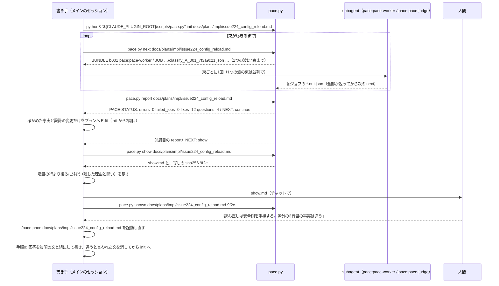

<!-- 目的: PACE を Claude Code プラグインとして作るための骨組み・受け渡しの形・守るべき性質と、実装の順序を決める -->

# PACE の設計

**この文書は、仕様の細部の正である。**確定方針の正は [../idea.md:59-111](../idea.md#L59-L111)（2章）で、idea.md のほかの章は検討と実験の記録である。
**idea.md 6章の方式は、「パイプライン」の節の変える点の表に挙げたもの以外は、そのまま採る。**W2（測る前に作り込まない。[../idea.md:105](../idea.md#L105)）に従うためである。
要約版は [pace_design_slim.md](pace_design_slim.md)。食い違ったらこの文書が正である。

---

## 1. 言いたいこと

**言いたいこと。**PACE は、continuo を知らない単独の Claude Code プラグインである。pace.py・SKILL.md・agent 2つで動く。
pace.py はプランを書き換えず、直すべき箇所・人間への質問・次に何をするか・人間に見せるもの（`show.md`）をファイルに書く。
SKILL.md は周を回し、書き手に3種類の文だけを書かせ、起動の終わりに `show.md` を人間に見せる（`--no-ask` では見せずに呼び出し側へ返す）。

- この文書が決めるのは骨組みまでである（プラグインの構成・書き手との境界・入出力のファイル・周の回し方）。段ごとの細部は、[実装計画](#13-実装計画) の各 issue の計画で決め、決めたものをこの文書へ書き足す。
- continuo は、1つの issue の最初の計画について、人間確認の前に PACE を呼ぶ側である（[continuo と組むとき](#11-continuo-と組むとき)）。

**単語。**単位・決定・前提・gap・反論・ジョブ・実行役は [../idea.md:119-139](../idea.md#L119-L139) のとおり。根拠グラフは、それらをつないだもの全体を指す。
**書き手**は PACE の skill を起動したメインのセッションで、プランを書いた本人である。**束**は、1回の subagent 呼び出しに渡すジョブのまとまりである。

---

## 2. 配り方とプラグインの形

**言いたいこと。**marketplace を持つこのリポジトリから `pace@pace` で入れる。核は skill で、AI の仕事は plugin の agent 2つが受け持つ。
`plugin.json` には version を書かない。動く環境は macOS と Linux の Python 3.9 以上で、標準ライブラリだけを使う。

```text
.claude-plugin/marketplace.json          {"name": "pace", "owner": {"name": "maimuzo"}, "metadata": {"description": "…"}, "plugins": [{"name": "pace", "source": "./plugins/pace", "description": "…"}]}
plugins/pace/.claude-plugin/plugin.json  {"name": "pace", "description": "…", "author": {"name": "maimuzo"}}
plugins/pace/skills/pace/SKILL.md        周の回し方。メインのセッションでインラインに動く。/pace:pace [--no-ask] <プランのパス>
plugins/pace/agents/pace-worker.md       model: sonnet / tools: Read, Write。分類・根拠付け
plugins/pace/agents/pace-judge.md        model: opus / tools: Read, Write。裁定・輪を断つ・反論
plugins/pace/scripts/pace.py             --version（段ごとの版の一覧）/ init / next / verify / report / show / shown（--version 以外はプランのパスを取る）
tests/                                   plugins/pace の外に置く（plugin のキャッシュに入れないため）。test_split.py は sys.path に plugins/pace/scripts を足して import pace し（__pycache__ をプラグインに書かない）、test_init.py・test_next.py・test_link.py・test_decycle.py・test_review.py・test_report.py は sys.executable で pace.py を叩く（test_next.py は束の分け方・鍵の計算・定数を、test_link.py は候補・2-gram・根拠付けの答えの検証を、test_decycle.py は強連結成分・輪を断つ答えの検証・強さと効きの計算を、test_review.py は反論の答えの検証を、test_report.py は囲みとインラインコードの形を import して確かめ、根拠付けの答えはテストのプロセスの中で Round を作ってキャッシュから引く。test_review.py と test_report.py は test_decycle.py の流れの道具を使う）。python3 -m unittest discover -s tests
```

| 決めたこと | 根拠 |
| --- | --- |
| 入れ方は `claude plugin marketplace add maimuzo/pace` と `claude plugin install pace@pace` | marketplace 名と plugin 名が同じ形には実例（`cloudflare@cloudflare`）がある |
| 第三者の marketplace は既定で自動更新されないので、README に `claude plugin marketplace update pace` と `claude plugin update pace@pace` を書く | [continuo の docs/FAQ.md:3262](https://github.com/maimuzo/continuo/blob/03a5fa3f/docs/FAQ.md#L3262) の「自動では新しくなりません」 |
| `plugin.json` に version を書かない | 書くと、上げ忘れたときに更新が入らず、同時に進む PR が版の行で衝突する。書かない plugin は commit の sha のディレクトリに入る |
| skill を核にする | どの流れからでも呼べる |
| agent に Bash を持たせない | 実行役がスクリプトを書いて済ませるのを道具の側で止める（[../idea.md:509](../idea.md#L509)） |
| 判定役を opus、ほかを sonnet。SKILL.md は呼び出しで model を渡さない | [../idea.md:513](../idea.md#L513) の使い分けを、呼び出し側の設定に左右されないようにする |
| Python 3.9 以上・標準ライブラリだけ | macOS の Command Line Tools の python3 が 3.9 で、入れる手順が要らない。Windows は確かめていないので対象に入れない |
| SKILL.md の `allowed-tools` を `Bash(python3 "${CLAUDE_PLUGIN_ROOT}/scripts/pace.py" *)` にし、本文に同じ文字列で `--version` などを書く | plugin の skill では、本文と `allowed-tools` の2か所で `${CLAUDE_PLUGIN_ROOT}` が置き換わる（公式文書の要約）。#2 で、`--plugin-dir` で読んだものと branch から入れたもの（cache の sha のディレクトリ）の両方で、確認なしで叩けた（Claude Code 2.1.301、user settings を読まない起動） |
| 許可が効くのは、skill を起動したターンの間だけ。subagent の完了の知らせで始まるターンには続かないので、確認を出すモードでは利用者が settings に `Bash(python3 "<pace.py の絶対パス>" *)` を足す（README に書く。`scripts/pace.py` を含めば何でも通す `*` の形は、任意の python3 を許すので勧めない） | 次に人間が発言すると消える（公式文書の要約）。#4 で、起動したターンの中では `init`・`next`・最初の波まで確認なしで進み、バックグラウンドの subagent の知らせのあとの `next` に確認が出た。規則を足すと出なかった（14節。2.1.301・`manual`・user settings を読む起動） |
| subagent の書き込みは、利用者が settings に `Edit(**/.pace/**)` を足して許す（README に書く） | plugin の agent では `permissionMode` が無視され、親の権限を受け継ぐ。ファイルの規則は Edit と Read で見られ、Write の規則は見られない（公式文書の要約）。#2 で、この規則を足した `manual` のモードで、pace-worker と pace-judge が確認なしに書けた（2.1.301、user settings を読まない起動、subagent はバックグラウンドで動いた。規則なしで確認が出るかは確かめていない）。#4 で、user settings を読む起動でも確認は出なかった（14節） |
| 書き手のプランの Edit（fixes を直す・回答を書く）には規則を勧めない。`--no-ask` で人の手の無い呼び出しから回すときは、呼び出し側がプランの Edit を許す（README に書く） | [#7](https://github.com/maimuzo/pace/issues/7) で確かめた（2.1.302、herdr の pane、`--permission-mode manual`、確かめ用のディレクトリの settings に上の2つの規則）。起動したターンと subagent の知らせのあとのターンの `pace.py`（`report`・`show`・`shown` を含む）と、`show.md` への注記の Edit には確認が出ず、回答のあとに起動し直した skill がプランへ回答を書く Edit は確認で止まった。`--no-ask` は確かめていない（引数で権限は変わらない見込み）。書き手がプランを直すことを利用者が見られるので、確認は残す |
| モデルの差し替えは、利用者が settings の `env` に `CLAUDE_CODE_SUBAGENT_MODEL` と `CLAUDE_CODE_SUBAGENT_MODEL_FORCE=1` を書く（README に書く。確かめていない） | Claude Code が持つ差し替えの手段で、plugin の側に仕組みが要らない。引き換えに全部の subagent が同じモデルになり、上の行の使い分けが消える（[限界](#10-限界)）。API など subagent 以外の実行役への差し替えは、ジョブを JSON ファイルで渡す形（[../idea.md:310](../idea.md#L310)）が受け皿なので、仕組みを足さない |
| `pace.py --version` は、AI に頼む段（`classify`・`adjudicate`・`link`・`decycle`・`review`）ごとに `<段の名前> <版>` を1行ずつ出す。版の形は `2026-10-16.1` | 版はキャッシュの鍵に入る（[../idea.md:316](../idea.md#L316)）ので、鍵を持つ段だけに付ける。名前は [../idea.md:801-846](../idea.md#L801-L846)、形は [../idea.md:475](../idea.md#L475) の `prompt_version` に揃える |
| マージ前に手元から試すときは `claude --plugin-dir <checkout>/plugins/pace`。push 済みの branch から入れて試すなら `claude plugin marketplace add 'maimuzo/pace#<branch 名>' --scope local` → `claude plugin install pace@pace --scope local`（README に書く。#2 で確かめた）。checkout のパスから入れる形も README に書く（確かめていない） | `--plugin-dir` はそのセッションだけ読み込み、利用者の設定を変えない。入れた plugin は cache に写るので、編集の反映には commit と update が要ることがある |

- agent の呼び名は `pace:pace-worker` と `pace:pace-judge` である（plugin の agent に名前空間が付く実例: `maimuzo-issue-manage:bug-reporter`）。
- スクリプトは `python3 "${CLAUDE_PLUGIN_ROOT}/scripts/pace.py"` で呼ぶ。`${CLAUDE_PLUGIN_ROOT}` が置き換わらないときは、黙って別の経路で叩かずに止まる。退けた経路は、skill のディレクトリから `../../scripts/pace.py` を辿る形で、置き換えの不具合を隠すため採らない。

**退けた案。**
- version を書いて PR ごとに上げる: 上の表の理由で採らない。
- ExitPlanMode の hook から skill を促す形（[../idea.md:656](../idea.md#L656) はプラン承認時の検証を勧めている）: #2 で、PACE は plan mode の中では回らないと判断した（[限界](#10-限界)）。plan mode を出たあとに回すと「設計を完了させる前」にならないので、この形のままでは採れない。[#4](https://github.com/maimuzo/pace/issues/4) で skill から呼ばせても、plan mode では `init` も叩かずにプランを書いて止まった（14節）。

---

## 3. 書き手との境界

**言いたいこと。**pace.py はプランを書き換えず、人間にも訊かない。直すのと見せるのは、SKILL.md を読んだ書き手のセッションである。
見せ方は SKILL.md の引数で選ぶ。既定ではチャットで見せ、`--no-ask` では見せずに呼び出し側へ返す。

- 既定: `show.md` をチャットに出し、`shown` を打ってから止まる。
- `--no-ask`: `show.md` のパスと、shown を打つコマンド行（写しの sha256 を含む）を返して終わる。コマンド行にはスクリプトの絶対パスが入るので、呼び出し側はそれを公開の場に写さない。
- SKILL.md はメインのセッションでインラインに動く（fork しない）。subagent は subagent を起動できないためである。
- 書き手は束を必ず subagent へ渡し、全部の結果が返ってから次の `next` を打つ。`*.out.json` を自分で書かない（[pace.py が守る性質と SKILL.md の決まり](#8-pacepy-が守る性質と-skillmd-の決まり)）。



**退けた案。**PACE の側で人間に訊く（issue のコメントへ書くなど）: 特定の流れを前提にすることになり、「pace は continuo を前提にしない」（オーナーの指示）に反する。

---

## 4. 入力

**言いたいこと。**入力はプランファイル1本である。前提の種類は fact / requirement / value の3つで、根っこはプランに書かれた前提である（S3。[../idea.md:89](../idea.md#L89)）。`init` がプランを引用の単位に分ける規則も、この節に置く。

- PACE は、特定の流れの印にも、見出しの名前にも依存しない。
- `init` はプランをバイトで読み、`utf-8-sig` で解く（BOM を外す）。行の終わりは `\r\n`・`\r`・`\n` だけにする（`str.splitlines()` は U+2028 なども行の終わりにするので使わない）。

**分割の規則（[#3](https://github.com/maimuzo/pace/issues/3)）。**まず行頭の引用の記号を段ごとに外す（空白・`>`・直後の空白1つまで）。フェンスの中では開きの行の段数だけ外し、それより深い `>` は本文に残す。そのあと1行ずつ、次の順に判定する（先に当たったものが勝つ）。

| 順 | 行 | 単位 |
| --- | --- | --- |
| 1 | フェンスの中 | 閉じ（前後の空白を落とすと、開きと同じ字が開きの長さ以上並ぶ行）なら閉じて捨てる。右の空白を落として空になる行は捨てる。ほかは右の空白だけ落として `code_line` |
| 2 | 空行 | 開いている段落・箇条書きを閉じる |
| 3 | ```` ``` ```` か `~~~`（3つ以上。字下げは問わない）で始まる | フェンスを開く（開きの行は捨てる）。backtick のフェンスの残りに backtick があれば開きではない。閉じが無ければ文書の終わりまで |
| 4 | 字下げ3つまでの `#`〜`######` に、空白か行の終わりが続く | `heading`。末尾の `#` の並びは、前に空白があるときだけ外す。本文の無い見出しは、単位にも構造にもしない |
| 5 | 字下げ3つまでで、`-`・`*`・`_` の同じ字が3つ以上だけ | 水平線。捨てる |
| 6 | 字下げ3つまでの `\|` で始まる | `table_row`。行頭の縦棒と行末の縦棒（あるとき）を1つずつ外し、前に `\` の無い縦棒でセルに分け、各セルの前後の空白を落として ` \| ` でつなぐ。空のセルも残し、`\` の付いた縦棒は縦棒1字に戻す。区切り行（表の2行目で、どのセルも `:?-+:?`）は捨て、見出しの行は残す |
| 7 | `-`・`*`・`+`、または数字と `.`・`)` に、空白か行の終わりが続く（字下げは問わない） | 箇条書きを開く。記号を外し、続きの行をつないで1つの `bullet`（`line` は記号の行）。記号を外した本文がフェンスの開き（`- ```go`）なら、箇条書きを開かずにフェンスを開く。「。」では切らない。入れ子は別の単位 |
| 8 | どれにも当たらない（4つ以上字下げした行も） | 開いている段落か箇条書きの引用の深さが同じならつなぎ、違えば新しい段落を開く。段落は閉じるときに「。」の直後で切って `sentence` にする |

- **空白**: 字下げと記号の後ろの空白は、半角空白とタブで数える（タブも1字）。空行の判定と空白を詰めるのは、Python の空白（全角空白も含む）で行う。
- **つなぎ方**: 行の前後の空白（Python の空白）を落とし、前の末尾と次の頭（端の `**` は見ない）がどちらも ASCII でないとき（日本語どうしの折り返し）だけ詰め、ほかは空白1つを入れる。
- **文の区切り**: backtick の中（同じ長さの並びで閉じる）と「」『』（）の中（括弧は backtick の外だけで数える）では切らない。閉じの無い backtick の並びがあるか、括弧の対応が崩れた段落では、守りを全部外して「。」の直後で全部切る。つないだ生の本文の上で切り、切った文の頭の位置から `line` を引いてから整える。
- **整え方**（`code_line` には当てず、右の空白を落とすだけにする）: backtick の外の `**` を外し（閉じの無い backtick がある単位では全部外す）、空白の並びを1つにし、前後を落とす。空になった単位は作らない。HTML コメントもふつうの本文として切る。
- **属性**: `id`・`pos`（0から）・`kind`・`line`（最初の行。1から）・`path`（囲む、引用の外の見出しの列。見出しは自分を含まない）・`sec`（属する H2。H2 の見出しでは自分。H2 より前と、H1 のあとで次の H2 より前は `""`）・`text`。引用の中の見出しは `heading` にするが、`path` と `sec` を進めない（その単位の `sec` も外の節のまま）。
- **ID**: `"u" + sha256("\n".join(path) + "\n" + text)[:8]`。同じ値の2つ目からは `_2`・`_3` を付ける。

**退けた案。**
- **4つ字下げのコードブロックも `code_line` にする**: 箇条書きの続きと見分けるのに直前のブロックの記憶が要り、水平線・箇条書きの判定との順もぶつかる。書き手がフェンスで書けば避けられるので、扱わない（[限界](#10-限界)）。
- **別の文書の参照も入力にする**（[../idea.md:697-699](../idea.md#L697-L699) の指摘）: いまは採らない。参照は本文の文字（「continuo_design.md の 3-24」）で書かれることが多く、continuo の docs/plans から continuo_design.md へのリンクのうちアンカー付きは約4分の1しかない。解決には節番号の解析と巨大な節の扱いが要る。W2 に従い、[#9](https://github.com/maimuzo/pace/issues/9) で「別の文書に答えがある gap」の数を測ってから決める。
- **前提に「人間の決定」の種類を足す**（[../idea.md:700-702](../idea.md#L700-L702)）: いまは採らない。中身で判定する規則が実データに合わず、照合しないと AI の書いた「人間はこう言った」が根っこになる。人間の回答は、質問の文と人間の原文を組にして自然文で書く（分類の段で、価値か要求の前提になる）（[pace.py が守る性質と SKILL.md の決まり](#8-pacepy-が守る性質と-skillmd-の決まり)）。

---

## 5. パイプライン

**言いたいこと。**idea.md 6.2 の段（分割・分類 A/B・裁定・候補・根拠付け・輪を断つ・結合と検証・反論・レポート）をそのまま採る。変える点は下の表で全部である。
`report` は内部で `verify` と同じ計算（根への到達・gap の効き）を行う。

| 変える点 | 理由 |
| --- | --- |
| コードブロックの中身を1行1単位（`code_line`）にし、言語ごとの解析はしない | 言語の指定が無いブロックが375個ある（[../idea.md:683](../idea.md#L683)） |
| 段落と箇条書きは、続く行をつないでから単位にする（idea.md 段1は行ごと）。英語の段落は「。」が無いので1段落が1単位になる | 行ごとに切ると、折り返した文の途中で単位が切れる（continuo の docs/plans で行頭が `>` の行が776行あり、多くが折り返した段落） |
| 引用の記号を外して中身を同じ規則で切り、引用の中の見出しは `path`・`sec` を進めない | 引用の中にも決定が書かれる。他の文書の見出しを `> ## …` で引く書き方がある |
| backtick の中と「」『』（）の中の「。」では切らない | 人間の原文の引用が割れる（`。」` が89行、`。）` が26行） |
| backtick の中の `**` を外さない（idea.md 段1は全部外す） | `` `Edit(**/.pace/**)` `` の意味が変わる |
| 表の `\` の付いた縦棒ではセルを分けず、空のセルを残す | セルの中の文字（56行）と列の位置を失わない |
| BOM を外し、`\r` だけの行の終わりも扱う | BOM 付きの UTF-8 を「UTF-8 でない」と数えない |
| 4つ字下げのコードブロックは捨てずに、段落か箇条書きの本文にする（idea.md 段1はコードブロックを捨てる） | 箇条書きの続きと見分けられない（[入力](#4-入力) の退けた案） |
| 差し戻しを3回使い切ったジョブは「失敗したジョブ」として記録して先へ進む。その影響を受けた決定と単位は、fixes と questions から外し、`show.md` の「確かめられなかったもの」に出す。反論の段の失敗は、その決定の反論だけを外す（17節）。U の決定は、悲観でも根に届いて rooted でも、その gap と反論を外す（18節） | 1件の失敗で、ほかの結果を全部捨てない。失敗をプランの穴に見せない |
| 根拠付けの決まり（15節）: H2 の塊を題名でなく位置で区切る／候補の形を短くし（ノードは `{"id","kind","text"}`）、決定に原文と節を付ける／ジョブは `instructions` と `input` で40,000字まで（遠い単位から削る）、束は120,000字まで／指示文に4文と excluded_note の規則（16節）を足す／検証に from が空でない・id の形・need の形・UTF-8 を足す／r2 の入力に `added`／r2 だけが失敗した決定も r1 で代えず、根拠付けの失敗ではノードを消さない／分類か裁定が失敗した単位のノードは候補に入らない | Read の上限に収め、長いプランでも r2 を作る。答えの形の誤りを取り込まない。失敗をほかの決定の候補に波及させない |
| 輪を断つ反復と結合の決まり（16節）: 「最大5回」は輪を断つ段の回数で、decycle_5 のあと回6の根拠付けをして終える／段とジョブの名前に回の番号を入れる（`link_r1_2`・`decycle_1_001`）／切った辺の記憶に周の印と回の番号を持たせ、効くのは両端の文と段の版・指示文・agent が同じ限り（分類し直しで言い換えが変わると切れる）／輪を断つ指示文に plan_text の1文を足し、輪を断つ答えもキャッシュに置くが、当たってもジョブは省かない（記憶を書く場面を残す）／「循環の中どうしの支えは数えない」を最小の不動点（輪の中だけで支え合う決定は根に届かない）で実装し、外の前提に根を持つ決定を理由にした輪の中の決定は根に届く／claim と step の全体 ID は決めない（gap だけ `G_<決定>_g<N>`）／gap の効きは idea.md 3章（:137）に寄せた近似で、needs_gap の決定から needs_gap の決定だけを通って数える（段5 の :440 の書き方は採らない。多めに数える）／失敗の影響は楽観と悲観の2回の計算で決める／`verify` はファイルを書かず（`graph.jsonl` も作らない）標準出力に出す | 同じ周に同じ決定を根拠付けし直す。前の回のジョブを、その回で効いていた記憶だけで作り直して確かめる。機械で読む段の無いファイルは書かない（15節の `links.jsonl` と同じ判断） |
| エラー（errors）として数えるのは、`init` がプランを読めないこと（ファイルが無い・UTF-8 でない）だけ。ほかの失敗（読む権限が無い・書けない など）と、`next` がプランを読めないときは、pace.py が 0 以外で終わって知らせる（[作業ディレクトリ](#9-作業ディレクトリ) の判定の順。`next` が 1 で終わる理由の列は14節） | 根拠の無い決定は、エラーではなく fixes の中身である |
| 反論の段（17節）: refuted の根拠（by）は入力の前提（kind が fact・requirement・value）の id だけにし、反論の target の前提と、同じ答えのどの反論の target の前提も根拠にしない。idea.md の `by_quotes` は受けない。そのため検証を通った refuted は必ず根に届き、idea.md 段7 の「根に届かない反証」（エラー）は起きない。反論にかけるのは local で、回 K の答えに gap が無く、U に入らない決定だけ。反論の target はほかの決定にしない。指示文は付録A の [review] の4か所を書き換え、4文を足したもの | claim・step・ほかの決定の強さは反論の target から来うるので、根拠に許すと1段経由した自分を理由にした循環が残る（設計レビューの7周で塞ぎきれなかった）。前提は強さを誰からも受けない。失うのは、ほかの決定や推論を経た反証で、accepted か needs_human に残る（安全側） |
| ジョブを束にして渡す | 呼び出し1回に約7万トークンの固定分がかかる（[../idea.md:601](../idea.md#L601)） |
| `next` の決まり（14節）: 束は字数と件数で切り1つの波に4束まで／出力の行は `BUNDLE`・`JOB`・`WAVE`・`DONE`（idea.md は `完了。AI のジョブは残っていない。`）／`pending.json` は保留中の全部ではなくいまの波の記録で、判定の元はジョブの `status`／`jobs/<段>/` には done・failed のジョブと答えも残り、作り終えた印に `created.json`、名前に周の印を入れる／`out_path` は絶対パス／ジョブは `indent=1`・`ensure_ascii=False` で、分類のジョブは `variant`（A か B）を持つ／差し戻した答えを `rejected-<n>` で残し、答えの無いジョブも試行に数え、差し戻しの上限を `MAX_RETRIES` と呼ぶ／失敗したジョブを同じ周で出し直さず、分類か裁定が失敗した単位のノードを作らない／分類と裁定に `kind` を渡し、指示文に code_line を足し（裁定には文脈を確かめる1文も足す）、分類は20,000字でも切る／裁定の鍵に前後の文を入れず、鍵に agent の定義の sha256 を入れ、鍵はジョブに持たず（`cache_key` は空）判定のときに作り直す／段の出力は `results/` でなく `cache/`（根拠付けの答えも `cache/` だけ）、周の結果は `nodes.jsonl`・`failed_jobs.jsonl`／`next` はプランが `init` のあとで変わったら 1 で終わる／ノード化の前に網羅を確かめる | 束と波は費用と待ち時間のため。ほかは途中で落ちたとき・遅れた答え・指示文の変更で、古い答えや拾い漏れを結果に混ぜないため |
| レポートを fixes.md・questions.md に分け、人間に見せるものは `show` が show.md にまとめる。切った辺は report.md に載せる | 書き手が直すもの・人間が決めるもの・人間に見せるものを分ける |
| 要求の gap を、AI が直す側から人間に訊く側へ移す | 書き手が要求を自分で作ると、それが根っこになる |
| 周の判定（NEXT の行）を pace.py に置き、上限を最後に見せてから3周にする（条件は7節） | 周回の制御は機械が行う（[../idea.md:311](../idea.md#L311)） |
| 判定役（裁定・輪を断つ・反論）を opus に、ほかを sonnet にする（idea.md は「既定のモデル」） | 呼び出し側の設定に左右されないようにする（[配り方とプラグインの形](#2-配り方とプラグインの形)） |
| 実行役（agent）に Bash を持たせない | スクリプトを書いて済ませるのを道具の側で止める |
| キャッシュの鍵に、段の指示文の sha256 も入れる | 指示文を変えて段の版を上げ忘れても、古い答えを使い回さない |
| 作業ディレクトリを引数で取らず、プランの隣に置き、`.gitignore` を書く | どのコマンドもプランのパスだけで動く。利用者のリポジトリへ中間のファイルを入れない |
| 作業ディレクトリに `source.json`（元のプランのファイル名）を足し、別の名前のプランのものなら `init` が止まる（[作業ディレクトリ](#9-作業ディレクトリ)） | 拡張子だけが違うプランが、前のプランの見せた記録と周の記録を使い回さない |
| CLI を `--version`・`init`・`next`・`verify`・`report`・`show`・`shown` にし、`rounds.jsonl`・`shown.md`・`show_snapshot.md` を足す | 書き手との境界と周の回し方 |

- 単位 ID の重複は、idea.md のとおり連番にする。分割の規則の全部は [入力](#4-入力) にある。
- 切った辺の記憶は、idea.md 6.3 のとおり、切られた側の決定の文を鍵にし、両端の文と段の版・指示文・agent が同じ限り効かせる（16節）。

**退けた案。**
- **HTML コメントを捨てる**: インラインコードの `<!--` や閉じの無い `<!--` から先を消し、評価用プランの目標の文が黙って消える。HTML コメントもふつうの文として扱う。
- **切った辺を fixes に入れる**: 切られる辺は根拠付けの AI が張ったもので書き手には直せず、fixes が0にならない。

---

## 6. 返すもの

**言いたいこと。**`report` は report.md・fixes.md・questions.md を書き直し、rounds.jsonl に行を足し、最後に `PACE-STATUS` と `NEXT` の2行を出す。`show` は show.md と show_snapshot.md を書く。数える単位は項目（gap ごと）で、細部は18節、見本は19節・20節・22節・24節にある。

| ファイル | 中身 |
| --- | --- |
| `report.md` | 全体。周・件数・決定ごとの状態・反論の全部（refuted も）・残った輪・切った辺（参考）・確かめられなかったもの |
| `fixes.md` | 書き手が直すもの。並びは、足りない事実の gap（止めている決定の数の多い順）→ accepted の反論 → 輪を断つ段を5回回しても残った輪 → 根拠の無い決定。項目には、その gap を持つ決定（反論なら審査した決定）の原文を引く（行番号は参考）。残った輪には輪の辺と warrant を添える |
| `questions.md` | 人間が決めるもの。価値判断の gap と要求の gap（本文が同じものは1つにまとめる）を止めている決定の数の順に並べ、gap を持つ決定の原文と分類の段で出た別案を添える。needs_human の反論も入れる。根拠を前提に限るので、根に届かない反証は起きない（17節） |
| `rounds.jsonl` | 周ごとの report の行と、`shown` の行（`"kind"` で見分ける。18節） |
| `show.md` | 人間に見せるもの。質問／残った fixes／確かめられなかった決定と単位／最後に見せてからのプランの差分（削除も出る）／「差分の中の事実・価値の文・回答の引用と、境目より後ろの注記は書き手が書いたもので、照合していない」という注意、の5つと境目の行（21節） |

見本（`report` の標準出力。見本どうしは別の状態の例で、件数を揃えない）:

```text
FILE fixes /home/u/proj/docs/plans/impl/.pace/issue224_config_reload/fixes.md
PACE-STATUS: errors=0 failed_jobs=1 fixes=12 questions=4
NEXT: continue
```

- `FILE fixes` の行は、SKILL.md の手順4が fixes.md を読むためにある。作業ディレクトリの名前は `workdir_for` の規則（9節）で決まり、SKILL.md の文で組み立てると食い違いうる。questions.md と report.md は書き手が読む手順が無いので、パスを出さない。

---

## 7. 周の回し方

**言いたいこと。**1回の起動は、前半（周を回す）と後半（見せる）の2段である。周を続けるか止めるかは pace.py の NEXT の行が決め、書き手は従うだけである。NEXT の条件の正はこの節だけに置く。SKILL.md の手順と `--no-ask` が返すものは23節にある。

**前半。**1周は `init` → `next` を `DONE` まで → `report` である。`NEXT: continue` なら、書き手は fixes を直して次の周へ進む（直せるものが無ければ、プランを変えずに進む）。`NEXT: show` なら後半へ進み、その起動の中ではもうプランを直さない。pace.py が 0 以外で終わったら、SKILL.md はそこで止めて理由を見せる。`init` が `errors=1` を出したら、`next` を打たずに後半へ進む。

**NEXT の条件。**上から順に見て、最初に当たったもので決める。

| 順 | 条件 | NEXT |
| --- | --- | --- |
| 1 | 最後の `shown` の行より後ろにある、1つ前の周（周の印の違う、いちばん新しい report の行）と `plan_sha256` が同じで、その周の failed_jobs が0 | show |
| 2 | 最後に見せてからの周の数（この周を含む。`since_shown`）が3以上 | show |
| 3 | fixes=0 | show |
| 4 | ほか | continue |

- 順1が性質1の「書き手が直さなかったとき」である。1つ前の周に失敗したジョブがあれば、この周は失敗したジョブを出し直したので結果が変わりうるため、「直さなかった」とはみなさない。見せたあとの最初の周には比べる相手が無いので当てない（見せた周は決まり4で直せなかったので、残った fixes を直す周に戻れるようにする）。
- 順3は failed_jobs を見ない（性質1の「fixes が0件のとき止める」）。失敗したジョブはキャッシュに入らないので、次に回る周で出し直される。毎回失敗するジョブがあると、順2の上限まで回る（10節）。
- 書き手に直せない fixes だけが残ったら、書き手はプランを変えずに次の周へ進む。キャッシュが当たり（AI のジョブは失敗したものだけ）、順1で show になる。書き手の申告で後半へ飛ぶ形は採らない。
- 「終わり」と言えるのは `errors=0 failed_jobs=0 fixes=0 questions=0` のときだけで、それ以外は、何が残っているかを見せて終わる。

**後半。**`show` が show.md と写しを書き、写しの sha256 を出す。書き手は境目の行より後ろに注記（残した fixes を書かずに残した理由と、人間への問いだけ）を足してよい。見せたあと `shown <プラン> <sha256>` を打つ。

**人間の回答のあと。**書き手は skill を起動し直し、手順0で回答を質問の文と組にしてプランへ書き、違うと言われた事実を消すか直してから `init` へ進む。

**退けた案。**
- **周の終わりを書き手の申告で決める**: [../idea.md:311](../idea.md#L311) は周回の制御を機械に置いている。同じ入力でも周の数が変わり、測った値の再現性も失う。
- **起動のたびに単位を控え、それに無い前提を「後から足された」として出す**: 起動し直すと、見せていない書き足しが基準に入る。見せた記録は `shown` でしか進めない。
- **failed_jobs があれば fixes=0 でも continue にする**: 性質1の「fixes が0件のとき止める」を外す。

---

## 8. pace.py が守る性質と SKILL.md の決まり

**言いたいこと。**pace.py が守る性質5つはテストで確かめる（test_report.py・test_review.py）。SKILL.md の決まりは機械では守らせられないので、[限界](#10-限界) に書く。

**pace.py が守る性質。**
1. **周を続けるか止めるかは pace.py が決める。**上限は最後に見せてから3周（1周に issue224 で約132ジョブかかるので、1回の起動を数周で切るための仮の値。[#9](https://github.com/maimuzo/pace/issues/9) で決め直す）。少なくとも、fixes が0件のとき・書き手が直さなかったとき・errors のときは止める。条件は7節。
2. **`shown.md` は `shown <プラン> <sha256>` でしか進まない。**`show_snapshot.md` の sha256 が引数と合うときだけ写しを繰り上げ、写しを消す。写しが無いか合わないときは何もせず理由を出す。`init` は `shown.md` が無いときだけ、その時点のプランの写しで作る。`show.md` の差分には、`shown` の行が無いか、最後の `shown` の行の写しの sha256 がいまの `shown.md` と合わないとき「初回（まだ人間に見せていない基準）」と添える。
3. **失敗したジョブと、その影響を受けた決定と単位は、fixes と questions に入れず、`show.md` の「確かめられなかったもの」に出す。**影響を辿る範囲は16節（[#6](https://github.com/maimuzo/pace/issues/6) で決めた）で、#7 はそれに従う: 影響を受けうる決定（U）を楽観で rooted・悲観で回 K の答えのままにして2回計算し、楽観で rooted なのに悲観で根に届かない決定を unverified にし、その gap は uncertain にする。分類か裁定が失敗した単位も出す。#7 はこれに2つを足す（U の集合と計算は変えない）: U の決定は、悲観でも根に届いて rooted でも、その gap と反論を fixes と questions に入れない（失敗した単位や作れなかった r2 に理由があったかもしれないため）。反論のジョブの失敗は、その決定の反論だけを外す（17節）。
4. **`show` が書く `show.md` の中身は、呼ばれ方に依らず同じである。**プランから引いた原文と差分はコードブロックで、AI の文はインラインコードで囲み、pace.py が書くパスはプランと同じディレクトリからの相対にする（形は21節）。
5. **errors は、`init` がプランを読めないことだけを数える（`next` は読めないとき 1 で終わる。`next` が 1 で終わる理由の列は14節）。**そのとき `init` が `PACE-STATUS: errors=1 …` と `NEXT: show` を出し、`show` は「読めなかった」とだけ書いて写しを作らない（24節）。

**SKILL.md の決まり。**番号は SKILL.md と同じ。
1. 書き手がプランに足してよい文は3種類だけである: (a) 確かめた事実（出どころは、リポジトリの中の相対パスと行・URL・叩いたコマンドそのものとその出力の要点）、(b) 設計そのものの変更、(c) 人間の回答（質問の文と人間の原文を組にして書く）。価値や要求の理由が要る fixes と、確かめられない事実は、書かずに注記で人間に訊く。
2. 秘密・個人の絶対パス・公開してよいか分からない中身は、プランにも注記にも書かない。そういう出どころしかない事実は書かずに、「出どころを伏せた」と添えて注記で訊く。
3. `show.md` の境目の行より前（pace.py が書いた部分）は、削りも書き換えもせず、既定の起動ではその全部を見せる。
4. `NEXT: show` のあとは、その起動の中ではプランを直さない（手順0は `NEXT: show` より前なので当たらない）。
5. `shown` は人間に見せたあとにだけ打つ。既定の起動では、チャットに出した時点を「見せた」とする。
6. 束は必ず subagent に渡し、全部の結果が返ってから次の `next` を打つ。`*.out.json` を自分で書かない。
7. `verify` は叩かない。
8. pace.py の出力に出たファイル（`next` の `JOB`・`report` の `FILE fixes`・`show` の `FILE show`）のほかは、作業ディレクトリの中のファイルを開かない。

- 決まり3・4は pace.py では確かめない。既定の起動では書き手はチャットに出すので、ファイルを確かめてもチャットに出したものとは照らせない。`--no-ask` では呼び出し側がファイルを読むが、照らす相手を `.pace/` に置くと、書き手は注記を書くのと同じ権限でそれも書き換えられる。決まり4を破っても、`show` の前なら読むだけの Round が「プランが init のあとで変わりました」で 1 で終わり、`show` のあとなら `shown` が記録するのは写しなので、次の周の差分に出る（見せずに基準へ入ることはない）。

---

## 9. 作業ディレクトリ

**言いたいこと。**作業ディレクトリはプランの隣の `.pace/` に置き、`.pace/.gitignore` で丸ごと無視させる。`init` は記録とキャッシュを残して、ほかを作り直す。

- 場所: `<プランと同じディレクトリ>/.pace/<プランのファイル名の拡張子を除いたもの>/`（例 `docs/plans/impl/.pace/issue224_config_reload/`）。中の構成は [../idea.md:484-498](../idea.md#L484-L498) の表に、上の節で足したファイルを加えたもの（`results/`・`stats_*.json`・`summary.json`・`graph.jsonl` は作らない。`next` が書くのは `jobs/`・`cache/`・`pending.json`・`failed_jobs.jsonl`・`nodes.jsonl`（14節）、`report` が書くのは `report.md`・`fixes.md`・`questions.md`・`rounds.jsonl`（18節）、`show` が書くのは `show.md`・`show_snapshot.md`、`shown` が書くのは `shown.md`・`rounds.jsonl`（21節））。プランを読めないときの `show` は、`.pace/` と作業ディレクトリが無ければ作り、`.gitignore` を `init` と同じく書く。`source.json` は書かない（無ければ `check_owner` がいまのプランのものとみなすので、あとの `init` は通る。打ち間違えたパスの名前を控えて、正しいプランの `init` を止めないため）。
- `init` は、プランを読めて作業ディレクトリを確かめたあと（下の順の5）に、`<プランと同じディレクトリ>/.pace/.gitignore`（中身は `*` の1行）を書く。`git status --porcelain` は無視されたファイルを出さないので、commit に入らず、worktree の片付けも止まらない。
- `init` は `cache/`・`rounds.jsonl`・`shown.md`・`show_snapshot.md` を残し、ほかを作り直す（P5 とキャッシュの両立。[../idea.md:69](../idea.md#L69)・[../idea.md:316](../idea.md#L316)）。作り直しで書くのは `plan.md`（プランのバイトの写し）・`units.jsonl`・`source.json`（元のプランのファイル名。`design.markdown` なら `{"plan_file": "design.markdown"}`。これも残す）で、`shown.md` は無いときだけプランの写しで作る。`.pace/` の中は、`init` を打った利用者だけが読み書きする（新しく作るファイルは 0600、`.pace/` と作業ディレクトリは 0700 に、umask に依らず揃える）。プランの中身を他の利用者に読ませないためで、プランの権限には合わせない。一時ファイルの権限は、パスでなく開いたファイルに付ける。既にあるファイル（`.gitignore`・`source.json`）は、いまの権限を写す。symlink の `shown.md` は、何を指していても触らない。pace.py が書くファイルとディレクトリは 0600 と 0700 に揃えるが、subagent が Write で書く `*.out.json` と、その名前を変えた `rejected-*` は Write の権限のまま（0700 の作業ディレクトリの中なので、ほかの利用者からは読めない）。
- キャッシュ無しで測るときは、`cache/` を空にしてから回す。

**`init` の判定の順（[#3](https://github.com/maimuzo/pace/issues/3)）。**作業ディレクトリの中身を変えるのは、プランを読めて、そこがいまのプランのものと確かめたあとだけにする。
1. プランを読む。無い（ディレクトリ・FIFO などふつうのファイルでないもの・途中がファイルのパス・輪になった symlink も含む）か UTF-8 でなければ、`PACE-STATUS: errors=1 failed_jobs=0 fixes=0 questions=0` と `NEXT: show` を出して 0 で終わる。`.pace/` には何も作らず、何も消さない（語幹が同じ別のプランの作業ディレクトリを消さないため）。
2. 作業ディレクトリの名前が `.`・`..` か空か、大文字と小文字を区別せずに `.gitignore`（`..md`・`...md`・`.gitignore.md`・`.GITIGNORE.md`）なら、1 で終わる。`.pace/` そのものやプランのディレクトリを作り直して、ほかの記録やプランを消さないため。`.pace/` か作業ディレクトリが symlink か、ディレクトリでないときも、1 で終わる。
3. `source.json` があって、ふつうのファイルでない（symlink・FIFO など）か、JSON として読めないか、`plan_file` がファイル名でなければ、1 で終わる。
4. `plan_file` がいまのプランのファイル名と違い、同じディレクトリのそのファイルといまのプランが `os.path.samefile` でなければ（控えたファイルがもう無いときも）、拡張子だけが違うか、拡張子だけを付け替えたプランとの衝突として、名前を変えるか作業ディレクトリを消すよう標準エラーに案内して 1 で終わる。`source.json` が無ければ、いまのプランのものとする。
5. 書く。ほかの失敗（読む権限が無い・書けない・プランの名前が UTF-8 で表せない）は、標準エラーに理由を出して 1 で終わる。成功したら `units=<数>` を出す。
- 名前は `Path.stem` と同じく、最後の点から後ろを除く（`a.b.md` は `a.b`。点で始まり、ほかに点の無い `.md` は除かずに `.md`）。控えたファイルが消えても引き継がないのは、別の名前のプランが前のプランの `shown.md` と `rounds.jsonl` を使い回さないためである。同じ名前のプランは、中身を書き直しても同じプランとみなす（見分けられない）。

**退けた案。**
- **README の注意書きだけで `.pace/` を commit させない**: commit するのが AI のときに守られない。
- **作業ディレクトリをリポジトリの根からのパスで名付ける**: リポジトリの外のプランで決まらない。
- **作業ディレクトリの名前に拡張子を入れて衝突を避ける**: #1 で「`.md` で終わる」として退けた。衝突は検出して止める。

---

## 10. 限界

**言いたいこと。**次のことは、この設計では防がない。どれも、人間に見せる差分と注意で補うか、[#9](https://github.com/maimuzo/pace/issues/9) で測ってから作り込むかを決める。

- **SKILL.md の決まり8つは、機械では守らせられない。**書き手が足した文が3種類に収まっているか、事実の出どころが実在するかも確かめない。出どころを機械で確かめる仕組みを足すとしても、プランにマーカーや構造化書式を埋め込まない（P3。[../idea.md:67](../idea.md#L67)）。
- 書き手が `*.out.json` を自分で書くこと、見せずに `shown` を打つことは、道具では止められない。既定の起動では、人間が読んだかどうかは分からない。
- プランを動かしたり `.pace/` を消したりすると `shown.md` が作り直され、それまで見せていなかった差分は基準に取り込まれる。拡張子だけを付け替えたプランと、拡張子だけが違う2本のプランは、作業ディレクトリを消すまで `init` が止まる（同時には回せない）。同じディレクトリで `init` を同時に2つ打つと、この判定をすり抜けることがある（錠は持たない。1つのプランは1つのセッションで回す）。`.pace/` は PACE が使う名前で、そこに置いたほかのもの（`.gitignore` の中身・語幹が同じディレクトリ）は上書きされる。
- `.pace/` は利用者ごとのもので、group で共有するプランを複数の利用者で回す使い方はしない。`init` が作る `.pace/` は 0700 なので、持ち主のほかは `init` が書けずに 1 で終わる。既にある `.pace/` と作業ディレクトリの権限は変えないので、ほかの手段で広い権限で作った `.pace/` は、複数の利用者で使わない（確かめてから消すまでの間に、中の名前を差し替えられうる）。
- 単位 ID は sha256 の先頭8桁なので、本文の違う単位がまれに同じ値になり、連番で区別される（continuo の46本で1組）。連番は出てきた順に付くので、本文の同じ単位（同じ値の単位）の前の方を消すか、前に同じ本文を足すと、後ろの ID が変わる（continuo の46本で、連番の付いた単位は229）。
- 叩いたコマンドの出力の要点は書き手の言い換えだが、根っこの前提になる。出どころを伏せた事実は、公開の場では辿れない。
- 別の文書の根拠は gap として出る（[入力](#4-入力)）。
- 別案の数が実行ごとに揺れ、gap が減らないことがある（[../idea.md:597](../idea.md#L597)）。切った辺の記憶は、両端の文と段の版・指示文・agent（pace-judge は裁定・反論と共用）が同じ限り効く（16節。`cache/` を空にすると消える）。
- 英語のプランは「。」が無いので、1段落が1単位になる。「。」の無い段落は、日本語でも1段落が1単位になる（continuo の docs/plans の46本で、いちばん長い単位は検索語を並べた段落の3,026字）。
- 分割は次の形を扱わない: 箇条書きの中で4つ以上字下げした表と見出し（箇条書きの本文につながる）・4つ字下げのコードブロック（段落か箇条書きの本文になる。中の `- ` の行は箇条書きに、```` ``` ```` の行はフェンスの開きになる。評価用の issue245 では十数か所が当たる）・Setext の見出し・行頭に `|` の無い表・YAML の front matter。箇条書きの記号を重ねた行（`- - ```go`・`- > ```go`）で開いたフェンスは開きと見ず、字下げした閉じの行が開きになって、内と外が文書の終わりまで逆になる（記号を1行に1つだけ書けば避けられる）。引用や箇条書きの中で閉じないフェンスは、描画と違って文書の終わりまで `code_line` になる（continuo の docs/plans の46本では0件）。
- 根拠付け（15節）: 候補を80件で切るときは遠い単位から落ちるので、大きな H2 の塊では「冒頭の節」と「識別子の共有」の候補から先に落ちる。字数は `instructions` と `input` で測るので、`out_path`・差し戻しの理由（3回で、日本語の理由なら約1,300字、`"` や `\` が多い理由では JSON のエスケープで約2,000字。issue134 の写しで測った）は40,000字の外にある。1回で読めた44,333字の内に収まる見込みだが、決定1件と指示文だけで40,000字を超えるジョブは Read で途中までしか読まれず、読んだ範囲で検証を通る答えが返りうる（continuo の4本では0件）。追加を全部削っても40,000字を超える決定は r2 を作らず、need の残った r1 の答えが残る。単位は見出しの段を持たないので、H2 の塊は `sec` と `path` から推す。H1 と同じ題名の H2・H2 と同じ題名の H4・H3 の下の引用の `## ` では、区切りが実際の見出しとずれる（continuo の docs 140本では0件）。長いプランでは1回の起動で Agent を100回以上呼び、メインのセッションの文脈が持つかは確かめていない。束とジョブの大きさは仮の値で、#9 で測り直す。
- 輪を断つ反復と結合（16節）: 大きな成分のジョブに字数の上限が無く、40,000字を超えると Read で途中までしか読まれず失敗しうる（issue224 の最大は23ノード。#9 で測る）。冒頭の節か、H2 が1つしかないか無いプランで分類のジョブが1件失敗すると、ほぼ全部の決定が影響を受けうる決定になり（悲観でも根に届く決定のほかは unverified）、その周の fixes はほぼ空になる（失敗したジョブは次の周で出し直される）。楽観でも根に届かない決定は「いまの答えのままでは届かない」の意味で、失敗が解けると輪を断つ段を通じて答えが変わりうる。2-gram の追加で失敗した単位に届いたかは見ない。輪を断つ段が失敗した成分は、この周では輪を断ち直さない。記憶の鍵は単位の原文とノードの言い換えだけで見出しを入れないので、節が違っても原文と言い換えが同じ決定は、切った辺の記憶を共有する（to の側でも from の側でも）。前の周に切った辺の記憶が消えると（`cache/` を空にしたときを含む）、その辺は戻りうる。いまの周の段を作る前に消えれば、輪が戻れば輪を断ち直す。作ったあとに消え、作り直した輪や後の回の入力が変われば `next`・`verify`・`report`・`show` が 1 で終わる。相手の決定が自分の記憶で外れたままなら輪にならず、どちらでも見つけない（突き合わせる痕跡が残らない）。輪を断つジョブの status を done から failed に書き換えると、その成分の決定は F_dec に入り、後の回の輪を断つ段の対象から外れる。後の回の輪を断つジョブが既に作られていて、その決定を含むなら、作り直した入力が作られたジョブと食い違うので、`next`・`verify`・`report`・`show` は 1 で終わる。作られる前なら、その輪は断たれず、反復が早く終わりうる（K が縮む）。終わった回 K の輪と重なれば、その決定は U に入る（悲観でも根に届かない決定は unverified、届く決定は rooted のまま。どちらも fixes と questions から外れる。楽観は U を rooted に固定するので、U の決定を理由にした U の外の決定も unverified になりうり、周の途中で1つ書き換えただけで fixes が0件になることがある）。反論の段が作られたあとなら、反論のジョブのある決定が対象から外れて、`next`・`report`・`show` が 1 で終わりうる（`verify` は反論の段を見ない）。どれにも当たらなければ見つけず、`failed_jobs` だけが増える（test_decycle.py の4つの流れで確かめた）。周の途中で記憶が壊れると `next` が 1 で終わり、`init` から回し直せば壊れた記憶は無いものとして進む。
- 反論（17節）: 根拠にした前提が本当に反論を退けているか（同じ前提で言い直しただけか）は確かめない（意味の判断で、反証の正しさの保証は後の段階。P8。[../idea.md:72](../idea.md#L72)）。ほかの決定や推論を経た反証と、候補の外の前提でしか退けられない反論は refuted にできず、accepted か needs_human として残る（安全側）。反論のジョブには字数の上限が無く、入力は1決定の答えと根拠付けの候補の前提で、根拠付けのジョブより大きくなりうる（見積もりで約1.3倍）。40,000字を超えると Read で途中までしか読まれうる（#9 で測る）。反論のジョブの status を done から failed に書き換えると、その決定の accepted が fixes から消える（網羅はジョブの status を先に見る）。
- report と show（18〜21節）: 本文が同じ質問だけをまとめるので、言い換えの違う同じ問いは別の項目に残る（#9 で数える）。決まり3は両方の起動で確かめない（8節）。rounds.jsonl と写しは `Edit(**/.pace/**)` で書き換えられるので、書き手は周を数え直させることも、見せていない版を基準に入れることもできる（`*.out.json` を書けるのと同じ型）。「初回」は shown.md の sha256 で、周の数は shown の行の位置で決めるので、shown.md を消して init し直すと、show.md は初回と出すのに、周は前の shown の行から数える。毎回失敗するジョブがあると、書き手が直さないまま上限の3周まで回る。プランのディレクトリが無いと、errors の `show` は書けずに 1 で終わる。
- H2 が1つしかないプラン（continuo の計画のコメントなど）では、「同じ H2」の候補の規則がプラン全体を指す（[../idea.md:694-696](../idea.md#L694-L696)）。「冒頭の節」の規則は、目標を冒頭に書く書き方を前提にしている（[../idea.md:704](../idea.md#L704)）。
- 人間の回答が決定として分類されると、同じ質問がまた出ることがある。
- 判定役とプランの書き手が同じモデルになることがある（[../idea.md:212](../idea.md#L212)）。
- 誰が何を言ったか（S1・S4・idea.md 11章）は扱わない。入力は1本のプランに限る（S2・W2）。人間の回答を書き写すときの改変は照合しない。扱う段は [#10](https://github.com/maimuzo/pace/issues/10) の計画で、回答の書き写し方とあわせて決める。
- plan mode の中では回らないので、プランは plan mode の外で書き、PACE も plan mode の外で起動する使い方に限る（plan mode を出るのは人間の承認なので、出てから回すと「設計を完了させる前」にならない）。[#2](https://github.com/maimuzo/pace/issues/2) で手で頼んだときも、[#4](https://github.com/maimuzo/pace/issues/4) で skill から呼んだときも（Claude Code 2.1.301）、subagent を呼ばずにプランを書き、plan mode を抜けてよいかの確認で止まった。#4 では `init` も叩かなかった。plan mode のプランは `~/.claude/plans/` に置かれ、作業ディレクトリの外になる。
- subagent の書き込みを許す規則（`Edit(**/.pace/**)`。[配り方とプラグインの形](#2-配り方とプラグインの形)）は、プランが Claude Code を起動したディレクトリの下にあるときにしか当たらない見込み（推論。確かめていない）。subagent に限らず、メインのセッションの `.pace/` への書き込みにも効く（公式文書の要約。確かめていない）ので、書き手が `*.out.json` を自分で書いても確認では気づけない。
- `next` は答えの無いジョブを差し戻しの1回に数えるので、束の結果が返る前に `next` を打つと試行を食い、出し直したジョブの同じ `out_path` に前の subagent が遅れて書いた答えを取り込みうる（SKILL.md の決まりで防ぐだけ）。確認を出すモードで回すには、利用者が settings に `Bash(python3 "<pace.py の絶対パス>" *)` を足す必要がある（許可が subagent の知らせのターンに続かないため。パスは plugin を更新すると変わる）。判定の途中で落ちると、1回多く食うことがある。1件で20,000字を超える分類のジョブ（1単位が長いとき）は、subagent の Read で1回に読めずに失敗したジョブになりうる。束・ジョブの大きさと並列の数は推論の仮の値（14節）。キャッシュの鍵は agent の定義を含むが、鍵が変わらないままモデルが変わる経路が3つある: 環境変数 `CLAUDE_CODE_SUBAGENT_MODEL` での差し替え（2.1.251 より前は `_FORCE` 無しでも効き、以降は `CLAUDE_CODE_SUBAGENT_MODEL_FORCE=1` と組で効く。README の公式文書の要約）・組織の `availableModels` による置き換え・Claude Code の更新で別名が指すモデルが変わること。どれも pace.py からは知れないので、そのときは `cache/` を空にする。
- 判定役の `model: opus` が使えるかは、利用者の環境（契約・プロバイダ）ごとに違い、確かめていない。組織の `availableModels` で禁じられていれば、許された版に置き換わるか、親のセッションのモデルで動く（公式文書の要約）。`CLAUDE_CODE_SUBAGENT_MODEL` と `CLAUDE_CODE_SUBAGENT_MODEL_FORCE=1` で差し替えると、全部の subagent が同じモデルになり、pace-worker と pace-judge の使い分けが消える（公式文書の要約。確かめていない）。

---

## 11. continuo と組むとき

**言いたいこと。**continuo は PACE を前提にしてよいが、PACE は continuo を前提にしない。continuo の run は、計画を書いた直後・人間確認の前に、`--no-ask` で PACE を回す。

1. continuo の run は、1つの issue の最初の計画を、git に無視される、issue ごとの固定のパスへ書く。
2. `/pace:pace --no-ask <そのパス>` を回す。
3. 直したあとの計画で、計画のコメントを書く。
4. 返された `show.md` の中身を、人間確認の報告のコメントへ入れる。公開の場に写すので、伏せる決まり（個人の絶対パスを書かない など）は continuo の側が当てる。伏せる対象は、`show.md` の全体（pace.py 自身が書くパスは相対だけだが、プランの原文と差分、AI の文、注記がそのまま入る）・返した行のパス・0 以外で終わったときの理由である。決まり3（境目より前を削らない）は skill を回す書き手に当たり、呼び出し側の伏せ処理はその後に当てる。
5. コメントを書けたら、返されたコマンド行（写しの sha256 を含む）で shown を打つ。
6. 回答のあとの流れは、[#10](https://github.com/maimuzo/pace/issues/10) で決める。

- オーナーが選んだのは「計画を書いた直後・人間確認の前」である。
- 回答で見直した計画にもう一度 PACE を回すかは、この文書では決めない。人間への質問はループの普通の一手である（[../idea.md:208](../idea.md#L208)）一方、回すと人間確認の往復が1回増える。どちらを取るかは [#10](https://github.com/maimuzo/pace/issues/10) でオーナーに訊く。
- continuo の 3-2 は、直しを求められると計画を直してもう一度訊く（[continuo の internal/prompt/builtin.md](https://github.com/maimuzo/continuo/blob/03a5fa3f/internal/prompt/builtin.md) の 3-2「計画を書き、レビューを受ける」）。PACE の質問への回答をそれと同じに扱うかも、[#10](https://github.com/maimuzo/pace/issues/10) で決める。

**退けた案。**
- **人間確認と設計レビューの間に挟む**: 人間への往復が1回増える。
- **設計レビューの代わりにする**: PACE は根拠のつながりしか見ないので、「実装すると壊れる記述」のような設計レビューの観点が抜ける。

---

## 12. 残っている論点

**言いたいこと。**次の論点は、受け持つ issue の計画で決める。各 issue の本文の「設計レビューで残った論点」にも同じものがある。

| 受け持つ issue | 論点 |
| --- | --- |
| [#9](https://github.com/maimuzo/pace/issues/9) | 「公開してよいか分からない中身は書かない」で質問が増えすぎないか。限界の節のうち、作り込むものの判断 |
| [#10](https://github.com/maimuzo/pace/issues/10) | `--no-ask` で返すものを公開のコメントへ写すときの伏せ方 |

---

## 13. 実装計画

**言いたいこと。**実装は9件の issue に分け、この順に進める。**順序の正はこの表で、カンバン「AI自動進行管理」の `Ice Box` の並びはその写しである。**各 issue は、着手したら自分の計画と設計レビューを通る。

| 順 | issue | 完了条件の要点 |
| --- | --- | --- |
| 1 | [#2](https://github.com/maimuzo/pace/issues/2) PACE を Claude Code のプラグインとして入れられるようにする。なぜなら、どのリポジトリのプランにも同じ手順で PACE を回せるようにしたいからだ | marketplace.json・plugin.json・SKILL.md・agent 2つ・`pace.py --version`（段ごとの版の一覧）。`claude plugin install pace@pace` で入り、skill から叩ける。README に入れ方と更新のコマンド |
| 2 | [#3](https://github.com/maimuzo/pace/issues/3) プランを見出し・文・表の行・箇条書き・コードの1行の単位に分けて引用できるようにし、作業ディレクトリを作る。なぜなら、根拠のグラフの全ての決定と前提が、プランの原文を指す必要があるからだ | `init`（`.pace/.gitignore`・残すファイル・`shown.md` の初回・読めないときの `errors=1`）と分割（`code_line`・連番）。unittest |
| 3 | [#4](https://github.com/maimuzo/pace/issues/4) AI に頼む仕事（分類・比較・裁定）を束にまとめて、少ない呼び出しで回せるようにする。なぜなら、subagent の呼び出し1回に約7万トークンの固定分がかかるからだ | `next` の枠（束・検証・差し戻し3回・失敗したジョブ・キャッシュ）と分類 A/B・比較・裁定・ノード化。SKILL.md のループで、continuo の issue224_config_reload.md と issue134_136_140_blocked_notice.md の分類が、メインのセッションで回る |
| 4 | [#5](https://github.com/maimuzo/pace/issues/5) 決定ごとに根拠の候補を絞り、前提からどう導いたかの段を AI に書かせられるようにする。なぜなら、根拠の穴を見つけるには、まず根拠の道筋を作る必要があるからだ | 候補の絞り込み・根拠付け（r1/r2）・2-gram の追加候補 |
| 5 | [#6](https://github.com/maimuzo/pace/issues/6) 循環論法と根拠切れを、プラン全体を結合したグラフで検出できるようにする。なぜなら、決定ごとに根拠付けすると互いを理由にし合う輪が必ず生じ、結合して初めて見えるからだ | 輪を断つ反復・結合・`verify` |
| 6 | [#7](https://github.com/maimuzo/pace/issues/7) 根拠の穴を、書き手が直すものと人間が決めるものに分けて返し、周を回して止められるようにする。なぜなら、事実の穴は AI が調べて直し、価値と要求は人間に決めてもらう必要があるからだ | 反論・`report`・`show`・`shown`、SKILL.md の周の回し方と決まり6つ。pace.py が守る性質5つがテストで成り立つ |
| 7 | [#8](https://github.com/maimuzo/pace/issues/8) プランを1行直したときにやり直したジョブの数を記録し、キャッシュの有無で結果が同じになることを確かめられるようにする。なぜなら、周を重ねる費用と結果の安定を測りたいからだ | やり直したジョブの数の記録と、キャッシュの有無で結果が一致するテスト |
| 8 | [#9](https://github.com/maimuzo/pace/issues/9) 評価用の6本のプランで PACE を回して効果と負担を測り、束・並列・周の上限を決め直せるようにする。なぜなら、どこを作り込むかは、測ってから決めるからだ | 評価用の6本（continuo の issue224・issue144・issue134_136_140・issue245、continuo の計画のコメント1本、continuo 以外の公開リポジトリのプラン1本。idea.md 12.4 の5種類に、H2 が1つの continuo の計画を足したもの）で回し、質問の周を1本以上通し、測った数を記録する。束・並列・周の上限を決め直す |
| 9 | [#10](https://github.com/maimuzo/pace/issues/10) continuo の設計の流れで PACE を回すための issue を、continuo に起票できるようにする。なぜなら、計画を書いた直後・人間確認の前に、根拠の穴を見つけられるようにしたいからだ | #9 の結果をオーナーが見て「動く」と判断してから、continuo に issue を起票する |

- 各 issue は、その計画で決めた細部をこの文書の該当の節へ書き足す。400行・1節50行の上限はこの版に当て、超えそうになったら節を分ける。
- カンバンへの配置は、#1 の run でオーナーの指示（「全てice boxレーンに入れて、実装順序になるように並び替えておけ」）による例外として、AI が行った。この PR のレビューで表が変わったときは、同じ run の中で同じ置き方で直す。そのあとの並べ替えと、表から外れた issue を閉じることは、人間が決める。

---

## 14. ジョブと束（next）

**言いたいこと。**`next` は1回ごとに「出したジョブの答えを判定する → ジョブの残る段で止まり、残りを束にして最大4束を出す」を行い、終わった回 K まで通ったら（16節）反論の段（17節）を作って出し、それも済んだら `nodes.jsonl` を書き、`DONE` を出す（[#4](https://github.com/maimuzo/pace/issues/4)）。判定の元はジョブファイルの `status` だけで、`pending.json` はいまの波の記録である。ジョブは `indent=1`・`ensure_ascii=False` で書く（日本語を `\uXXXX` にすると字数とトークンが数倍になる）。SKILL.md は `BUNDLE` ごとに Agent を1回呼び（`subagent_type` はその行の agent、model は渡さず、渡す文は「次のジョブファイルを、書いてある順に1件ずつ処理してください」と `JOB` のパスだけ）、1つの波の束を並列に呼んで全部の結果が返ってから次の `next` を打つ。エラーで返った束があれば `next` を打たずに止まる（試行は食わないが、起動し直すとその波の答えは消える）。`init` が `errors=1` を出したら `next` を打たずに後半（`show`）へ進む（7節）。

```text
BUNDLE b001 pace:pace-worker
JOB /home/u/proj/docs/plans/.pace/plan/jobs/classify/classify_A_001_7f3a9c21.json
WAVE bundles=1 jobs=1
# ↑ 波を出す next の出力。尽きた next は DONE decisions=49 premises=37 failed_jobs=0 の1行だけ。↓ ジョブファイル（実物は indent=1）
{"job_id": "classify_A_001_7f3a9c21", "stage": "classify", "variant": "A", "cache_key": "", "prompt_version": "2026-10-16.1", "instructions": "…", "input": {"units": [{"uid": "u2e8b33e5", "kind": "sentence", "section_path": ["題", "節"], "text": "…", "neighbors": ["…"]}]}, "out_path": "/home/u/…/classify_A_001_7f3a9c21.out.json", "attempts": 0, "previous_errors": [], "status": "issued"}
```

| 決めたこと | 根拠 |
| --- | --- |
| 段は分類（A と B）→ 比較 → 裁定 → ノード化 → 回ごとに（根拠付け r1 → 2-gram の追加候補 → 根拠付け r2 → 輪を断つ）を繰り返し、終わった回 K のあとに反論の段（`review`。回を持たない1つの段で、`JOB_STAGES` の外に置く）を見る（根拠付けは最大6回、輪を断つ段は最大5回。根拠付けは15節、回と輪を断つ段は16節、反論の段は17節）。`nodes.jsonl` の1行は `{"id","kind","ptype"(前提だけ),"text","alternatives"(決定だけ),"unit","line","sec","path"}` で、ID は `D_<uid の u を除いたもの>_<単位の中の決定の連番>`・`P_…`。原文は持たず `unit` で単位を指し、`text` は AI の言い換え。分類・裁定・根拠付け r1・r2・輪を断つ段はジョブを作り、比較・ノード化・候補の絞り込み・2-gram・強連結成分はその場で進む。段を前から見て、`pending` か `issued` のジョブが残る段で止める。キャッシュが全部当たって0件の段は通り抜ける（ただし0件の `decycle_k` で段の walk を終える。16節） | 1回に1段だけ進めると、0件の段のあとで裁定を通らずに終わる |
| 段のジョブを全部書いたら、最後に `jobs/<段>/created.json`（周の印・ジョブの ID の列）を書く。印が無い段は消して作り直す。ジョブとして数えるのは列にある `<job_id>.json` だけ。周の印は `init` のあと最初の `next` が決める8桁の乱数（`jobs/round.json`）で、ジョブの名前に入れる。ノード化の前に、どの単位にも分類の A と B の答え（食い違ったものは裁定の答え）か失敗したジョブ（ジョブの `status`）があるかを確かめ、無ければ `init` を打ち直すよう出して 1 で終わる。根拠付けの網羅は15節・16節 | 作る途中で落ちた段と、前の起動の subagent が遅れて書いた答え（前の周の名前に落ちる）を取り込まない。拾い漏れを `failed_jobs=0` の成功に見せない |
| 分類は節ごとに30単位まで、かつジョブファイルが作った時点で20,000字まで（差し戻しの理由は1件300字で切るが、出すジョブでは最大3件ぶん増え、制御文字は JSON のエスケープで膨らむ）。各単位に `uid`・`kind`・`section_path`・`text`・前後2単位の本文を付け、B は単位の順を逆にする。裁定は1件1単位で、同じものに A と B のラベルを足す。指示文は idea.md 付録A に code_line の1行を足し、裁定には「section_path と neighbors で文脈を確かめること」の1文も足したもの（裁定にも同じ文脈を渡すため） | subagent の Read が1回で読める大きさに収める。`kind` が無いとコードの行と文を見分けられない |
| 分類と裁定の束はジョブファイルの合計（指示文を含む）で60,000字まで・20ジョブまで（根拠付けは120,000字。15節）。分類の A と B は別の束にし、交互に並べて1つの波に4束まで出す。1件で上限を超えるジョブは1件だけの束にする | 固定分約7万トークンに入力約6万・答え1〜2万を足しても200k に収まる見込み（推論）。A と B を同じ subagent が続けて読むと独立な2回の判断にならない（[../idea.md:317](../idea.md#L317) の原則6）。値は [#9](https://github.com/maimuzo/pace/issues/9) で測り直す |
| 答えはふつうのファイル（symlink でない）の JSON のオブジェクト。分類は入力の全ての uid が過不足なく1回ずつ、`labels` は空でよい。ラベルは `decision`（`text` と1つ以上の `alternatives`）か `premise`（`ptype` が fact / requirement / value と `text`）。知らないキーは捨てる | AI の出力を必ず機械で検証する（[../idea.md:318](../idea.md#L318)） |
| 落ちた答えは `<job_id>.rejected-<n>.json`（`n` は増やしたあとの `attempts`。1から）に名前を変え、`attempts` を増やし理由を `previous_errors` に足して出し直す。答えが無いジョブも1回に数える。`attempts` が3のときにまた落ちたら（差し戻し3回のあと）、`failed_jobs.jsonl` に `{"job_id","stage","units","errors"}`（根拠付けと反論の段は `units` を空にし `decision` を、輪を断つ段は `units` を空にし成分の決定を `decisions` に足す）を書いて失敗にし（網羅と影響の辿りは記録でなくジョブの `status` から）、同じ周では出し直さない。分類か裁定が失敗した単位はノードを作らない。書く順: 波を出すときはジョブを `issued` にしてから `pending.json` を書いて出力する。通ったらキャッシュに書いてから `done`。落ちたら名前を変えてから `attempts` を増やす。失敗は記録を書いてから `failed`（記録は job_id で重ねない） | 同じ名前で残すと同じ答えを検証し直す。答えの無いジョブを数えないと `next` が尽きない。失敗はキャッシュに入らないので、次の周で最初から出し直す。途中で落ちても、同じ答えを検証し直すか、試行を1回多く食うだけで済む |
| キャッシュの鍵は sha256（段の名前・段の版・指示文の sha256・段の agent の定義ファイルの sha256・入力の鍵）。分類の入力の鍵は A/B・元のプランのファイル名・節・uid・kind・section_path・text、裁定は kind・section_path・text・A と B のラベル。前後の文は入れない。`cache/<鍵>.json` に `{"labels": [...]}`（根拠付けは `{"answer": {...}}`、輪を断つ段の答えは `{"cuts_answer": {...}}`、切った辺の記憶は `{"cuts": [...]}`、反論の答えは `{"defeaters_answer": {...}}`。鍵の入力は15節・16節・17節）を置く | 前後の文を入れると1行の修正が周りへ揺れる（[../idea.md:515-528](../idea.md#L515-L528)）。agent の定義（frontmatter の model を含む）を変えたら答えを作り直す |
| `next` が 1 で終わるのは、プランを読めない・`plan.md` が無い・`units.jsonl` が無いか、いまのプランを分けた単位と違う（書き換えられたか、分割の規則が変わったのに `init` を打っていない）・`init` のあとにプランが変わった・作業ディレクトリが使えない（`cache/`・`jobs/` が symlink を含む）・作業ディレクトリのファイルが壊れているか形が違う・網羅の欠け（根拠付けを含む）・根拠付けか輪を断つ段か反論の段のジョブの入力が作り直したものと違う（反論の対象から外れた決定のジョブを含む）・反論の答えが無い（17節）・作られた輪を断つ段の列が作り直した輪と違うか、done の輪を断つジョブの答えか、いまの周に切った辺の記憶が無い（記憶が消えた・壊れた・書き換えられた。16節）・agent の定義を読めない・答えを待っているジョブがある・書けない、のとき。`cache/` の答えが壊れているか形が違うときは、答えが無いものとしてジョブを作り直す（`init` が `cache/` を残すので、打ち直しでは直らないため）。`nodes.jsonl` は `next` が作業ディレクトリを確かめたらすぐ消し、`DONE` のときだけ書く。ジョブファイルの `job_id`・`out_path`・`cache_key`・`variant` は使わず、`created.json` の列の ID（形を確かめる）・段のディレクトリ・プランから分け直した単位から作り直す。単位はプランから分け直し、`units.jsonl` と同じであることを確かめる（ノードは `unit` で `units.jsonl` の単位を指す）。失敗した単位と `failed_jobs` の数はジョブの `status` から数え、`failed_jobs.jsonl` は理由を読むための記録にする（偽の記録で単位を外させない。1行は `ensure_ascii` で書く）（ジョブファイルは `Edit(**/.pace/**)` で書き換えられうるので、作業ディレクトリの外を指させない）。UTF-8 で書けない字を含む答えは検証に落とす。errors には数えない | プランを読めないことを errors に数えるのは `init` だけにする（[パイプライン](#5-パイプライン)） |

**#2 から移した論点の答え（2026-10-16、Claude Code 2.1.301、herdr の pane で起動、`--permission-mode manual`、user settings を読む起動。user settings に Bash・Edit・Write・Agent を許す規則は無かった）。**
- **同じターンの中の許可**: `/pace:pace` を打ったターンの中では、`init`・`next`・最初の波の Agent の呼び出しまで確認なしで進んだ。subagent は既定でバックグラウンドで動き、完了の知らせが新しいターンとして届き、そこで打った `next` に Bash の確認が出た（skill の `allowed-tools` の許可は、知らせで始まったターンには続かない）。Agent の呼び出しに前面で動かす選び方は無く、前面では確かめられなかった。確かめ用のディレクトリの `.claude/settings.local.json` に規則を足すと、確認なしで `DONE` まで回った（`Bash(python3 *scripts/pace.py*)` で2本、pace.py の絶対パスを書いた `Bash(python3 "<pace.py の絶対パス>" *)` で issue224 の写し。README には後者を書く）。
- **subagent の書き込み**: `Edit(**/.pace/**)` を足した状態で、pace-worker と pace-judge の書き込みに確認は出なかった（バックグラウンド）。
- **完了条件の2本**: issue224（89単位）は分類2束・裁定1束の3回の呼び出しで `DONE decisions=49 premises=37 failed_jobs=0`（約3分）。issue134_136_140（932単位）は分類84ジョブを26束（7波）、裁定124ジョブを7束（2波）の33回で `DONE decisions=577 premises=263 failed_jobs=0`（約15分。1ジョブ1回なら208回）。差し戻しは0件。subagent の記録で、呼び出しごとの文脈の最大は pace-worker（sonnet）で21k〜61kトークン、pace-judge（opus）で14k〜49kトークン、答えは2k〜13kトークンだった（文脈の 200k トークンに対して余裕がある。[../idea.md:601](../idea.md#L601) の「約7万トークンの固定分」はこの観測より大きく、数え方の違いか前提の外れかは #9 で確かめる。[#9](https://github.com/maimuzo/pace/issues/9) で束を大きくするかを決める）。
- **plan mode**: `--permission-mode plan` で `/pace:pace` を打つと、`init` も叩かずにプランを書き、plan mode を抜けてよいかの確認で止まった。回らないので、`~/.claude/plans/` のプランへの規則の当たり方は確かめていない。

**退けた案。****束を渡し直す**（エラーで返った束を同じ波でもう1回渡す）: 答えのあるジョブを飛ばさせると、agent の規則「他のジョブの結果は開かない」とぶつかる。**段の違うジョブを同じ束に入れない決まり**も持たない（ジョブの残る段で止めるので、そもそも同じ波に出ない）。

---

## 15. 根拠付け（next の後半）

**言いたいこと。**ノード化のあと、決定ごとに候補を規則で絞って根拠付け（r1）を pace-worker に頼み、need から 2-gram で足した候補で書き直させる（r2）。答えは `cache/` だけに置き、全部の決定に答えか失敗があることを確かめてから `DONE` を出す（[#5](https://github.com/maimuzo/pace/issues/5)）。ジョブは40,000字までで、subagent の Read の上限を測って決めた。束は120,000字までで、推論の値（確かめた回の文脈は最大約105k トークン）。

```json
{"target": {"id": "D_2e8b33e5_1", "text": "読み直しは Tick の頭で1回だけ行う", "alternatives": ["ファイル監視で読み直す"], "section": "設計", "plan_text": "読み直しは `Tick` の頭で1回だけ行う。"},
 "candidates": [{"section": "設計", "plan_text": "reflect | 使わない | map の比較で足りる", "nodes": [{"id": "P_7c01aa90_1", "kind": "fact", "text": "map の比較で変更を検出できる"}]}]}
```

（↑ r1 の `input`。r2 は `added`（足したノードの id）と `previous`（r1 の検証済みの答え）を足す。答えは `{"claims":[{"id","text"}],"gaps":[{"id","ptype","text"}],"steps":[{"from":[…],"to","warrant"}],"need":[…]}`）

| 決めたこと | 根拠 |
| --- | --- |
| 候補は、同じ H2 の塊（`sec` が変わるところと、`text` が `sec` と同じで `path` の末尾が `sec` でない見出しで区切る）・前後5単位・冒頭の節（最初の H2 の塊とそれより前。H2 が無ければ全部）・識別子の共有（backtick の中身。空は除く）のどれかに当たる単位のノード。決定そのものは除き、同じ単位のほかのノードは入れる | idea.md 段3 のまま（[../idea.md:378-391](../idea.md#L378-L391)）。同じ題名の H2 を1つの塊にしない。continuo の33本で、この区切りは実際の `## ` と全部一致した |
| 位置の近い単位から単位ごとに丸ごと入れ、80ノードを超える単位の手前で止める。ジョブが40,000字（`instructions` と `input` だけを `dumps` した長さ）を超えたら遠い単位から削る | 単位を半端に載せない。字数を `out_path` や差し戻しの理由で測ると、作業ディレクトリのパスや試行で候補が変わる |
| 候補の形は `{"section","plan_text","nodes":[{"id","kind","text"}]}`（`kind` は decision か fact / requirement / value）。決定に原文と節を付ける | idea.md 段3 の形に揃え、鍵を短くした（同じ80件で31,658字が20,243字）。決定しか無い単位では、原文がどこにも載らない |
| 指示文は idea.md 付録A の `[link]` に、gaps を必ず from に入れる・nodes の kind・plan_text がコードの1行のこと・input.added の4文と、excluded_note の規則（16節）を足したもの。agent は pace-worker | [../idea.md:633](../idea.md#L633) が gap の規則を指示文に入れるよう勧めている |
| 検証は idea.md 段4 の6つに、各 step の from が1件以上・to は `target.id` か自分の claim・claims は `c<数>`、gaps は `g<数>` で重ならない・ptype・need は文字列の配列（空でよい）・全部の文字列が UTF-8 で書ける、を足す。照らし先は、ジョブファイルでなくプランとキャッシュから作り直した入力で、違えば 1 で終わる | from が空だと根への到達が決まらない。書き換えたジョブファイルの候補で答えを通さない |
| 鍵の入力は作り直した `input` 全体。答えは `cache/<鍵>.json` に `{"answer": {...}}`。読むときにいまの入力で検証し直す | やり直すのは入力が変わった決定だけ（直した単位の決定・それを候補に含む決定・識別子や前後5単位が変わった決定・r2 の追加が変わった決定・外す決定が変わった決定） |
| r1 の need があれば、ノードの text と単位の原文を 2-gram（空白を落とし ASCII は小文字）のコサイン類似度で比べ、0より大きいものを need 1件6件・合計12件まで足す（同点は近い単位・前の単位・ノードの順）。r2 が40,000字を超えたら類似度の低いものから削り、0件なら r2 を作らない | idea.md 段4a のまま（[../idea.md:414-418](../idea.md#L414-L418)） |
| 差し戻しを使い切った決定は答えを持たず、`failed_jobs.jsonl` に `"units": []` と `"decision"` を書く。r2 だけの失敗も r1 で代えない。ノードを作らない単位は分類と裁定の失敗だけから数える | need を満たさないまま通ったように見せない。根拠付けの失敗でノードを消すと、ほかの決定の候補が変わって連鎖する |
| `DONE` の前に、回 k ≤ K のどの決定にも回 k の r1（r2 を作る決定は r2）の答えか失敗したジョブがあるかを確かめ、無ければ 1 で終わる（16節）。後の段は `nodes.jsonl` を読まず、キャッシュから作り直す | 拾い漏れを `failed_jobs=0` の成功に見せない。`nodes.jsonl` は書き換えられうる |
| ジョブは回 k ごとに `jobs/link_r1_<k>/`・`jobs/link_r2_<k>/` の `link_r1_<k>_<決定>_<周の印>`（16節）。版・指示文・agent・鍵の段の名前は `link` | 同じ周で r1 と r2 を、回ごとに別の段として作り終えた印を持つ |
| 根拠付けのジョブは1件40,000字まで、束は120,000字・20ジョブまで（分類と裁定は60,000字のまま） | ジョブ: Read は1回25,000トークンまでで、候補の形の JSON は約0.57トークン/字だった（短い形の44,333字・2,098行は1回で読め、53,526字は30,347トークンで切れた）。束: 60,000字では長いプランで1束2件前後になる。120,000字が200k の文脈に収まるかは推論で、#9 で測り直す |

**確かめた結果（2026-10-17、Claude Code 2.1.302、herdr の pane、`--permission-mode manual`、user settings を読む起動（Bash・Edit・Write・Agent を許す規則は無い）、確かめ用のディレクトリの settings に README の2つの規則）。**continuo `03a5fa3f` の issue224_config_reload.md（89単位）の写しで `DONE decisions=47 premises=33 failed_jobs=0`（約9分、確認なし）。根拠付けは r1 が47ジョブ（最大11,094字・平均8,777字）を4束、r2 が28ジョブ（最大15,390字・平均11,923字）を3束で、差し戻し0件。候補は平均27ノード・最大34ノード、r2 の追加は平均7.9件で、28件のうち10件が足した候補を step に使った。根拠付けの呼び出しの文脈は最大約105k トークン（sonnet）。長いプランは回していない（[#9](https://github.com/maimuzo/pace/issues/9) で測る）。

**退けた案。**
- **`DONE` で根拠付けの答えを `links.jsonl` に書く**: 機械で読む段が無く（後の段はキャッシュから作り直す）、網羅は `DONE` の前の確かめが担う。
- **#6 の `excluded_note` の規則を先に指示文へ入れる**: 守る根拠付けのキャッシュがまだ無く、#6 は候補そのものを変える。#6 で入れた（16節）。

---

## 16. 輪を断つ反復と結合（next の終わりと verify）

**言いたいこと。**根拠付けのあと、決定どうしの辺から輪（2ノード以上の強連結成分）を探して pace-judge に断たせ、切られた決定だけを根拠付けし直す。輪を断つ段は最大5回で、切った辺は「切られた側の決定の文」を鍵に `cache/` に残し、次の周からは最初から候補から外す。`verify` は終わった回 K まで進んだ作業ディレクトリを書き換えずに読み、根への到達と gap の効きを出す（反論の段は見ない。[#6](https://github.com/maimuzo/pace/issues/6)）。

```text
VERIFY decisions=3 rooted=1 needs_gap=2 ungrounded=0 unverified=0 local=2 cycles=0 gaps=1 uncertain=0 unverified_units=0
DECISION D_1a2b3c4d_1 needs_gap
DECISION D_5e6f7a8b_1 needs_gap local
DECISION D_9c0d1e2f_1 rooted local
GAP G_D_1a2b3c4d_1_g1 value leverage=2
# ↑ verify の出力（tests/test_decycle.py の流れ。A⇄B の輪を B→A で切り、A が gap で止まった）。並びは CYCLE・DECISION（ノードの順）・GAP（効きの多い順、uncertain は最後）・UNIT
```

| 決めたこと | 根拠 |
| --- | --- |
| 段は `link_r1_k`・`link_r2_k`・`decycle_k`（k は回。decycle は5まで、根拠付けは6まで）。ジョブは `link_r1_<k>_<決定>_<周の印>`・`decycle_<k>_<3桁の連番>_<周の印>`。`decycle_k` を作るとき、ジョブにする成分が0件なら0件の段として書き、そこで walk を終える（終わった回 K=k）。decycle_5 にジョブがあれば回6の根拠付けをして終える（K=6） | 同じ周で同じ決定を根拠付けし直す。切った結果を根拠付けに反映してから数え、回6で残った輪が「5回回しても残った輪」（6節） |
| 辺 X→Y は、回 k の Y の答えの step の from に決定 X があるとき。回 k の答えは r2 を作った決定は r2、ほかは r1 で、F_link(k)（回 k までに根拠付けが失敗した決定）は答え無し。輪を断つジョブにする成分は、F_dec(<k)（前の回の輪を断つ段で失敗したジョブの成分の決定）を含まないもの。根拠付けの入力（r1・r2）は記憶と r1 のキャッシュだけで作り、失敗の集合を見ない | 後の回の失敗で前の回の入力や連番が変わらない。r2 が失敗した決定で作り直しが自分を参照しない |
| 輪を断つ入力は `{"nodes":[{"id","text","plan_text"}],"edges":[{"from","to","warrants"}]}`（成分と辺はノードの順）。検証は、切る辺が入力にあり重ならない・理由が空でない・切ったあと輪が残らない。答えは `cuts_answer` に、記憶は切られた側の決定の文ごとに（同じ文の決定は記憶のファイルを共有する）`{"cuts":[{"from_plan_text","from_text","reason","round","pass"}]}` に書き、`done` にする（この順）。from が同じ記憶は `round` と `pass` と理由を書き直す | 作り直した入力に照らす（ジョブファイルは書き換えられうる）。途中で落ちても、次の `next` が同じ答えを検証し直して書き直す |
| 回 k の決定 Y の根拠付けは、Y の記憶のうち、from の2つの文がいまの決定と同じで、前の周の印か `pass` < k のものの決定を候補（2-gram の追加も）から外し、入力の `excluded_note` に `[{"text","plan_text"}]` で渡す（外す前に字数を測らず、入れてから40,000字を測る。r2 にも写す） | 次の周からは全部の記憶が最初から効き、idea.md が退けた「n回目に切ったものを外す」形（[../idea.md:428](../idea.md#L428)）にならない |
| walk は `decycle_k` を通るたびに、回 k の網羅・作られた輪を断つ段の列と作り直した成分の列が同じこと・done の輪を断つジョブの答えのキャッシュと、いまの周に切った辺の記憶（いまの周の印・`pass=k`）があることを確かめ、外れれば「init を打ち直してください」で 1 で終わる。回ごとのメモは判定を全部終えたところで1回捨てる | `DONE` のあとにいまの周の記憶が消えると、キャッシュに当たった決定の入力が切る前に戻り、断った輪が黙って戻る。decycle_6 の無い回6でも見つける（前の周に切った記憶の消失は、作り直した輪か入力が変わるとき（この周に作った回1のジョブの入力を含む）に見つかる。10節） |
| `verify` は読むだけの `Round`（`nodes.jsonl` を消さず、`jobs/round.json` を作らず、周の印の合わない段は「作られていない」）で walk と同じ確かめを通ってから計算する。`report` と `show` は同じ関数（`Round.analyze`）を読むだけの `Round` から呼び、出力は読まない。`report` と `show` は反論の段が済んだこと（`review_done`。17節）も確かめるが、`verify` は確かめない。SKILL.md は `verify` を叩かない | 千行になりうる出力をメインのセッションの文脈に入れない。見せ方は18〜22節 |
| 強さは premise が rooted、gap が needs_gap、step は from のいちばん弱いもの、ノードは step のいちばん強いもので、全部を ungrounded から始める最小の不動点。自前の推論の完結は、unverified でない決定について、ほかの決定を rooted とみなして同じ計算をする。gap の効きは needs_gap の決定から needs_gap の決定だけを通って辿り、届いた gap を数える | 輪の中だけで支え合う決定は根に届かない（[../idea.md:135](../idea.md#L135)）。ungrounded の決定は gap を1つ埋めても届かない（[../idea.md:137](../idea.md#L137)） |
| 失敗の影響（8節の性質3）: U は F_link(K)・回 K の成分のうち F_dec の決定を含む成分の決定・失敗した単位を候補の規則（80件と40,000字の切り落としは見ない）の範囲に持つ決定・字数で r2 を作れなかった決定。U を rooted とみなす楽観と、回 K の答えのままの悲観で2回計算し、楽観で rooted・悲観で届かない決定を unverified、ほかは楽観の状態にする。unverified の決定の gap は uncertain で効きを数えない。U を含む輪は `CYCLE` に出さず、失敗した単位は `UNIT` に出す。`report` は、これに加えて、悲観でも根に届いて rooted の U の決定の gap と反論も fixes と questions に入れない（性質3の追加。U の集合と計算は変えず、`verify` の出力も変えない。18節） | 失敗をプランの穴に見せず、失敗に依らず届かない決定は fixes に残す |

**退けた案。**
- **輪の中どうしの支えを、同じ成分の from ごと数えない**: 外の前提に根を持つ決定を理由にした決定まで根に届かなくなり、根拠の無い決定が fixes に誤って出る。最小の不動点で足りる。
- **SKILL.md で `DONE` のあとに `verify` を叩く**: 出力が全部メインのセッションの文脈に入り、件数の1行だけでは見分けられない。
- **失敗した決定から辿れる決定を全部外す**: 失敗1件でほかの結果をまとめて捨てる（5節）。

---

## 17. 反論（next の最後）

**言いたいこと。**終わった回 K のあとに、反論の段 `review` を1つ作る。自前の推論が完結した決定ごとに pace-judge へ渡し、答え（反論の列）を検証して `cache/` に置く。refuted の根拠は入力の前提だけに限るので、検証を通った refuted は必ず根に届く（[#7](https://github.com/maimuzo/pace/issues/7)）。

```json
{"target": {"id": "D_9c0d1e2f_1", "text": "設定の比べは map の比較で行う", "alternatives": ["reflect.DeepEqual で丸ごと比べる"], "plan_text": "設定の比べは map の比較で行う。"},
 "nodes": [{"id": "P_7c01aa90_1", "kind": "fact", "text": "map の比較で変更を検出できる", "plan_text": "reflect | 使わない | map の比較で足りる"}, {"id": "c1", "kind": "claim", "text": "…"}],
 "steps": [{"id": "s1", "from": ["P_7c01aa90_1"], "to": "c1", "warrant": "…"}, {"id": "s2", "from": ["c1"], "to": "D_9c0d1e2f_1", "warrant": "…"}]}
```

（↑ 入力。答えは `{"defeaters":[{"target","type","text","status","by","note"}]}`）

| 決めたこと | 根拠 |
| --- | --- |
| 反論にかけるのは、`analyze(K)` で unverified でなく、U に入らず、local で、回 K の答えに gap が1つも無い決定（`verify` の `local` より狭い） | pace.py の local は step の強い方を採るので、gap を抱えた決定も local になる。それをかけると gap を埋めたときに反論もやり直しになり、gap の項目と同じ穴を指す accepted が二重に出る（[../idea.md:136](../idea.md#L136) の「自分の推論に gap が無い」に揃える） |
| 入力の nodes は、回 K の答えの claims、steps の from に出る候補のノード、回 K の根拠付けの入力の候補（r2 の追加を含む）にある前提。steps の id は答えの並びの順に `s1`… | プランの別の節で答えている反論を、step に使われなかった前提でも反証できるようにする |
| 検証は、型を先に確かめ、target は審査する決定・step・claim・steps の from に出る前提のどれか（ほかの決定と、候補として足しただけの前提は不可）、type・status・text、refuted の by は入力の前提の id だけで1つ以上・同じ答えのどの反論の target の前提も含まない。accepted と needs_human の by は捨てる。知らないキー（idea.md の `by_quotes` を含む）は捨てる | claim・step・ほかの決定の強さは反論の target から来うるので、根拠に許すと自分を理由にした循環が1段ずつ残る。refuted どうしが互いの target を根拠にし合う持ち合いも断つ |
| 段は回を持たない1つの段で `JOB_STAGES` の外に置き、ジョブは `review_<決定>_<周の印>`。キャッシュに当たった決定はジョブにしない（根拠付けと同じ）。鍵は作り直した入力の全体で、読むたびに検証し直す | `JOB_STAGES` の並びと末尾を前提にする walk・run・テストを動かさない |
| `review_done`（`run` の `DONE` の前・`report`・`show`）は、段が作られていてジョブが残っていないこと・作られた列のどのジョブもいまの対象の決定のものであること・どの対象にも答えか失敗したジョブがあること（status を先に見る）を確かめる | 答えが消えたのに反論が0件に見えるのを止める（拾い漏れを `failed_jobs=0` の成功に見せない） |
| 失敗は `failed_jobs.jsonl` に `"units": []` と `"decision"` を書き、その決定の反論だけを外す（状態はふつうに数える）。agent は pace-judge、束は60,000字・20ジョブ | 反論のジョブは1つの決定の推論を読むだけで、どの決定の根への到達も変えない |
| 指示文は付録A の [review] の、ほかの決定の扱い・refuted の文・target の文・出力の形を書き換え、入力の形の説明4文を足したもの | 付録A は「既存の推論で反証できる」と by_quotes を許していて、そのままでは検証と食い違う |

**退けた案。**
- **refuted の根拠に claim・step・ほかの決定と by_quotes も許し、根に届くかを report で判定する**（idea.md 段7 のまま）: #7 の設計レビューの7周で、守りを1つ足すたびに別の経路の循環が見つかった。前提だけにすると、判定の仕組みごと要らなくなる。失うのは、ほかの決定や推論を経た反証で、accepted か needs_human に残る（安全側）。
- **同じ束に入れてはいけない反論の組を決める**: A/B を別の束にしたのは同じ単位の2回の判断を突き合わせるため（14節）で、反論は1決定に1回の判断なので、突き合わせる相手が無い。前のジョブを持ち込まないことは agent の規則が受け持つ。

---

## 18. report の数え方

**言いたいこと。**`report` は読むだけの `Round` で反論の段まで済んだことを確かめ、fixes と questions を項目で数え、4つのファイルを書いて、`PACE-STATUS` と `NEXT` の2行を出す。NEXT の条件は7節にある。

| 項目 | 入る先 | 並び |
| --- | --- | --- |
| U に入らない決定の gap で fact のもの | fixes | 止めている決定の数の多い順（同じなら決定の順） |
| accepted の反論 | fixes | 決定の順 |
| 残った輪（`analyze` の cycles。U を含む輪は入らない） | fixes | 輪の順 |
| ungrounded の決定（残った輪に入るもの・U の決定を除く） | fixes | 決定の順 |
| U に入らない決定の gap で value・requirement のもの | questions | 止めている決定の数の多い順（同じなら決定の順） |
| needs_human の反論 | questions | 決定の順 |

- **単位は gap ごと。**決定ごとに数えると、事実の gap を3つ抱える決定が1件に見える。どちらでも「0になる時点」は同じ。fact の gap は本文が同じでもまとめない（fixes の件数は直す数の上限として扱う）。
- **止めていない gap も数える。**rooted の決定の gap は、別案を退ける理由の穴であることが多い（step は強い方を採るので、指示文の規則4の gap が別の step にあると、決定は rooted のまま gap だけが残る）。止めている決定の数は0と書き、並びの後ろに置く。ungrounded の決定の gap も数える。
- **U の決定は外す。**悲観でも根に届いて rooted でも、その gap と反論を数えず、「確かめられなかったもの」に「失敗の影響を受けうる決定」として出す（性質3の追加。失敗した単位や作れなかった r2 に理由があったかもしれないため）。unverified の決定は U の中にある。
- **同じ価値を問う質問は、ptype と normalize した本文が同じものだけを1項目にまとめる**（止めている決定は和集合）。意味の近い gap はまとめない（測っていないので W2 に従う。#9 で数える）。AI にまとめさせる段も足さない。
- 項目には、その gap を持つ決定（まとめた質問では全部）の原文と、questions ではその決定の分類の段で出た別案を添える。止めている決定（`leverage_sets`）は数だけ書く。
- **プランの sha256 は、`Round` が init の写しと同じと確かめたバイト**から取る。
- **同じ周（同じ周の印）の2回目**は rounds.jsonl に行を足さず、3つのファイルを書き直し、標準出力の2行は記録した値を出す。計算し直した件数が記録と違えば（間にジョブの status が書き換えられた）、report.md にそう書く。
- rounds.jsonl は、読めた行に新しい行を足した全体を `write_atomic` で書く。読めない行と形の違う行は読み飛ばし（そのときに落ちる）、ふつうのファイルとして読めなければ空とみなす（init は残すので、打ち直しでは直らない。`cache/` と同じ）。

---

## 19. rounds.jsonl と questions.md の見本

**言いたいこと。**rounds.jsonl は report の行と shown の行を持ち、「最後に見せてから何周か」と「初回」の判定に使う。見本どうしは別の状態の例で、件数を揃えない。

```json
{"kind": "report", "round": 4, "run": "7f3a9c21", "plan_sha256": "9f2c…", "units": 96, "decisions": 50, "rooted": 2, "needs_gap": 48, "ungrounded": 0, "unverified": 0, "gaps": {"fact": 9, "requirement": 2, "value": 4}, "defeaters": {"accepted": 5, "refuted": 6, "needs_human": 2}, "failed_jobs": 0, "fixes": 14, "questions": 8, "since_shown": 2, "next": "continue"}
{"kind": "shown", "after_round": 5, "snapshot_sha256": "1b7e…"}
```

- 「最後に見せてから何周か」（`since_shown`）は、最後の shown の行より後ろの report の行の数に、この周の1を足したもの。「初回」は、shown の行が無いか、最後の shown の行の `snapshot_sha256` がいまの `shown.md` の sha256 と合わないこと（`shown.md` だけが消えて init が作り直した基準も初回と出る）。
- `round` は report の行の通し番号、`gaps` は全部の gap の数（数えた項目ではない。idea.md 7.2 と比べるため）、`after_round` は最後の report の行の `round`（無ければ0。判定には使わない）。

````markdown
# 人間への質問: issue224_config_reload.md（2件）

PACE-STATUS: errors=0 failed_jobs=0 fixes=14 questions=2

1. 価値判断: `worker が走っている間の再起動を、読み直し機能を作るコストを払ってでも避けたいか`（止めている決定 34件）
   - この gap を持つ決定（行42）:
     ```text
     読み直しは `Tick` の頭で1回だけ行う。
     ```
   - 分類の段で出た別案: `ファイル監視で読み直す`
2. 反論（needs_human。value）: `同じ警告を1回しか出さないと、見落とされたときに壊れた設定が効かない状態が続く。ログのうるささと見落とされにくさのどちらを取るか`
   - 決定（行57）:
     ```text
     警告は同じ内容につき1回だけ出す。
     ```
````

（fixes.md も同じ形で、題が「残った直すもの」、項目の頭が「足りない事実」「反論（accepted。…）」「残った輪」「根拠の無い決定」になる）

---

## 20. report.md の見本

**言いたいこと。**report.md は全体で、決定ごとの状態・反論の全部（refuted も）・残った輪・切った辺・確かめられなかったものを載せる。書き手が読む手順は無い（人間が全体を見たいときと、#9 で測るときのため）。

````markdown
# PACE の結果（全体）: issue224_config_reload.md

PACE-STATUS: errors=0 failed_jobs=0 fixes=14 questions=8

- 周: 4（最後に見せてから2周目）
- 決定 50（rooted 2・needs_gap 48・ungrounded 0・unverified 0）、ほかの決定を根に届くとみなせば届く決定（verify の local）15、うち反論にかけた決定（U に入らず、答えに gap が無いもの）13、前提 41

## 決定ごとの状態

| 決定 | 行 | 状態 | ほかを根とみなしたとき |
| --- | --- | --- | --- |
| D_2e8b33e5_1 | 42 | needs_gap | local |
| D_9c0d1e2f_1 | 47 | rooted | local・gap 無し（反論にかけた） |

## 反論（13件）

| 決定 | 向き先 | 種類 | 処理 | 中身 | 反証の根拠（refuted だけ） |
| --- | --- | --- | --- | --- | --- |
| D_9c0d1e2f_1 | s1 | missing | refuted | `…` | P_7c01aa90_1 |

## 残った輪（0件）

無し

## 切った辺（参考）

| 切られた側 | 理由にした側（原文） | 理由 |
| --- | --- | --- |
| D_2e8b33e5_1 | `…` | `並列の決定で理由ではない` |

## 確かめられなかったもの

無し
````

- AI の文（反論の中身・切った辺の理由など）は、改行を空白1つにしたインラインコードで書き、表の中では `|` を `\|` にする（21節）。

---

## 21. show と shown

**言いたいこと。**`show` は report と同じ計算をし直して show.md を書き、プランの写しを書いてその sha256 を出す。`shown` は写しの sha256 が合うときだけ、写しを差分の基準（shown.md）にする。決まり3・4は pace.py では確かめない（8節）。

- **`show` の道。**作業ディレクトリを確かめたら（`check_dir`・`check_owner`）、どの道でも最初に古い写しを消す（前の show のコマンド行で、人間が見ていない版を繰り上げさせない）。プランを読めないときは24節の show.md を書いて 0 で終わる。読めるときは、反論の段まで済んでいること（`review_done`）と、`shown.md` がふつうのファイルであることが要る（無ければ「init を打ち直して」、ふつうのファイルでなければ「消してから init を」で 1）。
- **出力。**`FILE show <show.md の絶対パス>`・`PACE-STATUS` の行・（プランを読めたときだけ）`SNAPSHOT <写しの sha256>`。`--no-ask` は、この PACE-STATUS の行を返す。
- **show.md の形**（性質4。22節）。見出しは、人間への質問／残った直すもの／確かめられなかったもの／最後に見せてからの差分／注意の5つで、0件の節も「無し」と書いて残す。最後の行が境目の行（`---- ここから下は書き手の注記で、pace.py は書いていない ----`）。境目は、チャットでも GitHub でも見えるよう HTML コメントにしない。読む人は「囲みの外で最初に現れる境目の行」で探す。
- **囲み。**原文と差分は、中の backtick のいちばん長い並びより1つ長い backtick（3つ以上）で囲む。AI の文（決定の言い換え・別案・gap の text・反論の text と note・切った辺の理由）は、改行を空白1つにして、インラインコード（中のいちばん長い並びより1つ長い backtick。中身が backtick で始まるか終わるときは前後に空白を1つずつ足す）で書く。足さないと GFM で囲みが成り立たず、中の `<!-- -->` が効いて後ろの節が消える。
- **パス。**pace.py が書くパスは、プランと同じディレクトリからの相対だけ（プランはファイル名だけ）。プランの原文と差分には、プランに書かれた絶対パスがそのまま入る（11節の伏せる対象）。
- **差分。**`difflib.unified_diff` の前後1行の文脈で、削らずに全部載せる（削除も出る）。差分は質問・直すもの・確かめられなかったもののあとに置くので、長くても先に読める。公開のコメントの字数の上限に当たるかは、写す側（[#10](https://github.com/maimuzo/pace/issues/10)）で扱う。
- **`shown`。**Round を作らない（プランが読めなくても打てる）ので、作業ディレクトリが自分のプランのものかを確かめてから、写し（ふつうのファイル）の sha256 が引数と合うときだけ、shown.md を写しのバイトで置き換え、rounds.jsonl に shown の行を足し、写しを消す（この順）。symlink の shown.md は、init と同じく外を指すかもしれないリンクを壊さないよう触らずに 1。写しを消すので、同じコマンド行をもう一度打つと 1 で終わる。
- 途中で落ちたら、打ち直せば同じ写しで繰り上がる。rounds.jsonl に足したあと写しを消す前に落ちると shown の行が二重になるが、どちらも同じ写しを指すので判定は変わらない。

**退けた案。**
- **境目より前の sha256 を `shown` で確かめる**（決まり3を pace.py で守る）: 既定の起動はチャットに出すので照らせず、`--no-ask` でも照らす相手を `.pace/` に置けば同じ権限で書き換えられる。issue が求めるのは「確かめるか」を決めることで、守れるのはうっかりだけなので足さない。
- **差分を長さで切る**: 差分の中の事実は照合していない文で、人間に見せる唯一の機会になる。

---

## 22. show.md の見本

**言いたいこと。**呼ばれ方に依らず同じ形で、pace.py の部分は境目の行で終わる（性質4）。

````markdown
# PACE の結果: issue224_config_reload.md

PACE-STATUS: errors=0 failed_jobs=1 fixes=1 questions=1

## 人間への質問（1件）

1. 価値判断: `worker が走っている間の再起動を、読み直し機能を作るコストを払ってでも避けたいか`（止めている決定 34件）
   - この gap を持つ決定（行42）:
     ```text
     読み直しは `Tick` の頭で1回だけ行う。
     ```
   - 分類の段で出た別案: `ファイル監視で読み直す`

## 残った直すもの（1件）

1. 足りない事実: `ファイル監視・SIGHUP を退ける理由がプランに無い`（止めている決定 3件）
   - この gap を持つ決定（行42）:
     ```text
     読み直しは `Tick` の頭で1回だけ行う。
     ```

## 確かめられなかったもの

- 失敗したジョブ: link_r1_1_D_5e6f7a8b_1_7f3a9c21（根拠付け。差し戻し3回）
- 失敗の影響を受けうる決定（行57）:
  ```text
  警告は同じ内容につき1回だけ出す。
  ```

## 最後に見せてからの差分

```diff
--- 最後に見せた版
+++ いまの版
@@ -40,1 +40,2 @@
 読み直しは `Tick` の頭で1回だけ行う。
+SIGHUP は使わない。worker が受け取ると止まるためである（`internal/worker/signal.go:12`）。
```

## 注意

差分の中の事実・価値の文・回答の引用と、境目より後ろの注記は書き手が書いたもので、照合していない。

---- ここから下は書き手の注記で、pace.py は書いていない ----
````

---

## 23. SKILL.md の手順と --no-ask が返すもの

**言いたいこと。**SKILL.md は手順0〜7で周を回し、NEXT の行に従うだけで、条件を写さない。`--no-ask` は見せずに、show.md のパスと `shown` を打つコマンド行を呼び出し側へ返す。

0. この会話に、前の起動で見せた show.md への人間の回答があれば、決まり1の (c) でプランへ書き、違うと言われた事実を消すか直してから 1 へ。
1. `init`。`errors=1` なら 6 へ。
2. `next` を `DONE` まで（束ごとに Agent を1回、1つの波は並列で、全部が返ってから次の `next`）。
3. `report`。
4. `NEXT: continue` → `FILE fixes` の fixes.md を Read し、決まり1・2に沿って直せるものを直して 1 へ。直せるものが無ければ、プランを変えずに 1 へ。
5. `NEXT: show` → 6 へ（この起動の中では、もうプランを直さない）。
6. `show`。境目の行より後ろに注記（残した fixes を書かずに残した理由と、その fixes の問いだけ。pace.py の質問と同じなら「質問1と同じ」と番号で指す）を足してよい。
7. 既定: show.md の全文をチャットに出し、`SNAPSHOT` があれば `shown` を打って止まる。`--no-ask`: 見せずに、下の3行を返して止まる（`shown` は打たない）。

```text
PACE-STATUS: errors=0 failed_jobs=0 fixes=3 questions=2
SHOW /home/u/proj/docs/plans/impl/.pace/issue224_config_reload/show.md
SHOWN-COMMAND python3 "/home/u/.claude/plugins/cache/pace/pace/0123abcd/scripts/pace.py" shown '/home/u/proj/docs/plans/impl/issue224_config_reload.md' 1b7e…
```

- プランを読めなかったとき（`SNAPSHOT` の行が無いとき）は、3行目を `SHOWN-COMMAND none` にする。どの手順でも pace.py が 0 以外で終わったら、既定の起動では標準エラーを見せて止まり、`--no-ask` では `PACE-EXIT <コマンド名> <終了状態>` の行と標準エラーの全文を返す（絶対パスが入りうると1行添える）。
- 決まり3（境目より前を削らない）は skill を回す書き手に当たる。呼び出し側が公開の場に写すときの伏せ処理（11節の4）は、その後に当てる。
- プランのパスは単一引用符で囲む。パスに単一引用符が含まれるときは、skill が始めに止まるので、`SHOWN-COMMAND` の引用符は壊れない。

---

## 24. 性質5の show.md の見本

**言いたいこと。**プランを読めないとき、`show` は見出し・PACE-STATUS の行・「読めなかった」の1文・境目の行だけを書き（節を持たない）、写しを作らない。

```markdown
# PACE の結果: issue224_config_reload.md

PACE-STATUS: errors=1 failed_jobs=0 fixes=0 questions=0

プランを読めませんでした（無いか、UTF-8 ではありません）。

---- ここから下は書き手の注記で、pace.py は書いていない ----
```

- `.pace/` と作業ディレクトリが無ければ作り、`.pace/.gitignore` を `init` と同じく書く（`.pace/` を commit に入れないため）。`source.json` は書かない（9節）。プランのディレクトリが無ければ書けないので、理由を出して 1 で終わる（10節）。
- 見本どうしは別の状態の例で、件数を見本どうしで揃えない（6節・19〜24節）。
