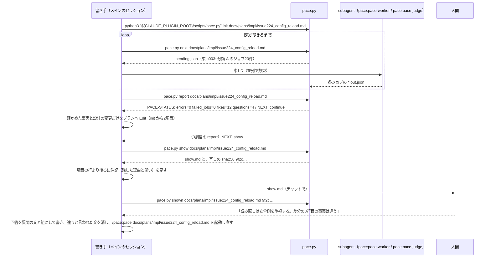

<!-- 目的: PACE を Claude Code プラグインとして作るための骨組み・受け渡しの形・守るべき性質と、実装の順序を決める -->

# PACE の設計

**この文書は、仕様の細部の正である。**確定方針の正は [../idea.md:59-111](../idea.md#L59-L111)（2章）で、idea.md のほかの章は検討と実験の記録である。
**idea.md 6章の方式は、「パイプライン」の節の変える点の表に挙げたもの以外は、そのまま採る。**W2（測る前に作り込まない。[../idea.md:105](../idea.md#L105)）に従うためである。
要約版は [pace_design_slim.md](pace_design_slim.md)。食い違ったらこの文書が正である。

---

## 1. 言いたいこと

**言いたいこと。**PACE は、continuo を知らない単独の Claude Code プラグインである。pace.py・SKILL.md・agent 2つで動く。
pace.py はプランを書き換えず、直すべき箇所・人間への質問・次に何をするか・人間に見せるもの（`show.md`）をファイルに書く。
SKILL.md は周を回し、書き手に3種類の文だけを書かせ、起動の終わりに `show.md` を人間に見せる（`--no-ask` では見せずに呼び出し側へ返す）。

- この文書が決めるのは骨組みまでである（プラグインの構成・書き手との境界・入出力のファイル・周の回し方）。段ごとの細部は、[実装計画](#13-実装計画) の各 issue の計画で決め、決めたものをこの文書へ書き足す。
- continuo は、1つの issue の最初の計画について、人間確認の前に PACE を呼ぶ側である（[continuo と組むとき](#11-continuo-と組むとき)）。

**単語。**単位・決定・前提・gap・反論・ジョブ・実行役は [../idea.md:119-139](../idea.md#L119-L139) のとおり。根拠グラフは、それらをつないだもの全体を指す。
**書き手**は PACE の skill を起動したメインのセッションで、プランを書いた本人である。**束**は、1回の subagent 呼び出しに渡すジョブのまとまりである。

---

## 2. 配り方とプラグインの形

**言いたいこと。**marketplace を持つこのリポジトリから `pace@pace` で入れる。核は skill で、AI の仕事は plugin の agent 2つが受け持つ。
`plugin.json` には version を書かない。動く環境は macOS と Linux の Python 3.9 以上で、標準ライブラリだけを使う。

```text
.claude-plugin/marketplace.json          {"name": "pace", "owner": {"name": "maimuzo"}, "metadata": {"description": "…"}, "plugins": [{"name": "pace", "source": "./plugins/pace", "description": "…"}]}
plugins/pace/.claude-plugin/plugin.json  {"name": "pace", "description": "…", "author": {"name": "maimuzo"}}
plugins/pace/skills/pace/SKILL.md        周の回し方。メインのセッションでインラインに動く。/pace:pace [--no-ask] <プランのパス>
plugins/pace/agents/pace-worker.md       model: sonnet / tools: Read, Write。分類・根拠付け
plugins/pace/agents/pace-judge.md        model: opus / tools: Read, Write。裁定・輪を断つ・反論
plugins/pace/scripts/pace.py             --version（段ごとの版の一覧）/ init / next / verify / report / show / shown（--version 以外はプランのパスを取る）
tests/                                   plugins/pace の外に置く（plugin のキャッシュに入れないため）。どちらのファイルも sys.path に plugins/pace/scripts を足して import pace する（test_init.py は権限を決める関数だけ）。init の振る舞いは、test_init.py が sys.executable で pace.py を叩いて確かめる。python3 -m unittest discover -s tests
```

| 決めたこと | 根拠 |
| --- | --- |
| 入れ方は `claude plugin marketplace add maimuzo/pace` と `claude plugin install pace@pace` | marketplace 名と plugin 名が同じ形には実例（`cloudflare@cloudflare`）がある |
| 第三者の marketplace は既定で自動更新されないので、README に `claude plugin marketplace update pace` と `claude plugin update pace@pace` を書く | [continuo の docs/FAQ.md:3262](https://github.com/maimuzo/continuo/blob/03a5fa3f/docs/FAQ.md#L3262) の「自動では新しくなりません」 |
| `plugin.json` に version を書かない | 書くと、上げ忘れたときに更新が入らず、同時に進む PR が版の行で衝突する。書かない plugin は commit の sha のディレクトリに入る |
| skill を核にする | どの流れからでも呼べる |
| agent に Bash を持たせない | 実行役がスクリプトを書いて済ませるのを道具の側で止める（[../idea.md:509](../idea.md#L509)） |
| 判定役を opus、ほかを sonnet。SKILL.md は呼び出しで model を渡さない | [../idea.md:513](../idea.md#L513) の使い分けを、呼び出し側の設定に左右されないようにする |
| Python 3.9 以上・標準ライブラリだけ | macOS の Command Line Tools の python3 が 3.9 で、入れる手順が要らない。Windows は確かめていないので対象に入れない |
| SKILL.md の `allowed-tools` を `Bash(python3 "${CLAUDE_PLUGIN_ROOT}/scripts/pace.py" *)` にし、本文に同じ文字列で `--version` などを書く | plugin の skill では、本文と `allowed-tools` の2か所で `${CLAUDE_PLUGIN_ROOT}` が置き換わる（公式文書の要約）。#2 で、`--plugin-dir` で読んだものと branch から入れたもの（cache の sha のディレクトリ）の両方で、確認なしで叩けた（Claude Code 2.1.301、user settings を読まない起動） |
| 許可が効くのは、skill を起動したターンの間だけ | 次に人間が発言すると消える（公式文書の要約）。1回の起動の前半を人間の発言を挟まずに回せば、その間は確認が出ない見込み（推論。同じターンで何度も叩けるかは [#4](https://github.com/maimuzo/pace/issues/4) で確かめる） |
| subagent の書き込みは、利用者が settings に `Edit(**/.pace/**)` を足して許す（README に書く） | plugin の agent では `permissionMode` が無視され、親の権限を受け継ぐ。ファイルの規則は Edit と Read で見られ、Write の規則は見られない（公式文書の要約）。#2 で、この規則を足した `manual` のモードで、pace-worker と pace-judge が確認なしに書けた（2.1.301、user settings を読まない起動、subagent はバックグラウンドで動いた。規則なしで確認が出るかは確かめていない） |
| モデルの差し替えは、利用者が settings の `env` に `CLAUDE_CODE_SUBAGENT_MODEL` と `CLAUDE_CODE_SUBAGENT_MODEL_FORCE=1` を書く（README に書く。確かめていない） | Claude Code が持つ差し替えの手段で、plugin の側に仕組みが要らない。引き換えに全部の subagent が同じモデルになり、上の行の使い分けが消える（[限界](#10-限界)）。API など subagent 以外の実行役への差し替えは、ジョブを JSON ファイルで渡す形（[../idea.md:310](../idea.md#L310)）が受け皿なので、仕組みを足さない |
| `pace.py --version` は、AI に頼む段（`classify`・`adjudicate`・`link`・`decycle`・`review`）ごとに `<段の名前> <版>` を1行ずつ出す。版の形は `2026-10-16.1` | 版はキャッシュの鍵に入る（[../idea.md:316](../idea.md#L316)）ので、鍵を持つ段だけに付ける。名前は [../idea.md:801-846](../idea.md#L801-L846)、形は [../idea.md:475](../idea.md#L475) の `prompt_version` に揃える |
| マージ前に手元から試すときは `claude --plugin-dir <checkout>/plugins/pace`。push 済みの branch から入れて試すなら `claude plugin marketplace add 'maimuzo/pace#<branch 名>' --scope local` → `claude plugin install pace@pace --scope local`（README に書く。#2 で確かめた）。checkout のパスから入れる形も README に書く（確かめていない） | `--plugin-dir` はそのセッションだけ読み込み、利用者の設定を変えない。入れた plugin は cache に写るので、編集の反映には commit と update が要ることがある |

- agent の呼び名は `pace:pace-worker` と `pace:pace-judge` である（plugin の agent に名前空間が付く実例: `maimuzo-issue-manage:bug-reporter`）。
- スクリプトは `python3 "${CLAUDE_PLUGIN_ROOT}/scripts/pace.py"` で呼ぶ。`${CLAUDE_PLUGIN_ROOT}` が置き換わらないときは、黙って別の経路で叩かずに止まる。退けた経路は、skill のディレクトリから `../../scripts/pace.py` を辿る形で、置き換えの不具合を隠すため採らない。

**退けた案。**
- version を書いて PR ごとに上げる: 上の表の理由で採らない。
- ExitPlanMode の hook から skill を促す形（[../idea.md:656](../idea.md#L656) はプラン承認時の検証を勧めている）: #2 で、PACE は plan mode の中では回らないと判断した（[限界](#10-限界)）。plan mode を出たあとに回すと「設計を完了させる前」にならないので、この形のままでは採れない。[#4](https://github.com/maimuzo/pace/issues/4) で skill から subagent を呼ばせて確かめ直し、plan mode の中で回ると分かったら拾い直す。

---

## 3. 書き手との境界

**言いたいこと。**pace.py はプランを書き換えず、人間にも訊かない。直すのと見せるのは、SKILL.md を読んだ書き手のセッションである。
見せ方は SKILL.md の引数で選ぶ。既定ではチャットで見せ、`--no-ask` では見せずに呼び出し側へ返す。

- 既定: `show.md` をチャットに出し、`shown` を打ってから止まる。
- `--no-ask`: `show.md` のパスと、shown を打つコマンド行（写しの sha256 を含む）を返して終わる。コマンド行にはスクリプトの絶対パスが入るので、呼び出し側はそれを公開の場に写さない。
- SKILL.md はメインのセッションでインラインに動く（fork しない）。subagent は subagent を起動できないためである。
- 書き手は束を必ず subagent へ渡す。`*.out.json` を自分で書かない（[pace.py が守る性質と SKILL.md の決まり](#8-pacepy-が守る性質と-skillmd-の決まり)）。



**退けた案。**PACE の側で人間に訊く（issue のコメントへ書くなど）: 特定の流れを前提にすることになり、「pace は continuo を前提にしない」（オーナーの指示）に反する。

---

## 4. 入力

**言いたいこと。**入力はプランファイル1本である。前提の種類は fact / requirement / value の3つで、根っこはプランに書かれた前提である（S3。[../idea.md:89](../idea.md#L89)）。`init` がプランを引用の単位に分ける規則も、この節に置く。

- PACE は、特定の流れの印にも、見出しの名前にも依存しない。
- `init` はプランをバイトで読み、`utf-8-sig` で解く（BOM を外す）。行の終わりは `\r\n`・`\r`・`\n` だけにする（`str.splitlines()` は U+2028 なども行の終わりにするので使わない）。

**分割の規則（[#3](https://github.com/maimuzo/pace/issues/3)）。**まず行頭の引用の記号を段ごとに外す（空白・`>`・直後の空白1つまで）。フェンスの中では開きの行の段数だけ外し、それより深い `>` は本文に残す。そのあと1行ずつ、次の順に判定する（先に当たったものが勝つ）。

| 順 | 行 | 単位 |
| --- | --- | --- |
| 1 | フェンスの中 | 閉じ（前後の空白を落とすと、開きと同じ字が開きの長さ以上並ぶ行）なら閉じて捨てる。右の空白を落として空になる行は捨てる。ほかは右の空白だけ落として `code_line` |
| 2 | 空行 | 開いている段落・箇条書きを閉じる |
| 3 | ```` ``` ```` か `~~~`（3つ以上。字下げは問わない）で始まる | フェンスを開く（開きの行は捨てる）。backtick のフェンスの残りに backtick があれば開きではない。閉じが無ければ文書の終わりまで |
| 4 | 字下げ3つまでの `#`〜`######` に、空白か行の終わりが続く | `heading`。末尾の `#` の並びは、前に空白があるときだけ外す。本文の無い見出しは、単位にも構造にもしない |
| 5 | 字下げ3つまでで、`-`・`*`・`_` の同じ字が3つ以上だけ | 水平線。捨てる |
| 6 | 字下げ3つまでの `\|` で始まる | `table_row`。行頭の縦棒と行末の縦棒（あるとき）を1つずつ外し、前に `\` の無い縦棒でセルに分け、各セルの前後の空白を落として ` \| ` でつなぐ。空のセルも残し、`\` の付いた縦棒は縦棒1字に戻す。区切り行（表の2行目で、どのセルも `:?-+:?`）は捨て、見出しの行は残す |
| 7 | `-`・`*`・`+`、または数字と `.`・`)` に、空白か行の終わりが続く（字下げは問わない） | 箇条書きを開く。記号を外し、続きの行をつないで1つの `bullet`（`line` は記号の行）。記号を外した本文がフェンスの開き（`- ```go`）なら、箇条書きを開かずにフェンスを開く。「。」では切らない。入れ子は別の単位 |
| 8 | どれにも当たらない（4つ以上字下げした行も） | 開いている段落か箇条書きの引用の深さが同じならつなぎ、違えば新しい段落を開く。段落は閉じるときに「。」の直後で切って `sentence` にする |

- **空白**: 字下げと記号の後ろの空白は、半角空白とタブで数える（タブも1字）。空行の判定と空白を詰めるのは、Python の空白（全角空白も含む）で行う。
- **つなぎ方**: 行の前後の空白（Python の空白）を落とし、前の末尾と次の頭（端の `**` は見ない）がどちらも ASCII でないとき（日本語どうしの折り返し）だけ詰め、ほかは空白1つを入れる。
- **文の区切り**: backtick の中（同じ長さの並びで閉じる）と「」『』（）の中（括弧は backtick の外だけで数える）では切らない。閉じの無い backtick の並びがあるか、括弧の対応が崩れた段落では、守りを全部外して「。」の直後で全部切る。つないだ生の本文の上で切り、切った文の頭の位置から `line` を引いてから整える。
- **整え方**（`code_line` には当てず、右の空白を落とすだけにする）: backtick の外の `**` を外し（閉じの無い backtick がある単位では全部外す）、空白の並びを1つにし、前後を落とす。空になった単位は作らない。HTML コメントもふつうの本文として切る。
- **属性**: `id`・`pos`（0から）・`kind`・`line`（最初の行。1から）・`path`（囲む、引用の外の見出しの列。見出しは自分を含まない）・`sec`（属する H2。H2 の見出しでは自分。H2 より前と、H1 のあとで次の H2 より前は `""`）・`text`。引用の中の見出しは `heading` にするが、`path` と `sec` を進めない（その単位の `sec` も外の節のまま）。
- **ID**: `"u" + sha256("\n".join(path) + "\n" + text)[:8]`。同じ値の2つ目からは `_2`・`_3` を付ける。

**退けた案。**
- **4つ字下げのコードブロックも `code_line` にする**: 箇条書きの続きと見分けるのに直前のブロックの記憶が要り、水平線・箇条書きの判定との順もぶつかる。書き手がフェンスで書けば避けられるので、扱わない（[限界](#10-限界)）。
- **別の文書の参照も入力にする**（[../idea.md:697-699](../idea.md#L697-L699) の指摘）: いまは採らない。参照は本文の文字（「continuo_design.md の 3-24」）で書かれることが多く、continuo の docs/plans から continuo_design.md へのリンクのうちアンカー付きは約4分の1しかない。解決には節番号の解析と巨大な節の扱いが要る。W2 に従い、[#9](https://github.com/maimuzo/pace/issues/9) で「別の文書に答えがある gap」の数を測ってから決める。
- **前提に「人間の決定」の種類を足す**（[../idea.md:700-702](../idea.md#L700-L702)）: いまは採らない。中身で判定する規則が実データに合わず、照合しないと AI の書いた「人間はこう言った」が根っこになる。人間の回答は、質問の文と人間の原文を組にして自然文で書く（分類の段で、価値か要求の前提になる）（[pace.py が守る性質と SKILL.md の決まり](#8-pacepy-が守る性質と-skillmd-の決まり)）。

---

## 5. パイプライン

**言いたいこと。**idea.md 6.2 の段（分割・分類 A/B・裁定・候補・根拠付け・輪を断つ・結合と検証・反論・レポート）をそのまま採る。変える点は下の表で全部である。
`report` は内部で `verify` と同じ計算（根への到達・gap の効き）を行う。

| 変える点 | 理由 |
| --- | --- |
| コードブロックの中身を1行1単位（`code_line`）にし、言語ごとの解析はしない | 言語の指定が無いブロックが375個ある（[../idea.md:683](../idea.md#L683)） |
| 段落と箇条書きは、続く行をつないでから単位にする（idea.md 段1は行ごと）。英語の段落は「。」が無いので1段落が1単位になる | 行ごとに切ると、折り返した文の途中で単位が切れる（continuo の docs/plans で行頭が `>` の行が776行あり、多くが折り返した段落） |
| 引用の記号を外して中身を同じ規則で切り、引用の中の見出しは `path`・`sec` を進めない | 引用の中にも決定が書かれる。他の文書の見出しを `> ## …` で引く書き方がある |
| backtick の中と「」『』（）の中の「。」では切らない | 人間の原文の引用が割れる（`。」` が89行、`。）` が26行） |
| backtick の中の `**` を外さない（idea.md 段1は全部外す） | `` `Edit(**/.pace/**)` `` の意味が変わる |
| 表の `\` の付いた縦棒ではセルを分けず、空のセルを残す | セルの中の文字（56行）と列の位置を失わない |
| BOM を外し、`\r` だけの行の終わりも扱う | BOM 付きの UTF-8 を「UTF-8 でない」と数えない |
| 4つ字下げのコードブロックは捨てずに、段落か箇条書きの本文にする（idea.md 段1はコードブロックを捨てる） | 箇条書きの続きと見分けられない（[入力](#4-入力) の退けた案） |
| 差し戻しを3回使い切ったジョブは「失敗したジョブ」として記録して先へ進む。その影響を受けた決定と単位は、fixes と questions から外し、`show.md` の「確かめられなかったもの」に出す | 1件の失敗で、ほかの結果を全部捨てない。失敗をプランの穴に見せない |
| エラー（errors）として数えるのは、プランを読めないこと（ファイルが無い・UTF-8 でない）だけ。ほかの失敗（読む権限が無い・書けない など）は pace.py が 0 以外で終わって知らせる（[作業ディレクトリ](#9-作業ディレクトリ) の判定の順） | 根拠の無い決定は、エラーではなく fixes の中身である |
| 根に届かない反証（idea.md 段7）は、エラーにせず、止めているものの側に出す | 直す先は止めているもので、設計ではない |
| ジョブを束にして渡す | 呼び出し1回に約7万トークンの固定分がかかる（[../idea.md:601](../idea.md#L601)） |
| レポートを fixes.md・questions.md に分け、人間に見せるものは `show` が show.md にまとめる。切った辺は report.md に載せる | 書き手が直すもの・人間が決めるもの・人間に見せるものを分ける |
| 要求の gap を、AI が直す側から人間に訊く側へ移す | 書き手が要求を自分で作ると、それが根っこになる |
| 周の判定（NEXT の行）を pace.py に置き、上限を最後に見せてから3周にする | 周回の制御は機械が行う（[../idea.md:311](../idea.md#L311)） |
| 判定役（裁定・輪を断つ・反論）を opus に、ほかを sonnet にする（idea.md は「既定のモデル」） | 呼び出し側の設定に左右されないようにする（[配り方とプラグインの形](#2-配り方とプラグインの形)） |
| 実行役（agent）に Bash を持たせない | スクリプトを書いて済ませるのを道具の側で止める |
| キャッシュの鍵に、段の指示文の sha256 も入れる | 指示文を変えて段の版を上げ忘れても、古い答えを使い回さない |
| 作業ディレクトリを引数で取らず、プランの隣に置き、`.gitignore` を書く | どのコマンドもプランのパスだけで動く。利用者のリポジトリへ中間のファイルを入れない |
| 作業ディレクトリに `source.json`（元のプランのファイル名）を足し、別の名前のプランのものなら `init` が止まる（[作業ディレクトリ](#9-作業ディレクトリ)） | 拡張子だけが違うプランが、前のプランの見せた記録と周の記録を使い回さない |
| CLI を `--version`・`init`・`next`・`verify`・`report`・`show`・`shown` にし、`rounds.jsonl`・`shown.md`・`show_snapshot.md` を足す | 書き手との境界と周の回し方 |

- 単位 ID の重複は、idea.md のとおり連番にする。分割の規則の全部は [入力](#4-入力) にある。
- 切った辺の記憶は、idea.md 6.3 のとおり、切られた側の決定の文を鍵にし、両端の文が同じ限り効かせる。

**退けた案。**
- **HTML コメントを捨てる**: インラインコードの `<!--` や閉じの無い `<!--` から先を消し、評価用プランの目標の文が黙って消える。HTML コメントもふつうの文として扱う。
- **切った辺を fixes に入れる**: 切られる辺は根拠付けの AI が張ったもので書き手には直せず、fixes が0にならない。

---

## 6. 返すもの

**言いたいこと。**`report` は report.md・fixes.md・questions.md・rounds.jsonl を書き、最後に `PACE-STATUS` と `NEXT` の2行を出す。`show` は show.md と show_snapshot.md を書く。

| ファイル | 中身 |
| --- | --- |
| `report.md` | 全体。切った辺（輪を断つ段が「本当の理由ではない」とした辺）も参考として載せる |
| `fixes.md` | 書き手が直すもの。並びは idea.md 段9 の順（足りない事実の gap → accepted の反論 → 輪を断つ段を5回回しても残った輪 → 根拠の無い決定）。各項目に決定の原文を引く（行番号は参考）。残った輪には輪の辺と warrant を添える |
| `questions.md` | 人間が決めるもの。価値判断の gap と要求の gap は止めている決定の数の順に並べ、止めている決定の原文と分類の段で出た別案を添える。needs_human の反論も入れる。根に届かない反証は、止めているものが価値か要求の gap ならここへ、事実の gap・根拠の無い決定・残った輪なら fixes へ入れる |
| `rounds.jsonl` | 周ごとの1行（周の番号・プランの sha256・各件数） |
| `show.md` | 人間に見せるもの。質問／残った fixes／確かめられなかった決定と単位／最後に見せてからのプランの差分（削除も出る）／「差分の中の事実・価値の文・回答の引用と、境目より後ろの注記は書き手が書いたもので、照合していない」という注意、の5つと境目の行 |

見本:

```text
PACE-STATUS: errors=0 failed_jobs=1 fixes=12 questions=4
NEXT: continue
```

```json
{"round": 1, "plan_sha256": "9f2c…", "units": 96, "decisions": 50, "rooted": 2, "needs_gap": 48, "gaps": {"fact": 40, "requirement": 11, "value": 12}, "defeaters": {"accepted": 17, "refuted": 6, "needs_human": 4}, "failed_jobs": 1, "fixes": 12, "questions": 4}
```

```markdown
- 行42「読み直しは `Tick` の頭で1回だけ行う」
  - 足りない事実: ファイル監視・SIGHUP を退ける理由がプランに無い（G_D_2e8b33e5_1_g2、fact）
```

（上から、`report` の最後の2行・`rounds.jsonl` の1行・`fixes.md` の1項目。`rounds.jsonl` の決定・gap・反論の数は [../idea.md:557-570](../idea.md#L557-L570) の値で、PACE-STATUS の数は形を示すための例。fixes と questions を何の単位で数えるかは [#7](https://github.com/maimuzo/pace/issues/7) で決める）

---

## 7. 周の回し方

**言いたいこと。**1回の起動は、前半（周を回す）と後半（見せる）の2段である。周を続けるか止めるかは pace.py の NEXT の行が決め、書き手は従うだけである。

**前半。**
- 1周は `init` → `next` を束が尽きるまで → `report` である。
- `NEXT: continue` なら、書き手は fixes を直して次の周へ進む。`NEXT: show` なら後半へ進み、その起動の中ではもうプランを直さない。
- pace.py が 0 以外で終わったら（`.pace/` に書けない、などのプラン以外の失敗）、SKILL.md はそこで止めて理由を見せる。

**後半。**
- `pace.py show` を打つ。`show` は `show.md` と、プランの写し `show_snapshot.md` を書き、写しの sha256 を出す。
- 書き手は、`show.md` の境目の行より後ろに注記を足してよい。足すのは、残った fixes を書かずに残した理由と、人間への問いだけである。事実とその出どころは、注記ではなくプランに書く。
- 見せたあと、`pace.py shown <プラン> <sha256>` を打つ。

**人間の回答のあと。**書き手は回答をプランへ書き、違うと言われた事実は消すか直す。そのあと起動し直す。

「終わり」と言えるのは `errors=0 failed_jobs=0 fixes=0 questions=0` のときだけである。それ以外は、何が残っているかを見せて終わる。

**次のことは [#7](https://github.com/maimuzo/pace/issues/7) の計画で決める。**
- NEXT のそのほかの条件（failed_jobs の扱いを含む）
- プランの sha256 を取る時点
- report を同じ周に2回打ったときの扱い
- 書き手に直せない fixes だけが残ったときの扱い

**退けた案。**
- **周の終わりを書き手の申告で決める**: [../idea.md:311](../idea.md#L311) は周回の制御を機械に置いている。同じ入力でも周の数が変わり、測った値の再現性も失う。
- **起動のたびに単位を控え、それに無い前提を「後から足された」として出す**: 起動し直すと、見せていない書き足しが基準に入る。見せた記録は `shown` でしか進めない（次の節）。

---

## 8. pace.py が守る性質と SKILL.md の決まり

**言いたいこと。**pace.py が守る性質5つはテストで確かめる（[#7](https://github.com/maimuzo/pace/issues/7) の完了条件）。SKILL.md の決まり6つは機械では守らせられないので、[限界](#10-限界) に書く。

**pace.py が守る性質。**
1. **周を続けるか止めるかは pace.py が決める。**上限は最後に見せてから3周（1周に issue224 で約132ジョブかかるので、1回の起動を数周で切るための仮の値。[#9](https://github.com/maimuzo/pace/issues/9) で決め直す）。少なくとも、fixes が0件のとき・書き手が直さなかったとき・errors のときは止める。
2. **`shown.md` は `shown <プラン> <sha256>` でしか進まない。**`show_snapshot.md` の sha256 が引数と合うときだけ写しを繰り上げ、写しが無いか合わないときは何もせず理由を出す。`init` は `shown.md` が無いときだけ、その時点のプランの写しで作り、`show.md` の差分に「初回（まだ人間に見せていない基準）」と添える。
3. **失敗したジョブと、その影響を受けた決定と単位は、fixes と questions に入れず、`show.md` の「確かめられなかったもの」に出す。**影響を辿る範囲は [#6](https://github.com/maimuzo/pace/issues/6) の計画で決め、[#7](https://github.com/maimuzo/pace/issues/7) はそれに従う。
4. **`show` が書く `show.md` の中身は、呼ばれ方に依らず同じである。**プランから引いた原文と差分はコードブロックで囲み、中のパスはプランと同じディレクトリからの相対にする。
5. **errors は、プランを読めないことだけを数える。**そのとき `init` が `PACE-STATUS: errors=1 …` と `NEXT: show` を出し、`show` は「読めなかった」とだけ書いて写しを作らない。

**SKILL.md の決まり。**
1. 書き手がプランに足してよい文は3種類だけである。
   - (a) 確かめた事実。出どころは、読み手が辿れる形にする（リポジトリの中の相対パスと行、URL、叩いたコマンドそのものとその出力の要点）。
   - (b) 設計そのものの変更（何を作るか・どう作るか）。
   - (c) 人間の回答。質問の文と人間の原文を組にして書く（例「読み直しに失敗したときに何を重視するかについて、オーナーは『安全側を重視する』と答えた」）。

   価値や要求の理由が要る fixes と、確かめられない事実は、書かずに注記で人間に訊く。
2. 秘密・個人の絶対パス・公開してよいか分からない中身は、プランにも注記にも書かない。そういう出どころしかない事実は書かずに、「出どころを伏せた」と添えて注記で訊く。
3. `show.md` の境目の行より前（pace.py が書いた部分）は、削りも書き換えもせず、既定の起動ではその全部を見せる。
4. `NEXT: show` のあとは、その起動の中ではプランを直さない。
5. `shown` は人間に見せたあとにだけ打つ。既定の起動では、チャットに出した時点を「見せた」とする。
6. 束は必ず subagent に渡し、`*.out.json` を自分で書かない。

---

## 9. 作業ディレクトリ

**言いたいこと。**作業ディレクトリはプランの隣の `.pace/` に置き、`.pace/.gitignore` で丸ごと無視させる。`init` は記録とキャッシュを残して、ほかを作り直す。

- 場所: `<プランと同じディレクトリ>/.pace/<プランのファイル名の拡張子を除いたもの>/`（例 `docs/plans/impl/.pace/issue224_config_reload/`）。中の構成は [../idea.md:484-498](../idea.md#L484-L498) の表に、上の節で足したファイルを加えたもの。
- `init` は、プランを読めて作業ディレクトリを確かめたあと（下の順の5）に、`<プランと同じディレクトリ>/.pace/.gitignore`（中身は `*` の1行）を書く。`git status --porcelain` は無視されたファイルを出さないので、commit に入らず、worktree の片付けも止まらない。
- `init` は `cache/`・`rounds.jsonl`・`shown.md`・`show_snapshot.md` を残し、ほかを作り直す（P5 とキャッシュの両立。[../idea.md:69](../idea.md#L69)・[../idea.md:316](../idea.md#L316)）。作り直しで書くのは `plan.md`（プランのバイトの写し）・`units.jsonl`・`source.json`（元のプランのファイル名。`design.markdown` なら `{"plan_file": "design.markdown"}`。これも残す）で、`shown.md` は無いときだけプランの写しで作る。プランの中身を持つもの（`plan.md`・`units.jsonl`・`shown.md`）は、元のプランの権限（umask を当てたもの）に持ち主の読み書きを足した権限で作る。新しく作る作業ディレクトリは、プランを読める相手に読み・入る権限を、書ける相手に書く権限を渡す（0600 のプランなら 0700、group で書ける 0664 なら 0775）。新しく作る `.pace/` は読み・入る権限だけを渡し、書く権限は持ち主だけにする（渡すと、同じディレクトリの別のプランの作業ディレクトリを他人が差し替えられる）。前の起動が広い権限で作った `shown.md`・`show_snapshot.md` も狭める（symlink・hard link・ふつうのファイルでないもの・ほかの利用者の物には触らない。symlink の `shown.md` は、行き先が無くても作り直さない）。消すときは symlink の先を辿らない。
- キャッシュ無しで測るときは、`cache/` を空にしてから回す。

**`init` の判定の順（[#3](https://github.com/maimuzo/pace/issues/3)）。**作業ディレクトリの中身を変えるのは、プランを読めて、そこがいまのプランのものと確かめたあとだけにする。
1. プランを読む。無い（ディレクトリ・FIFO などふつうのファイルでないもの・途中がファイルのパス・輪になった symlink も含む）か UTF-8 でなければ、`PACE-STATUS: errors=1 failed_jobs=0 fixes=0 questions=0` と `NEXT: show` を出して 0 で終わる。`.pace/` には何も作らず、何も消さない（語幹が同じ別のプランの作業ディレクトリを消さないため）。
2. 作業ディレクトリの名前が `.`・`..`・`.gitignore` か空（`..md`・`...md`・`.gitignore.md`）なら、1 で終わる。`.pace/` そのものやプランのディレクトリを作り直して、ほかの記録やプランを消さないため。`.pace/` か作業ディレクトリが symlink か、ディレクトリでないときも、1 で終わる。
3. `source.json` があって、ふつうのファイルでない（symlink・FIFO など）か、JSON として読めないか、`plan_file` がファイル名でなければ、1 で終わる。
4. `plan_file` がいまのプランのファイル名と違い、同じディレクトリのそのファイルといまのプランが `os.path.samefile` でなければ（控えたファイルがもう無いときも）、拡張子だけが違うか、拡張子だけを付け替えたプランとの衝突として、名前を変えるか作業ディレクトリを消すよう標準エラーに案内して 1 で終わる。`source.json` が無ければ、いまのプランのものとする。
5. 書く。ほかの失敗（読む権限が無い・書けない・プランの名前が UTF-8 で表せない）は、標準エラーに理由を出して 1 で終わる。成功したら `units=<数>` を出す。
- 名前は `Path.stem` と同じく、最後の点から後ろを除く（`a.b.md` は `a.b`。点で始まり、ほかに点の無い `.md` は除かずに `.md`）。控えたファイルが消えても引き継がないのは、別の名前のプランが前のプランの `shown.md` と `rounds.jsonl` を使い回さないためである。同じ名前のプランは、中身を書き直しても同じプランとみなす（見分けられない）。

**退けた案。**
- **README の注意書きだけで `.pace/` を commit させない**: commit するのが AI のときに守られない。
- **作業ディレクトリをリポジトリの根からのパスで名付ける**: リポジトリの外のプランで決まらない。
- **作業ディレクトリの名前に拡張子を入れて衝突を避ける**: #1 で「`.md` で終わる」として退けた。衝突は検出して止める。

---

## 10. 限界

**言いたいこと。**次のことは、この設計では防がない。どれも、人間に見せる差分と注意で補うか、[#9](https://github.com/maimuzo/pace/issues/9) で測ってから作り込むかを決める。

- **SKILL.md の決まり6つは、機械では守らせられない。**書き手が足した文が3種類に収まっているか、事実の出どころが実在するかも確かめない。出どころを機械で確かめる仕組みを足すとしても、プランにマーカーや構造化書式を埋め込まない（P3。[../idea.md:67](../idea.md#L67)）。
- 書き手が `*.out.json` を自分で書くこと、見せずに `shown` を打つことは、道具では止められない。既定の起動では、人間が読んだかどうかは分からない。
- プランを動かしたり `.pace/` を消したりすると `shown.md` が作り直され、それまで見せていなかった差分は基準に取り込まれる。拡張子だけを付け替えたプランと、拡張子だけが違う2本のプランは、作業ディレクトリを消すまで `init` が止まる（同時には回せない）。同じディレクトリで `init` を同時に2つ打つと、この判定をすり抜けることがある（錠は持たない。1つのプランは1つのセッションで回す）。`.pace/` は PACE が使う名前で、そこに置いたほかのもの（`.gitignore` の中身・語幹が同じディレクトリ）は上書きされる。
- 権限は数字だけを揃え、group は写さない（作るファイルの group は OS が決める）。既にある `.pace/` と作業ディレクトリの権限は変えない。`cache/` と `rounds.jsonl` はプランの写しを持たないので狭めない。group で共有するプランでは、`.pace/` を最初に作った人のほかは、新しいプランの作業ディレクトリを作れない（書けないと 1 で終わる）。
- 単位 ID は sha256 の先頭8桁なので、本文の違う単位がまれに同じ値になり、連番で区別される（continuo の46本で1組）。連番は出てきた順に付くので、本文の同じ単位（同じ値の単位）の前の方を消すか、前に同じ本文を足すと、後ろの ID が変わる（continuo の46本で、連番の付いた単位は229）。
- 叩いたコマンドの出力の要点は書き手の言い換えだが、根っこの前提になる。出どころを伏せた事実は、公開の場では辿れない。
- 別の文書の根拠は gap として出る（[入力](#4-入力)）。
- 別案の数が実行ごとに揺れ、gap が減らないことがある（[../idea.md:597](../idea.md#L597)）。切った辺の記憶は、両端の文が変わるまで残る。
- 英語のプランは「。」が無いので、1段落が1単位になる。
- 「。」の無い段落は、日本語でも1段落が1単位になる（continuo の docs/plans の46本で、いちばん長い単位は検索語を並べた段落の3,026字）。
- 分割は次の形を扱わない: 箇条書きの中で4つ以上字下げした表と見出し（箇条書きの本文につながる）・4つ字下げのコードブロック（段落か箇条書きの本文になる。中の `- ` の行は箇条書きに、```` ``` ```` の行はフェンスの開きになる。評価用の issue245 では十数か所が当たる）・Setext の見出し・行頭に `|` の無い表・YAML の front matter。箇条書きの記号を重ねた行（`- - ```go`・`- > ```go`）で開いたフェンスは開きと見ず、字下げした閉じの行が開きになって、内と外が文書の終わりまで逆になる（記号を1行に1つだけ書けば避けられる）。引用や箇条書きの中で閉じないフェンスは、描画と違って文書の終わりまで `code_line` になる（continuo の docs/plans の46本では0件）。
- H2 が1つしかないプラン（continuo の計画のコメントなど）では、「同じ H2」の候補の規則がプラン全体を指す（[../idea.md:694-696](../idea.md#L694-L696)）。「冒頭の節」の規則は、目標を冒頭に書く書き方を前提にしている（[../idea.md:704](../idea.md#L704)）。
- 人間の回答が決定として分類されると、同じ質問がまた出ることがある。
- 判定役とプランの書き手が同じモデルになることがある（[../idea.md:212](../idea.md#L212)）。
- 誰が何を言ったか（S1・S4・idea.md 11章）は扱わない。入力は1本のプランに限る（S2・W2）。人間の回答を書き写すときの改変は照合しない。扱う段は [#10](https://github.com/maimuzo/pace/issues/10) の計画で、回答の書き写し方とあわせて決める。
- plan mode の中では回らないので、プランは plan mode の外で書き、PACE も plan mode の外で起動する使い方に限る（plan mode を出るのは人間の承認なので、出てから回すと「設計を完了させる前」にならない）。[#2](https://github.com/maimuzo/pace/issues/2) で1回ずつ試した（Claude Code 2.1.301、user settings を読まない起動）: plan mode でも `/pace:pace`（`pace.py --version` だけ）は確認なしで通ったが、subagent にジョブを渡すよう手で頼むと、subagent を呼ばずにプランを書き、plan mode を抜けてよいかの確認で止まった。plan mode のプランは `~/.claude/plans/` に置かれ、作業ディレクトリの外になった。書き込みを伴う pace.py の段（`init`）は、plan mode では試していない。
- subagent の書き込みを許す規則（`Edit(**/.pace/**)`。[配り方とプラグインの形](#2-配り方とプラグインの形)）は、プランが Claude Code を起動したディレクトリの下にあるときにしか当たらない見込み（推論。確かめていない）。subagent に限らず、メインのセッションの `.pace/` への書き込みにも効く（公式文書の要約。確かめていない）ので、書き手が `*.out.json` を自分で書いても確認では気づけない。
- 判定役の `model: opus` が使えるかは、利用者の環境（契約・プロバイダ）ごとに違い、確かめていない。組織の `availableModels` で禁じられていれば、許された版に置き換わるか、親のセッションのモデルで動く（公式文書の要約）。`CLAUDE_CODE_SUBAGENT_MODEL` と `CLAUDE_CODE_SUBAGENT_MODEL_FORCE=1` で差し替えると、全部の subagent が同じモデルになり、pace-worker と pace-judge の使い分けが消える（公式文書の要約。確かめていない）。

---

## 11. continuo と組むとき

**言いたいこと。**continuo は PACE を前提にしてよいが、PACE は continuo を前提にしない。continuo の run は、計画を書いた直後・人間確認の前に、`--no-ask` で PACE を回す。

1. continuo の run は、1つの issue の最初の計画を、git に無視される、issue ごとの固定のパスへ書く。
2. `/pace:pace --no-ask <そのパス>` を回す。
3. 直したあとの計画で、計画のコメントを書く。
4. 返された `show.md` の中身を、人間確認の報告のコメントへ入れる。公開の場に写すので、伏せる決まり（個人の絶対パスを書かない など）は continuo の側が当てる。
5. コメントを書けたら、返されたコマンド行（写しの sha256 を含む）で shown を打つ。
6. 回答のあとの流れは、[#10](https://github.com/maimuzo/pace/issues/10) で決める。

- オーナーが選んだのは「計画を書いた直後・人間確認の前」である。
- 回答で見直した計画にもう一度 PACE を回すかは、この文書では決めない。人間への質問はループの普通の一手である（[../idea.md:208](../idea.md#L208)）一方、回すと人間確認の往復が1回増える。どちらを取るかは [#10](https://github.com/maimuzo/pace/issues/10) でオーナーに訊く。
- continuo の 3-2 は、直しを求められると計画を直してもう一度訊く（[continuo の internal/prompt/builtin.md](https://github.com/maimuzo/continuo/blob/03a5fa3f/internal/prompt/builtin.md) の 3-2「計画を書き、レビューを受ける」）。PACE の質問への回答をそれと同じに扱うかも、[#10](https://github.com/maimuzo/pace/issues/10) で決める。

**退けた案。**
- **人間確認と設計レビューの間に挟む**: 人間への往復が1回増える。
- **設計レビューの代わりにする**: PACE は根拠のつながりしか見ないので、「実装すると壊れる記述」のような設計レビューの観点が抜ける。

---

## 12. 残っている論点

**言いたいこと。**次の論点は、受け持つ issue の計画で決める。各 issue の本文の「設計レビューで残った論点」にも同じものがある。

| 受け持つ issue | 論点 |
| --- | --- |
| [#4](https://github.com/maimuzo/pace/issues/4) | `*.out.json` を書かなかったジョブを試行に数えるか。キャッシュの鍵に agent の定義やモデルの別名が入らないこと。同じターンの中で pace.py を何度も叩き、間に subagent を挟んでも、`allowed-tools` の許可が続くか（1回叩けることは確かめてある）。ふだんの設定（user settings を読む・subagent が前面で動く）で、subagent の書き込みに確認が出ないか（#2 は user settings を読まない起動・バックグラウンドの subagent で確かめた）。skill から subagent を呼ばせる形で、plan mode の中で回らないことを確かめ直す（#2 は手で頼んだ1回だけ）。回ると分かったら、`init` の書き込みと `~/.claude/plans/` のプランへの規則の当たり方も確かめる |
| [#7](https://github.com/maimuzo/pace/issues/7) | 書き手のプランの Edit・注記の Edit・ターンのあとの `shown`・回答のあとに書き手が起動し直した skill・`--no-ask` で呼ばれたときに、権限の確認が出ないか。show.md のコードブロックがプランの中の ``` で閉じる。errors のときに古い show_snapshot.md が残る。「最後に見せてから何周か」と「初回」を判定する記録の置き場所。`--no-ask` のときの決まり3と伏せ処理の上下・0 以外で終わったときに返すもの。決まり4の範囲・注記の問いと質問の重なり・show.md の中のパスの基準。init が `NEXT: show` を出したときの分かれ道・停止の条件の書き分け・性質4と5の show.md の形。境目の行の形と、show.md・questions.md・report.md・`--no-ask` が返すものの見本。決まり3・4を pace.py で確かめるか（境目より前の sha256 など）。fixes と questions を何の単位で数えるか（gap ごとか、決定ごとか） |
| [#9](https://github.com/maimuzo/pace/issues/9) | 「公開してよいか分からない中身は書かない」で質問が増えすぎないか。限界の節のうち、作り込むものの判断 |
| [#10](https://github.com/maimuzo/pace/issues/10) | `--no-ask` で返すものを公開のコメントへ写すときの伏せ方 |

---

## 13. 実装計画

**言いたいこと。**実装は9件の issue に分け、この順に進める。**順序の正はこの表で、カンバン「AI自動進行管理」の `Ice Box` の並びはその写しである。**各 issue は、着手したら自分の計画と設計レビューを通る。

| 順 | issue | 完了条件の要点 |
| --- | --- | --- |
| 1 | [#2](https://github.com/maimuzo/pace/issues/2) PACE を Claude Code のプラグインとして入れられるようにする。なぜなら、どのリポジトリのプランにも同じ手順で PACE を回せるようにしたいからだ | marketplace.json・plugin.json・SKILL.md・agent 2つ・`pace.py --version`（段ごとの版の一覧）。`claude plugin install pace@pace` で入り、skill から叩ける。README に入れ方と更新のコマンド |
| 2 | [#3](https://github.com/maimuzo/pace/issues/3) プランを見出し・文・表の行・箇条書き・コードの1行の単位に分けて引用できるようにし、作業ディレクトリを作る。なぜなら、根拠のグラフの全ての決定と前提が、プランの原文を指す必要があるからだ | `init`（`.pace/.gitignore`・残すファイル・`shown.md` の初回・読めないときの `errors=1`）と分割（`code_line`・連番）。unittest |
| 3 | [#4](https://github.com/maimuzo/pace/issues/4) AI に頼む仕事（分類・比較・裁定）を束にまとめて、少ない呼び出しで回せるようにする。なぜなら、subagent の呼び出し1回に約7万トークンの固定分がかかるからだ | `next` の枠（束・検証・差し戻し3回・失敗したジョブ・キャッシュ）と分類 A/B・比較・裁定・ノード化。SKILL.md のループで、continuo の issue224_config_reload.md と issue134_136_140_blocked_notice.md の分類が、メインのセッションで回る |
| 4 | [#5](https://github.com/maimuzo/pace/issues/5) 決定ごとに根拠の候補を絞り、前提からどう導いたかの段を AI に書かせられるようにする。なぜなら、根拠の穴を見つけるには、まず根拠の道筋を作る必要があるからだ | 候補の絞り込み・根拠付け（r1/r2）・2-gram の追加候補 |
| 5 | [#6](https://github.com/maimuzo/pace/issues/6) 循環論法と根拠切れを、プラン全体を結合したグラフで検出できるようにする。なぜなら、決定ごとに根拠付けすると互いを理由にし合う輪が必ず生じ、結合して初めて見えるからだ | 輪を断つ反復・結合・`verify` |
| 6 | [#7](https://github.com/maimuzo/pace/issues/7) 根拠の穴を、書き手が直すものと人間が決めるものに分けて返し、周を回して止められるようにする。なぜなら、事実の穴は AI が調べて直し、価値と要求は人間に決めてもらう必要があるからだ | 反論・`report`・`show`・`shown`、SKILL.md の周の回し方と決まり6つ。pace.py が守る性質5つがテストで成り立つ |
| 7 | [#8](https://github.com/maimuzo/pace/issues/8) プランを1行直したときにやり直したジョブの数を記録し、キャッシュの有無で結果が同じになることを確かめられるようにする。なぜなら、周を重ねる費用と結果の安定を測りたいからだ | やり直したジョブの数の記録と、キャッシュの有無で結果が一致するテスト |
| 8 | [#9](https://github.com/maimuzo/pace/issues/9) 評価用の6本のプランで PACE を回して効果と負担を測り、束・並列・周の上限を決め直せるようにする。なぜなら、どこを作り込むかは、測ってから決めるからだ | 評価用の6本（continuo の issue224・issue144・issue134_136_140・issue245、continuo の計画のコメント1本、continuo 以外の公開リポジトリのプラン1本。idea.md 12.4 の5種類に、H2 が1つの continuo の計画を足したもの）で回し、質問の周を1本以上通し、測った数を記録する。束・並列・周の上限を決め直す |
| 9 | [#10](https://github.com/maimuzo/pace/issues/10) continuo の設計の流れで PACE を回すための issue を、continuo に起票できるようにする。なぜなら、計画を書いた直後・人間確認の前に、根拠の穴を見つけられるようにしたいからだ | #9 の結果をオーナーが見て「動く」と判断してから、continuo に issue を起票する |

- 各 issue は、その計画で決めた細部をこの文書の該当の節へ書き足す。400行・1節50行の上限はこの版に当て、超えそうになったら節を分ける。
- カンバンへの配置は、#1 の run でオーナーの指示（「全てice boxレーンに入れて、実装順序になるように並び替えておけ」）による例外として、AI が行った。この PR のレビューで表が変わったときは、同じ run の中で同じ置き方で直す。そのあとの並べ替えと、表から外れた issue を閉じることは、人間が決める。
