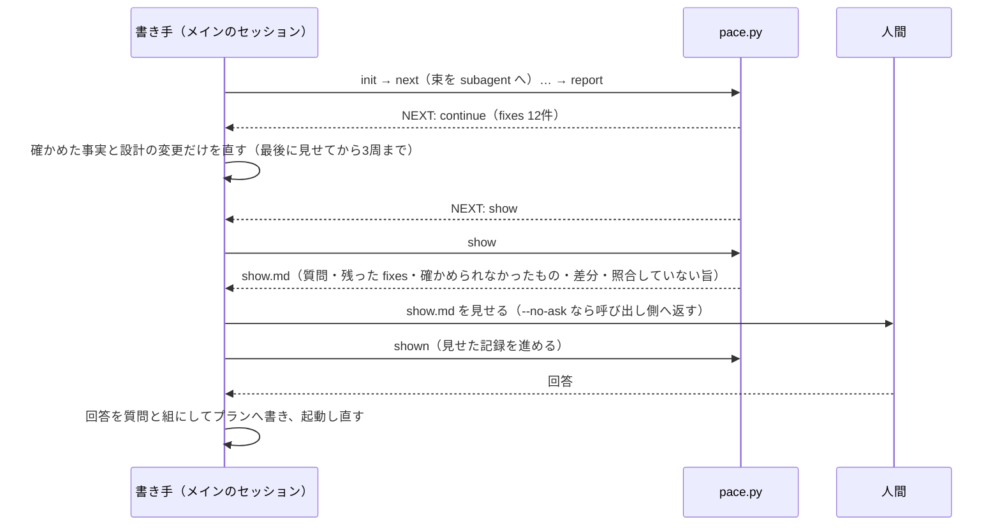

<!-- 目的: pace_design.md を人間がレビューするための要約版。人間のレビューを求めるたびに詳細版から作り直す -->

# PACE の設計（要約版）

**この文書は要約版である。食い違ったら [pace_design.md](pace_design.md)（詳細版）が正である。**
人間のレビューを求めるたびに、詳細版から作り直す。手で差分を当てない。

---

## 何を作るか

**言いたいこと。**PACE は、AI が書いた設計プランから根拠のグラフを作る。根拠の無い決定・循環論法・プランに無い前提への依存を洗い出し、書き手（AI）が直すものと、人間が決めるものに分けて返す。continuo を知らない、単独の Claude Code プラグインとして配る。

- 入れ方: `claude plugin marketplace add maimuzo/pace` → `claude plugin install pace@pace`。更新は `claude plugin marketplace update pace` と `claude plugin update pace@pace`。マージ前に手元から試すときは `claude --plugin-dir <checkout>/plugins/pace`。
- 権限: `pace.py` は skill の `allowed-tools` で、起動したターンの間は確認なしで叩ける見込み（1回叩けることは確かめた）。subagent の書き込みは、利用者が settings に `Edit(**/.pace/**)` を足して許す（README に書く）。
- 部品は4つ。
  - `pace.py`: 機械の仕事を受け持つ。AI は呼ばず、プランも書き換えない。
  - `SKILL.md`: 周を回す。
  - `pace-worker`（sonnet）と `pace-judge`（opus）: AI の仕事を受け持つ。
- 入力はプランファイル1本。根っこは、プランに書かれた前提である。

## 1回の起動で何が起きるか

- 周を続けるか止めるかは、`pace.py` が決める。AI の申告には頼らない。
- 書き手がプランに足してよい文は、3種類だけ。確かめた事実（出どころ付き）・設計の変更・人間の回答（質問の文と原文の組）。価値や要求の理由は書かずに、人間に訊く。
- 秘密や個人の絶対パスは、プランにも注記にも書かない。
- 「人間に見せた」記録は、見せたあとに `shown` を打ったときだけ進む。見せていない書き足しは、次の起動の差分に出続ける。

## continuo と組むとき

- continuo の run は、計画を書いた直後・人間確認の前に、`/pace:pace --no-ask` を回す。
- 返された `show.md` は、人間確認の報告のコメントへ入れる。伏せる決まりは continuo の側が当てる。
- 回答のあとにもう一度回すかは、[#10](https://github.com/maimuzo/pace/issues/10) でオーナーに訊く。

## 防がないこと（限界の要点）

- 書き手が決まりを守ったか、事実の出どころが実在するかは、機械では確かめない。人間に見せる差分と注意で補う。
- plan mode の中では回らない。プランは plan mode の外で書き、PACE も plan mode の外で起動する（[#2](https://github.com/maimuzo/pace/issues/2) で1回試して判断した。skill から subagent を呼ばせる形ができたら確かめ直す）。
- 判定役の `opus` が使えるかは、利用者の環境ごとに違い、確かめていない。
- subagent の書き込みを許す規則（`Edit(**/.pace/**)`）は、プランが Claude Code を起動したディレクトリの下にあるときにしか当たらない見込み。メインのセッションの書き込みにも効くので、書き手が `*.out.json` を自分で書いても確認の画面では気づけない。
- 別の文書にある根拠は gap として出る。使ってみてから作り込むかを決める（[#9](https://github.com/maimuzo/pace/issues/9)）。
- 拡張子だけが違う2本のプラン（`plan.md` と `plan.txt`）は、作業ディレクトリが同じ `.pace/plan/` になるので、同時には回せない。拡張子だけを付け替えたプランも同じで、`init` は止まって知らせる。作業ディレクトリを消すと通るが、見せた記録も消える。
- 4つ字下げで書いたコードは、コードの1行ずつには分けない（フェンスで囲めば分ける）。英語のプランは1段落が1単位になる。
- 誰が何を言ったか（発言者の扱い）は扱わない。扱う段は、回答の書き写し方とあわせて [#10](https://github.com/maimuzo/pace/issues/10) で決める。

## 実装の順序（カンバンの Ice Box の並びと同じ）

| 順 | issue |
| --- | --- |
| 1 | [#2](https://github.com/maimuzo/pace/issues/2) PACE を Claude Code のプラグインとして入れられるようにする。なぜなら、どのリポジトリのプランにも同じ手順で PACE を回せるようにしたいからだ |
| 2 | [#3](https://github.com/maimuzo/pace/issues/3) プランを見出し・文・表の行・箇条書き・コードの1行の単位に分けて引用できるようにし、作業ディレクトリを作る。なぜなら、根拠のグラフの全ての決定と前提が、プランの原文を指す必要があるからだ |
| 3 | [#4](https://github.com/maimuzo/pace/issues/4) AI に頼む仕事（分類・比較・裁定）を束にまとめて、少ない呼び出しで回せるようにする。なぜなら、subagent の呼び出し1回に約7万トークンの固定分がかかるからだ |
| 4 | [#5](https://github.com/maimuzo/pace/issues/5) 決定ごとに根拠の候補を絞り、前提からどう導いたかの段を AI に書かせられるようにする。なぜなら、根拠の穴を見つけるには、まず根拠の道筋を作る必要があるからだ |
| 5 | [#6](https://github.com/maimuzo/pace/issues/6) 循環論法と根拠切れを、プラン全体を結合したグラフで検出できるようにする。なぜなら、決定ごとに根拠付けすると互いを理由にし合う輪が必ず生じ、結合して初めて見えるからだ |
| 6 | [#7](https://github.com/maimuzo/pace/issues/7) 根拠の穴を、書き手が直すものと人間が決めるものに分けて返し、周を回して止められるようにする。なぜなら、事実の穴は AI が調べて直し、価値と要求は人間に決めてもらう必要があるからだ |
| 7 | [#8](https://github.com/maimuzo/pace/issues/8) プランを1行直したときにやり直したジョブの数を記録し、キャッシュの有無で結果が同じになることを確かめられるようにする。なぜなら、周を重ねる費用と結果の安定を測りたいからだ |
| 8 | [#9](https://github.com/maimuzo/pace/issues/9) 評価用の6本のプランで PACE を回して効果と負担を測り、束・並列・周の上限を決め直せるようにする。なぜなら、どこを作り込むかは、測ってから決めるからだ |
| 9 | [#10](https://github.com/maimuzo/pace/issues/10) continuo の設計の流れで PACE を回すための issue を、continuo に起票できるようにする。なぜなら、計画を書いた直後・人間確認の前に、根拠の穴を見つけられるようにしたいからだ ／ 着手は、#9 の結果をオーナーが見て「動く」と判断してから |
