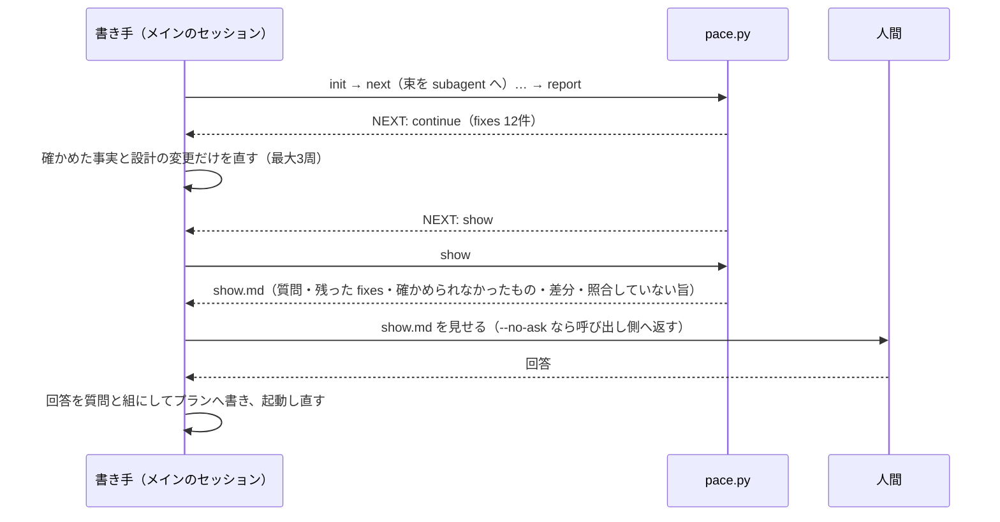

<!-- 目的: pace_design.md を人間がレビューするための要約版。PR を出すときと実装レビューのたびに詳細版から作り直す -->

# PACE の設計（要約版）

**この文書は要約版である。食い違ったら [pace_design.md](pace_design.md)（詳細版）が正である。**
人間のレビューを求めるたびに、詳細版から作り直す。手で差分を当てない。

---

## 何を作るか

**言いたいこと。**PACE は、AI が書いた設計プランから根拠のグラフを作る。根拠の無い決定・循環論法・プランに無い前提への依存を洗い出し、書き手（AI）が直すものと、人間が決めるものに分けて返す。continuo を知らない、単独の Claude Code プラグインとして配る。

- 入れ方: `claude plugin marketplace add maimuzo/pace` → `claude plugin install pace@pace`。更新は `claude plugin marketplace update pace` と `claude plugin update pace@pace`。
- 部品は4つ。
  - `pace.py`: 機械の仕事を受け持つ。AI は呼ばず、プランも書き換えない。
  - `SKILL.md`: 周を回す。
  - `pace-worker`（sonnet）と `pace-judge`（opus）: AI の仕事を受け持つ。
- 入力はプランファイル1本。根っこは、プランに書かれた前提である。

## 1回の起動で何が起きるか

- 周を続けるか止めるかは、`pace.py` が決める。AI の申告には頼らない。
- 書き手がプランに足してよい文は、3種類だけ。確かめた事実（出どころ付き）・設計の変更・人間の回答（質問の文と原文の組）。価値や要求の理由は書かずに、人間に訊く。
- 秘密や個人の絶対パスは、プランにも注記にも書かない。
- 「人間に見せた」記録は、見せたあとに `shown` を打ったときだけ進む。見せていない書き足しは、次の起動の差分に出続ける。

## continuo と組むとき

- continuo の run は、計画を書いた直後・人間確認の前に、`/pace:pace --no-ask` を回す。
- 返された `show.md` は、人間確認の報告のコメントへ入れる。伏せる決まりは continuo の側が当てる。
- 回答のあとにもう一度回すかは、[#10](https://github.com/maimuzo/pace/issues/10) でオーナーに訊く。

## 防がないこと（限界の要点）

- 書き手が決まりを守ったか、事実の出どころが実在するかは、機械では確かめない。人間に見せる差分と注意で補う。
- 別の文書にある根拠は gap として出る。誰が何を言ったか（発言者の扱い）も扱わない。どちらも、使ってみてから作り込むかを決める（[#9](https://github.com/maimuzo/pace/issues/9)）。

## 実装の順序（カンバンの Ice Box の並びと同じ）

| 順 | issue |
| --- | --- |
| 1 | [#2](https://github.com/maimuzo/pace/issues/2) PACE を Claude Code のプラグインとして入れられない |
| 2 | [#3](https://github.com/maimuzo/pace/issues/3) プランの文を1つずつ引用できない |
| 3 | [#4](https://github.com/maimuzo/pace/issues/4) AI に頼む仕事を少ない呼び出しで回せない |
| 4 | [#5](https://github.com/maimuzo/pace/issues/5) 決定の根拠を辿れない |
| 5 | [#6](https://github.com/maimuzo/pace/issues/6) 循環論法と根拠切れを検出できない |
| 6 | [#7](https://github.com/maimuzo/pace/issues/7) 根拠の穴が書き手と人間に返らない |
| 7 | [#8](https://github.com/maimuzo/pace/issues/8) 1行直したときに、何がやり直しになり何が残るか分からない |
| 8 | [#9](https://github.com/maimuzo/pace/issues/9) PACE の効果が分からない |
| 9 | [#10](https://github.com/maimuzo/pace/issues/10) continuo の側に、PACE を組み込む issue が無い（#9 の結果をオーナーが見て「動く」と判断してから） |
